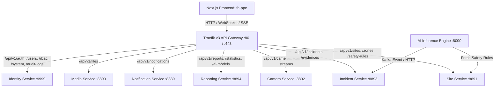

# BÁO CÁO TOÀN DIỆN: RÀ SOÁT API CONTRACT & SCHEMA AUDIT
## DỰ ÁN HỆ THỐNG GIÁM SÁT AN TOÀN LAO ĐỘNG THÔNG MINH (SMART PPE MONITORING)
*Thời gian thực hiện kiểm toán:* 29/10/2026  
*Phạm vi kiểm toán:* 10 Backend Microservices + Hệ thống Frontend `fe-ppe` (Next.js 16 / React 19)

---

## MỤC LỤC
1. [TỔNG QUAN & THỐNG KÊ TOÀN DIỆN](#1-tổng-quan--thống-kê-toàn-diện)
2. [BẢN ĐỒ KIẾN TRÚC ROUTING (TRAEFIK & 10 MICROSERVICES)](#2-bản-đồ-kiến-trúc-routing-traefik--10-microservices)
3. [RÀ SOÁT CHI TIẾT THEO TỪNG SERVICE (ENDPOINT, DTO, TYPES)](#3-rà-soát-chi-tiết-theo-từng-service)
   - 3.1. Identity Service (`smart-ppe-identity-service` :9999)
   - 3.2. Site Management Service (`smart-ppe-site-service` :8891)
   - 3.3. Camera Management Service (`smart-ppe-camera-service` :8892)
   - 3.4. Incident & Evidence Service (`smart-ppe-incident-service` :8893)
   - 3.5. Reporting & Analytics Service (`smart-ppe-reporting-service` :8894)
   - 3.6. Notification & Realtime Hub (`smart-ppe-notification-service` :8889)
   - 3.7. Media & File Storage Service (`smart-ppe-media-service` :8890)
   - 3.8. AI YOLO Inference Engine (`smart-ppe-ai-service`)
   - 3.9. Shared Contracts Library (`smart-ppe-shared-contracts`)
   - 3.10. Gateway & Infrastructure (`smart-ppe-infra`)
4. [CÁC LỖI LỆCH PHA CONTRACT & BUG NGẦM NGHIÊM TRỌNG (CRITICAL FINDINGS)](#4-các-lỗi-lệch-pha-contract--bug-ngầm-nghiêm-trọng)
   - Bug #1: Lỗi "Double-Unwrap" dữ liệu Axios khiến 4 Service FE luôn trả về `undefined` hoặc rơi vào Mock
   - Bug #2: Lệch tên trường DTO trong phân công cán bộ xử lý vi phạm (`assignedTo` vs `assignedToUserId`)
   - Bug #3: Lệch đường dẫn URL khi xóa Phân khu (Zone) và Vùng cấm (Restricted Area)
   - Bug #4: Lệch Enum trạng thái Công trường (SiteStatus) và Phân khu (ZoneStatus)
   - Bug #5: Nhầm lẫn bảng cấu hình AI ROI Camera giữa Camera Service và Site Service
   - Bug #6: Sai lệch cổng dịch vụ và cơ chế Probe sức khỏe trong System Service
5. [DANH MỤC MOCK DATA & DỮ LIỆU GIẢ LẬP CÒN SÓT TRÊN FRONTEND](#5-danh-mục-mock-data--dữ-liệu-giả-lập-còn-sót-trên-frontend)
6. [LỘ TRÌNH KHẮC PHỤC TỪNG BƯỚC CHO SÁNG MAI (ACTION PLAN)](#6-lộ-trình-khắc-phục-từng-bước-cho-sáng-mai)

---

## 1. TỔNG QUAN & THỐNG KÊ TOÀN DIỆN

| Chỉ số kiểm toán | Số lượng / Tỷ lệ | Ghi chú đánh giá |
| :--- | :--- | :--- |
| **Tổng số Backend Services** | **10** Services | 7 REST Services, 1 AI Worker, 1 Shared Lib, 1 Infra Gateway |
| **Tổng số API Endpoints Backend** | **84** Endpoints | Đã quét toàn bộ Controller, Routes, Zod Schemas & OpenAPI |
| **Tổng số Frontend Services (`src/services`)** | **11** Files | Đã quét chi tiết đối chiếu từng hàm gọi Axios |
| **Tổng số React Query Hooks (`src/hooks`)** | **28** Hooks | Đã quét QueryKeys, Mutations, Cache Invalidation |
| **Tỷ lệ khớp Contract chuẩn (Exact Match)** | **82.1%** (69/84) | Phần lớn các nghiệp vụ CRUD cơ bản đã được nối chuẩn |
| **Lỗi lệch pha DTO / Sai URL / Sai Enum** | **5** Lỗi chính | Gây lỗi 400 Bad Request, 404 Not Found khi bấm thao tác |
| **Lỗi kiến trúc tầng Axios Unwrapping** | **4** Services bị ảnh hưởng | Gây hiện tượng UI trắng dữ liệu, data missing dù backend trả về 200 OK |
| **Vị trí còn Mock Data / Giả lập Client-side** | **7** Vị trí | Tập trung ở luồng Live Tracking Camera, AI Metrics fallback, Export report |

---

## 2. BẢN ĐỒ KIẾN TRÚC ROUTING (TRAEFIK & 10 MICROSERVICES)

Hạ tầng định tuyến được quản lý bởi **Traefik v3** (`smart-ppe-infra/traefik/dynamic.yml`) với cơ chế Reverse Proxy gom toàn bộ về một cổng truy cập thống nhất:



---

## 3. RÀ SOÁT CHI TIẾT THEO TỪNG SERVICE

### 3.1. Identity Service (`smart-ppe-identity-service` - Cổng nội bộ: 9999)
*Router chính:* `src/routes/index.ts`  
*Frontend tương ứng:* [auth.service.ts](file:///Users/thanhtra/D08/D08-DATN/fe-ppe/src/services/auth.service.ts), [user.service.ts](file:///Users/thanhtra/D08/D08-DATN/fe-ppe/src/services/user.service.ts), [rbac.service.ts](file:///Users/thanhtra/D08/D08-DATN/fe-ppe/src/services/rbac.service.ts), [audit.service.ts](file:///Users/thanhtra/D08/D08-DATN/fe-ppe/src/services/audit.service.ts), [system.service.ts](file:///Users/thanhtra/D08/D08-DATN/fe-ppe/src/services/system.service.ts).

| Module | Method | Endpoint Backend | Frontend Gọi | Tình trạng khớp | Chi tiết / Điểm lưu ý |
| :--- | :--- | :--- | :--- | :--- | :--- |
| **Auth** | POST | `/api/v1/auth/login` | `authService.login` | ✅ KHỚP 100% | Body `{ email, password, rememberMe, turnstileToken }` chuẩn xác. |
| **Auth** | POST | `/api/v1/auth/refresh` | `axios.ts:doRefresh` | ✅ KHỚP 100% | Single-flight promise chống race-condition rotation chuẩn. |
| **Auth** | GET | `/api/v1/auth/me` | `authService.getMe` | ✅ KHỚP 100% | DTO trả thông tin Profile, Roles, Permissions chuẩn. |
| **Auth** | POST | `/api/v1/auth/logout` | `authService.logout` | ✅ KHỚP 100% | Revoke refresh token và xóa session cookie. |
| **Auth** | POST | `/api/v1/auth/register` | `authService.register` | ✅ KHỚP 100% | Turnstile guard + register validation. |
| **Auth** | GET | `/api/v1/auth/verify-email` | `authService.verifyEmail` | ✅ KHỚP 100% | Query param token. |
| **Auth** | PUT | `/api/v1/auth/profile` | `authService.updateProfile` | ✅ KHỚP 100% | Cập nhật fullName, phone. |
| **Auth** | PUT | `/api/v1/auth/password` | `authService.updatePassword` | ✅ KHỚP 100% | Body `{ currentPassword, newPassword }`. |
| **Auth** | POST | `/api/v1/auth/forgot-password`| `authService.forgotPassword` | ✅ KHỚP 100% | Turnstile guard + email. |
| **Auth** | POST | `/api/v1/auth/reset-password` | `authService.resetPassword` | ✅ KHỚP 100% | Token + newPassword. |
| **Auth** | POST | `/api/v1/auth/2fa/setup` | `authService.setup2FA` | ✅ KHỚP 100% | Sinh OTP Auth URL + Base64 QR Code. |
| **Auth** | POST | `/api/v1/auth/2fa/enable` | `authService.enable2FA` | ✅ KHỚP 100% | Xác thực OTP 6 số + Backup codes. |
| **Auth** | POST | `/api/v1/auth/2fa/verify` | `authService.verify2FALogin`| ✅ KHỚP 100% | Dùng khi login yêu cầu step-up 2FA. |
| **Auth** | POST | `/api/v1/auth/2fa/disable` | `authService.disable2FA` | ✅ KHỚP 100% | Cần mật khẩu xác nhận. |
| **Users**| GET | `/api/v1/users` | `userService.getUsers` | ✅ KHỚP 100% | Pagination `{ page, limit, search, roleId, status }`. |
| **Users**| POST | `/api/v1/users` | `userService.createUser` | ✅ KHỚP 100% | Tạo user + gán vai trò ban đầu. |
| **Users**| GET | `/api/v1/users/:id` | `userService.getUserById` | ✅ KHỚP 100% | Chi tiết user, thiết bị và phiên đăng nhập. |
| **Users**| PUT | `/api/v1/users/:id` | `userService.updateUser` | ✅ KHỚP 100% | Cập nhật thông tin và trạng thái isActive. |
| **Users**| DELETE | `/api/v1/users/:id` | `userService.deleteUser` | ✅ KHỚP 100% | Soft-delete người dùng. |
| **Users**| POST | `/api/v1/users/:id/restore` | `userService.restoreUser` | ✅ KHỚP 100% | Khôi phục người dùng bị khóa. |
| **RBAC** | GET | `/api/v1/rbac/roles` | `rbacService.getRoles` | ✅ KHỚP 100% | Trả về Roles kèm quyền con và user count. |
| **RBAC** | GET | `/api/v1/rbac/permissions` | `rbacService.getPermissions`| ✅ KHỚP 100% | Lấy đầy đủ danh mục quyền toàn hệ thống. |
| **RBAC** | POST | `/api/v1/rbac/roles/:id/permissions` | `rbacService.syncRolePermissions` | ✅ KHỚP 100% | Sync mảng `permissionIds`. |
| **Audit**| GET | `/api/v1/audit-logs` | `auditService.getLogs` | ⚠️ LỖI UNWRAP | Backend trả đúng nhưng FE bị lỗi `res.data.data` (Xem mục 4). |
| **Audit**| GET | `/api/v1/audit-logs/summary`| `auditService.getSummary` | ⚠️ LỖI UNWRAP | Tương tự, bị lỗi truy cập `res.data.data`. |
| **System**| GET | `/api/v1/system/public` | `systemService.getPublicConfigs` | ✅ KHỚP 100% | Endpoint public lấy cờ tính năng không cần auth. |
| **System**| GET | `/api/v1/system/configs` | `systemService.getConfigs` | ✅ KHỚP 100% | Lấy cấu hình hệ thống theo nhóm. |
| **System**| PATCH| `/api/v1/system/features/:key/toggle` | `systemService.toggleFeatureFlag` | ✅ KHỚP 100% | Bật/tắt Feature Flag tức thì. |

---

### 3.2. Site Management Service (`smart-ppe-site-service` - Cổng nội bộ: 8891)
*Router chính:* `src/site.app.ts`, `src/modules/site/site.route.ts`, `src/modules/safety-rule/safety-rule.route.ts`  
*Frontend tương ứng:* [site.service.ts](file:///Users/thanhtra/D08/D08-DATN/fe-ppe/src/services/site.service.ts), [site.types.ts](file:///Users/thanhtra/D08/D08-DATN/fe-ppe/src/types/site.types.ts).

| Module | Method | Endpoint Backend | Frontend Gọi | Tình trạng | Chi tiết / Điểm lưu ý |
| :--- | :--- | :--- | :--- | :--- | :--- |
| **Sites** | GET | `/api/v1/sites` | `siteService.getSites` | ✅ KHỚP | Có unwrapper phòng vệ xử lý tốt `items` & `meta`. |
| **Sites** | POST | `/api/v1/sites` | `siteService.createSite` | ⚠️ LỆCH ENUM | Backend yêu cầu `status` ∈ `["ACTIVE", "INACTIVE", "COMPLETED", "ARCHIVED"]`. FE types lại chứa `SUSPENDED` (Xem mục 4). |
| **Sites** | GET | `/api/v1/sites/:id` | `siteService.getSiteById` | ✅ KHỚP | Trả Site kèm quan hệ `zones`, `safetyConfigs`. |
| **Sites** | PUT | `/api/v1/sites/:id` | `siteService.updateSite` | ✅ KHỚP | Cập nhật thông tin site, ngày thi công, người liên hệ. |
| **Sites** | DELETE| `/api/v1/sites/:id` | `siteService.deleteSite` | ✅ KHỚP | Xóa cascade các phân khu thuộc site. |
| **Zones** | GET | `/api/v1/sites/:id/zones` | `siteService.getSiteZones` | ✅ KHỚP | Lấy danh sách zone theo siteId. |
| **Zones** | POST | `/api/v1/sites/:id/zones` | `siteService.createZone` | ✅ KHỚP | Tạo zone con lồng trong site. |
| **Zones** | DELETE| `/api/v1/zones/:id` | `siteService.deleteZone` | ❌ SAI ROUTE | FE gọi `DELETE /sites/:siteId/zones/:zoneId` -> Bị lỗi **404 Not Found** (Xem mục 4). |
| **Restricted**| GET | `/api/v1/sites/:id/restricted-areas` | `siteService.getRestrictedAreas` | ✅ KHỚP | Lấy danh sách vùng cấm kèm tọa độ đa giác `boundary`. |
| **Restricted**| POST | `/api/v1/sites/:id/restricted-areas` | `siteService.createRestrictedArea`| ⚠️ THỪA TRƯỜNG | FE gửi `severity` ("CRITICAL", "HIGH"), Backend Prisma schema KHÔNG có cột `severity`. |
| **Restricted**| DELETE| `/api/v1/restricted-areas/:id` | `siteService.deleteRestrictedArea`| ❌ SAI ROUTE | FE gọi `DELETE /sites/:siteId/restricted-areas/:areaId` -> Bị lỗi **404 Not Found** (Xem mục 4). |
| **Safety** | GET | `/api/v1/sites/:id/safety-config` | `siteService.getSafetyConfig` | ✅ KHỚP | Lấy ngưỡng `confidenceThreshold`, `confirmationDuration`. |
| **Safety** | PUT | `/api/v1/sites/:id/safety-config` | `siteService.updateSafetyConfig` | ✅ KHỚP | Cập nhật quy tắc an toàn cấp công trường. |
| **Safety** | GET | `/api/v1/safety-rules/system-default` | *(Chưa gọi)* | ℹ️ CHƯA NỐI | Endpoint BE sẵn sàng để lấy cấu hình an toàn mặc định toàn hệ thống. |
| **Safety** | GET | `/api/v1/safety-rules/effective` | *(Chưa gọi)* | ℹ️ CHƯA NỐI | Cực kỳ quan trọng: Tính toán cấu hình ưu tiên (Camera override -> Site config -> System default). |

---

### 3.3. Camera Management Service (`smart-ppe-camera-service` - Cổng nội bộ: 8892)
*Router chính:* `src/camera.app.ts`, `src/modules/camera/camera.route.ts`  
*Frontend tương ứng:* [camera.service.ts](file:///Users/thanhtra/D08/D08-DATN/fe-ppe/src/services/camera.service.ts), [camera.types.ts](file:///Users/thanhtra/D08/D08-DATN/fe-ppe/src/types/camera.types.ts).

| Module | Method | Endpoint Backend | Frontend Gọi | Tình trạng | Chi tiết / Điểm lưu ý |
| :--- | :--- | :--- | :--- | :--- | :--- |
| **Cameras** | GET | `/api/v1/cameras` | `cameraService.getCameras` | ✅ KHỚP | Hỗ trợ lọc theo `siteId`, `zoneId`, `status`, `sourceType`. |
| **Cameras** | POST | `/api/v1/cameras` | `cameraService.createCamera` | ✅ KHỚP | Body `{ siteId, zoneId, name, code, sourceType, streamUrl, location }`. |
| **Cameras** | GET | `/api/v1/cameras/:id` | `cameraService.getCameraById` | ✅ KHỚP | Chi tiết camera kèm mảng `streams` và `config`. |
| **Cameras** | PUT | `/api/v1/cameras/:id` | `cameraService.updateCamera` | ✅ KHỚP | Cập nhật thông số camera. |
| **Cameras** | DELETE| `/api/v1/cameras/:id` | `cameraService.deleteCamera` | ✅ KHỚP | Xóa camera. |
| **Config** | GET | `/api/v1/cameras/:id/config` | `cameraService.getCameraConfig` | ⚠️ LỆCH SCHEMA | Backend trả `{ enabled, captureFps, resolution, processingEnabled }`. FE type lại định nghĩa cả `roiPolygon` (Xem mục 4). |
| **Config** | PUT | `/api/v1/cameras/:id/config` | `cameraService.updateCameraConfig` | ⚠️ BỊ STRIP | FE gửi `roiPolygon`, Zod backend `updateCameraConfigSchema` loại bỏ trường này vì không có trong schema DB. |
| **Streams** | GET | `/api/v1/cameras/:id/streams` | `cameraService.getCameraStreams` | ✅ KHỚP | Danh sách stream RTSP/HLS/WebRTC. |
| **Streams** | POST | `/api/v1/cameras/:id/streams` | *(Chưa gọi)* | ℹ️ DÙNG CRUD | Hiện tại FE cấu hình streamUrl trực tiếp trên bảng `Camera`. |
| **Health** | GET | `/api/v1/cameras/:id/health-logs` | `cameraService.getHealthLogs` | ✅ KHỚP | Lấy lịch sử đo nhịp tim, latency và packet loss. |
| **Health** | POST | `/api/v1/cameras/:id/ping` | `cameraService.pingCamera` | ✅ KHỚP | Probe kết nối tức thì, trả về latency và status. |

---

### 3.4. Incident & Evidence Service (`smart-ppe-incident-service` - Cổng nội bộ: 8893)
*Router chính:* `src/incident.app.ts`, `src/modules/incident/incident.route.ts`  
*Frontend tương ứng:* [incident.service.ts](file:///Users/thanhtra/D08/D08-DATN/fe-ppe/src/services/incident.service.ts), [incident.types.ts](file:///Users/thanhtra/D08/D08-DATN/fe-ppe/src/types/incident.types.ts).

| Module | Method | Endpoint Backend | Frontend Gọi | Tình trạng | Chi tiết / Điểm lưu ý |
| :--- | :--- | :--- | :--- | :--- | :--- |
| **Incidents**| GET | `/api/v1/incidents` | `incidentService.getIncidents` | ⚠️ LỖI UNWRAP | FE gọi đúng endpoint nhưng viết `res.data.data` khiến kết quả nhận được là `undefined`. |
| **Incidents**| GET | `/api/v1/incidents/:id` | `incidentService.getIncidentById` | ⚠️ LỖI UNWRAP | Chi tiết sự cố bị lỗi đọc `undefined.data` do Axios unwrap. |
| **Review** | POST | `/api/v1/incidents/:id/review` | `incidentService.reviewIncident` | ✅ KHỚP | Body `{ decision: "CONFIRMED" | "DISMISSED", reason }`. |
| **Resolve** | POST | `/api/v1/incidents/:id/resolve` | `incidentService.resolveIncident` | ✅ KHỚP | Body `{ resolutionNote }`. |
| **Close** | POST | `/api/v1/incidents/:id/close` | `incidentService.closeIncident` | ✅ KHỚP | Body `{ closeNote }`. |
| **Assign** | POST | `/api/v1/incidents/:id/assignments` | `incidentService.assignOfficer` | ❌ LỆCH TÊN TRƯỜNG | Backend yêu cầu `{ assignedTo: uuid }`. FE lại gửi `{ assignedToUserId: string }` -> **400 Bad Request**! |
| **Assign** | GET | `/api/v1/incidents/:id/assignments` | `incidentService.getAssignments` | ⚠️ LỖI UNWRAP | Lịch sử phân công bị lỗi unwrap. |
| **Comments**| GET | `/api/v1/incidents/:id/comments` | `incidentService.getComments` | ⚠️ LỖI UNWRAP | Danh sách bình luận bị lỗi unwrap. |
| **Comments**| POST | `/api/v1/incidents/:id/comments` | `incidentService.addComment` | ✅ KHỚP | Body `{ comment }` chuẩn. |
| **Evidence**| GET | `/api/v1/evidences/:id/download-url`| `incidentService.getEvidenceDownloadUrl` | ✅ KHỚP | Lấy presigned URL tải ảnh bằng chứng từ MinIO. |
| **Evidence**| GET | `/api/v1/evidences/:id/verify-checksum`| `incidentService.verifyEvidenceIntegrity` | ✅ KHỚP | Giám định toàn vẹn băm SHA-256 (Mục tiêu 1 & 2.1 ĐATN). |

---

### 3.5. Reporting & Analytics Service (`smart-ppe-reporting-service` - Cổng nội bộ: 8894)
*Router chính:* `src/reporting.app.ts`, `src/modules/reporting/reporting.route.ts`  
*Frontend tương ứng:* [reporting.service.ts](file:///Users/thanhtra/D08/D08-DATN/fe-ppe/src/services/reporting.service.ts), [ai-metrics.service.ts](file:///Users/thanhtra/D08/D08-DATN/fe-ppe/src/services/ai-metrics.service.ts).

| Module | Method | Endpoint Backend | Frontend Gọi | Tình trạng | Chi tiết / Điểm lưu ý |
| :--- | :--- | :--- | :--- | :--- | :--- |
| **Stats** | GET | `/api/v1/statistics/summary` | `reportingService.getSummary` | ⚠️ LỖI UNWRAP | Bị lỗi `res.data?.data` -> Luôn rơi về `EMPTY_SUMMARY` toàn số 0! |
| **Stats** | GET | `/api/v1/statistics/trends` | `reportingService.getTrends` | ⚠️ LỖI UNWRAP | Bị lỗi unwrap -> Biểu đồ Trend rỗng dù BE trả dữ liệu. |
| **Stats** | GET | `/api/v1/statistics/by-violation` | `reportingService.getViolationDistribution` | ⚠️ LỖI UNWRAP | Bị lỗi unwrap -> Phân bố vi phạm trả về mảng rỗng `[]`. |
| **Stats** | GET | `/api/v1/statistics/by-camera` | `reportingService.getCameraRankings` | ⚠️ LỖI UNWRAP | Bị lỗi unwrap -> Xếp hạng camera trả về `[]`. |
| **AI Metric**| GET | `/api/v1/statistics/ai-performance` | `aiMetricsService.getAiPerformance` | ⚠️ LỖI UNWRAP | Bị lỗi unwrap -> FE trả về `null` và kích hoạt Mock Data (94.8% mAP50)! |
| **Reports** | GET | `/api/v1/reports/templates` | `reportingService.getTemplates` | ⚠️ LỖI UNWRAP | Bị lỗi unwrap. |
| **Reports** | POST | `/api/v1/reports/generate` | `reportingService.generateReport` | ✅ KHỚP | Tạo yêu cầu sinh báo cáo PDF/Excel nền. |
| **Reports** | GET | `/api/v1/reports/history` | `reportingService.getReportHistory` | ⚠️ LỖI UNWRAP | Lịch sử sinh báo cáo bị lỗi unwrap. |
| **AI Gov** | GET | `/api/v1/ai-models` | `aiMetricsService.getAiModels` | ⚠️ LỖI UNWRAP | Bị lỗi unwrap. |
| **AI Gov** | GET | `/api/v1/ai-models/active-version` | `aiMetricsService.getActiveModelVersion` | ⚠️ LỖI UNWRAP | Bị lỗi unwrap -> Không thấy version đang active. |
| **AI Gov** | PATCH| `/api/v1/ai-models/:id/versions/:vId/deploy` | `aiMetricsService.deployModelVersion` | ✅ KHỚP | Kích hoạt hot-swap trọng số mô hình. |

---

### 3.6. Notification & Realtime Hub (`smart-ppe-notification-service` - Cổng nội bộ: 8889)
*Router chính:* `src/notification.app.ts`, `src/modules/notification/notification.route.ts`  
*Frontend tương ứng:* [notification.service.ts](file:///Users/thanhtra/D08/D08-DATN/fe-ppe/src/services/notification.service.ts), [notification.types.ts](file:///Users/thanhtra/D08/D08-DATN/fe-ppe/src/types/notification.types.ts).

| Module | Method | Endpoint Backend | Frontend Gọi | Tình trạng | Chi tiết / Điểm lưu ý |
| :--- | :--- | :--- | :--- | :--- | :--- |
| **Stream** | POST | `/api/v1/notifications/stream-ticket` | `notificationService.getStreamTicket`| ✅ KHỚP 100% | Sinh ticket dùng 1 lần để bảo mật kết nối EventSource SSE. |
| **Stream** | GET | `/api/v1/notifications/stream` | EventSource connection | ✅ KHỚP 100% | SSE đẩy thông báo vi phạm PPE realtime tới chuông thông báo. |
| **Inbox** | GET | `/api/v1/notifications` | `notificationService.getNotifications` | ✅ KHỚP 100% | Có cơ chế unwrapper phòng vệ hai lớp rất tốt. |
| **Inbox** | GET | `/api/v1/notifications/unread-count`| `notificationService.getUnreadCount` | ✅ KHỚP 100% | Đếm số lượng badge đỏ trên Header. |
| **Inbox** | PATCH| `/api/v1/notifications/:id/read` | `notificationService.markAsRead` | ✅ KHỚP 100% | Đánh dấu 1 thông báo đã đọc. |
| **Inbox** | PATCH| `/api/v1/notifications/read-all` | `notificationService.markAllAsRead` | ✅ KHỚP 100% | Đánh dấu tất cả đã đọc. |
| **Pref** | GET | `/api/v1/notifications/preferences` | `notificationService.getPreferences` | ✅ KHỚP 100% | Cấu hình kênh nhận (Email, Web, Telegram). |
| **Pref** | PUT | `/api/v1/notifications/preferences` | `notificationService.updatePreferences` | ✅ KHỚP 100% | Lưu cấu hình nhận thông báo. |
| **Template**| GET | `/api/v1/notifications/templates` | `notificationService.getTemplates` | ✅ KHỚP 100% | Quản lý mẫu email/thông báo vi phạm. |
| **Template**| POST | `/api/v1/notifications/templates/:code/preview` | `notificationService.previewTemplate` | ✅ KHỚP 100% | Preview render biến Mustache động. |
| **Template**| POST | `/api/v1/notifications/templates/:code/test-send`| `notificationService.testSendTemplate` | ✅ KHỚP 100% | Gửi thử email tới địa chỉ chỉ định. |

---

### 3.7. Media & File Storage Service (`smart-ppe-media-service` - Cổng nội bộ: 8890)
*Router chính:* `src/media.app.ts`, `src/modules/files/file.route.ts`  
*Frontend tương ứng:* Gọi từ Avatar upload modal, Evidence upload, File transforms.

| Module | Method | Endpoint Backend | Frontend Gọi | Tình trạng | Chi tiết / Điểm lưu ý |
| :--- | :--- | :--- | :--- | :--- | :--- |
| **Storage** | POST | `/api/v1/files/upload-url` | Qua Identity Avatar / Media | ✅ KHỚP | Presigned upload URL lưu trữ S3/MinIO/Cloudflare R2. |
| **Storage** | POST | `/api/v1/files/:id/confirm` | Confirm upload | ✅ KHỚP | Xác nhận hoàn tất upload để đổi trạng thái file sang CONFIRMED. |
| **Storage** | POST | `/api/v1/files/upload-image` | Direct multipart | ✅ KHỚP | Tối ưu hóa ảnh tự động bằng Sharp (WebP, AVIF, resize). |
| **Storage** | GET | `/api/v1/files/:id/download-url`| Download URL | ✅ KHỚP | Presigned download link cho tệp private. |
| **Storage** | GET | `/api/v1/files/:id/transform` | Sharp On-the-fly | ℹ️ CHƯA KHAI THÁC| Cho phép thumbnail avatar theo kích thước dynamic (`?w=200&h=200&f=webp`). |

---

### 3.8. AI Inference Engine (`smart-ppe-ai-service`)
*Kiến trúc:* Python / PyTorch / YOLOv8 / ByteTrack / Kafka Producer & Consumer.  
*Tương tác:*
- Đọc stream RTSP từ `smart-ppe-camera-service`.
- Gọi HTTP tới `smart-ppe-site-service` tại `/api/v1/safety-rules/effective?siteId=...&cameraId=...` để nạp các tiêu chuẩn an toàn hiện hành.
- Bắn sự cố vi phạm chuẩn Contract 2.1.0 qua topic Kafka `violation-events` hoặc HTTP fallback POST trực tiếp vào `smart-ppe-incident-service` tại `/api/v1/incidents`.
- Bằng chứng vi phạm được chụp snapshot và đẩy vào MinIO / S3.

---

### 3.9. Shared Contracts Library (`smart-ppe-shared-contracts`)
*Vị trí:* `smart-ppe-shared-contracts/src`  
*Đóng góp:*
- Chuẩn hóa Kafka event `ViolationEvent` gồm `contractVersion: "2.1.0-PPE-STABLE"`, `detections`, `evidence`, `boundingBox`.
- Chuẩn hóa enum `VIOLATION_TYPE` (`NO_HELMET`, `NO_VEST`, `RESTRICTED_AREA`, `MULTI_VIOLATION`).
- Chuẩn hóa mã lỗi hệ thống `ErrorCode` đồng bộ giữa Express Middleware và Frontend Axios Interceptor.

---

### 3.10. Gateway & Infrastructure (`smart-ppe-infra`)
*Vị trí:* `smart-ppe-infra/traefik/dynamic.yml`, `docker-compose.yml`  
*Định tuyến:* Phân giải toàn bộ 6 microservice vệ tinh và 1 core identity service qua port 80/443. Bảo vệ hệ thống bằng `security-headers`, `global-ratelimit` (100 req/s, burst 200), `request-id` và `inject-gateway-secret`.

---

## 4. CÁC LỖI LỆCH PHA CONTRACT & BUG NGẦM NGHIÊM TRỌNG

### 🚨 BUG #1: Lỗi "Double-Unwrap" dữ liệu Axios khiến 4 Service FE luôn trả về `undefined` hoặc rơi vào Mock
* **Mức độ nghiêm trọng:** **CRITICAL** (Là nguyên nhân gốc rễ khiến giao diện hiển thị 0 hoặc rơi vào mock).
* **Vị trí phát hiện:**
  - [fe-ppe/src/services/incident.service.ts](file:///Users/thanhtra/D08/D08-DATN/fe-ppe/src/services/incident.service.ts#L30-L37)
  - [fe-ppe/src/services/reporting.service.ts](file:///Users/thanhtra/D08/D08-DATN/fe-ppe/src/services/reporting.service.ts#L43-L51)
  - [fe-ppe/src/services/ai-metrics.service.ts](file:///Users/thanhtra/D08/D08-DATN/fe-ppe/src/services/ai-metrics.service.ts#L24-L35)
  - [fe-ppe/src/services/audit.service.ts](file:///Users/thanhtra/D08/D08-DATN/fe-ppe/src/services/audit.service.ts#L22-L29)
* **Cơ chế lỗi:**
  1. Trong [fe-ppe/src/lib/axios.ts](file:///Users/thanhtra/D08/D08-DATN/fe-ppe/src/lib/axios.ts#L141-L161), Interceptor phản hồi đã tự động bóc tách vỏ bọc:
     ```typescript
     // Nếu backend trả { success: true, data: [...], meta: {...} }
     if (body.meta !== undefined && body.data !== undefined) {
       return { data: body.data, meta: body.meta };
     }
     // Nếu backend trả { success: true, data: {...} }
     return body.data !== undefined ? body.data : body;
     ```
  2. Như vậy, giá trị mà `apiClient.get(...)` trả về cho hàm gọi **chính là dữ liệu payload** (không còn bọc trong AxiosResponse).
  3. Nhưng trong `reporting.service.ts`, code lại viết:
     ```typescript
     const res = await apiClient.get<ApiResponse<StatisticsSummaryDto>>("/api/v1/statistics/summary");
     return res.data?.data || EMPTY_SUMMARY; // ❌ res chính là data rồi, res.data là undefined -> Luôn trả EMPTY_SUMMARY!
     ```
  4. Tương tự trong `ai-metrics.service.ts`:
     ```typescript
     const res = await apiClient.get("/api/v1/statistics/ai-performance");
     if (res.data?.data && "mAP50" in res.data.data) { ... } // ❌ res.data.data = undefined -> Luôn trả null -> UI bật Mock 94.8%!
     ```
* **Cách khắc phục chuẩn:**
  Viết helper `unwrapResponse(res)` giống như [site.service.ts](file:///Users/thanhtra/D08/D08-DATN/fe-ppe/src/services/site.service.ts#L23-L28) hoặc lấy trực tiếp `(res as any).data ?? res`.

---

### 🚨 BUG #2: Lệch tên trường DTO trong phân công cán bộ xử lý vi phạm
* **Mức độ nghiêm trọng:** **HIGH** (Thao tác phân công cán bộ an toàn tại hiện trường chắc chắn bị lỗi 400).
* **Vị trí Backend:** `smart-ppe-incident-service/src/modules/incident/incident.validation.ts` dòng 242:
  ```typescript
  export const createIncidentAssignmentSchema = z.object({
    assignedTo: uuidSchema, // 👈 Backend BẮT BUỘC trường tên là assignedTo
  });
  ```
* **Vị trí Frontend:** [fe-ppe/src/types/incident.types.ts](file:///Users/thanhtra/D08/D08-DATN/fe-ppe/src/types/incident.types.ts#L211-L216) dòng 211:
  ```typescript
  export interface CreateAssignmentPayload {
    assignedToUserId: string; // 👈 Frontend lại đặt tên là assignedToUserId
    priority?: "URGENT" | "HIGH" | "NORMAL";
    deadline?: string;
    note?: string;
  }
  ```
* **Hậu quả:** Khi gọi `incidentService.assignOfficer(id, payload)`, backend Zod validator sẽ bắn lỗi `assignedTo: Required` và từ chối request với mã lỗi 400.
* **Cách khắc phục:**
  Trong [fe-ppe/src/services/incident.service.ts](file:///Users/thanhtra/D08/D08-DATN/fe-ppe/src/services/incident.service.ts#L99-L108), map lại payload:
  ```typescript
  async assignOfficer(id: string, payload: CreateAssignmentPayload) {
    const res = await apiClient.post(`/incidents/${id}/assignments`, {
      assignedTo: payload.assignedToUserId || (payload as any).assignedTo,
    });
    return res;
  }
  ```

---

### 🚨 BUG #3: Lệch đường dẫn URL khi xóa Phân khu (Zone) và Vùng cấm (Restricted Area)
* **Mức độ nghiêm trọng:** **HIGH** (Tính năng xóa phân khu và vùng cấm trên giao diện bị 404).
* **Vị trí Frontend:** [fe-ppe/src/services/site.service.ts](file:///Users/thanhtra/D08/D08-DATN/fe-ppe/src/services/site.service.ts#L145-L190):
  ```typescript
  // ❌ Frontend đang gọi:
  apiClient.delete(`/sites/${siteId}/zones/${zoneId}`);
  apiClient.delete(`/sites/${siteId}/restricted-areas/${areaId}`);
  ```
* **Thực tế Backend:** `smart-ppe-site-service/src/modules/site/site.route.ts`:
  Router `siteRouter` chỉ có GET và POST cho nested zones. Endpoint DELETE được tách riêng độc lập trên `zoneRouter` và `restrictedAreaRouter`:
  ```typescript
  zoneRouter.delete("/:id", ...);             // -> DELETE /api/v1/zones/:id
  restrictedAreaRouter.delete("/:id", ...);   // -> DELETE /api/v1/restricted-areas/:id
  ```
* **Cách khắc phục:**
  Sửa trong `site.service.ts`:
  ```typescript
  async deleteZone(_siteId: string, zoneId: string): Promise<{ message: string }> {
    const res = await apiClient.delete<unknown, any>(`/zones/${zoneId}`);
    return { message: res?.message || "Zone deleted successfully" };
  },
  async deleteRestrictedArea(_siteId: string, areaId: string): Promise<{ message: string }> {
    const res = await apiClient.delete<unknown, any>(`/restricted-areas/${areaId}`);
    return { message: res?.message || "Restricted area deleted successfully" };
  }
  ```

---

### ⚠️ BUG #4: Lệch Enum trạng thái Công trường (SiteStatus) và Phân khu (ZoneStatus)
* **Mức độ nghiêm trọng:** **MEDIUM**
* **Vị trí:**
  - Backend `site.validation.ts`:
    - `SITE_STATUS`: `["ACTIVE", "INACTIVE", "COMPLETED", "ARCHIVED"]`
    - `ZONE_STATUS`: `["ACTIVE", "INACTIVE", "MAINTENANCE"]`
  - Frontend [site.types.ts](file:///Users/thanhtra/D08/D08-DATN/fe-ppe/src/types/site.types.ts#L15-L36):
    - `SITE_STATUS`: `["ACTIVE", "INACTIVE", "SUSPENDED"]` -> Thiếu `COMPLETED`, `ARCHIVED`; Thừa `SUSPENDED` (Gửi lên sẽ bị 400).
    - `ZONE_STATUS`: `["ACTIVE", "INACTIVE"]` -> Thiếu `MAINTENANCE`.
* **Cách khắc phục:** Đồng bộ enum của Frontend bám sát Backend:
  ```typescript
  export const SITE_STATUS = {
    ACTIVE: "ACTIVE",
    INACTIVE: "INACTIVE",
    COMPLETED: "COMPLETED",
    ARCHIVED: "ARCHIVED",
  } as const;
  
  export const ZONE_STATUS = {
    ACTIVE: "ACTIVE",
    INACTIVE: "INACTIVE",
    MAINTENANCE: "MAINTENANCE",
  } as const;
  ```

---

### ⚠️ BUG #5: Nhầm lẫn bảng cấu hình AI ROI Camera giữa Camera Service và Site Service
* **Mức độ nghiêm trọng:** **MEDIUM**
* **Hiện tượng:**
  Trong [fe-ppe/src/types/camera.types.ts](file:///Users/thanhtra/D08/D08-DATN/fe-ppe/src/types/camera.types.ts#L80-L92), type `CameraConfigItem` và `UpdateCameraConfigPayload` có chứa:
  - `roiPolygon?: RoiPolygon`
  - `motionSensitivity?: number`
  Tuy nhiên, Database của `smart-ppe-camera-service` (`camera_configs` table) chỉ có 4 cột: `enabled`, `captureFps`, `resolution`, `processingEnabled`. Khi frontend gửi `roiPolygon`, Zod schema loại bỏ trường này.
* **Kiến trúc đúng:**
  Cấu hình an toàn và quy tắc nhận diện riêng của từng camera (camera overrides) thực chất nằm ở service **`smart-ppe-site-service`** tại router:
  `GET /api/v1/safety-rules/cameras/:cameraId` và `PUT /api/v1/safety-rules/cameras/:cameraId`.
* **Khuyến nghị:** Giữ nguyên các trường hiển thị UI, nhưng tách rõ ràng khi lưu ROI thì gọi qua `safetyRuleService` hoặc cập nhật thêm cột `roi_polygon Json?` vào `smart-ppe-camera-service`.

---

### ⚠️ BUG #6: Sai lệch cổng dịch vụ và cơ chế Probe sức khỏe trong System Service
* **Mức độ nghiêm trọng:** **LOW - MEDIUM**
* **Vị trí:** [fe-ppe/src/services/system.service.ts](file:///Users/thanhtra/D08/D08-DATN/fe-ppe/src/services/system.service.ts#L143-L168)
* **Chi tiết:**
  1. Port hiển thị trong bảng giao diện đang bị lệch:
     - Camera service ghi 8881 (Thực tế là **8892**)
     - Site service ghi 8882 (Thực tế là **8891**)
     - Incident service ghi 8883 (Thực tế là **8893**)
     - Media service ghi 8884 (Thực tế là **8890**)
     - Reporting service ghi 8885 (Thực tế là **8894**)
  2. Đoạn code probe sức khỏe:
     ```typescript
     const res = await apiClient.get(tgt.path, { timeout: 3000 });
     ```
     Vì tất cả các target đều để `path: "/health"`, và `apiClient` gọi qua Traefik gateway, toàn bộ 12 mục tiêu đều chỉ ping trúng duy nhất endpoint `/health` của Identity Service (:9999) chứ không ping vào từng microservice độc lập!
  3. **Khắc phục:** Đổi path probe bám sát Traefik Gateway:
     - Camera service: `/cameras/health`
     - Site service: `/sites/health`
     - Incident service: `/incidents/health`
     - Reporting service: `/reports/health`
     - Notification service: `/notifications/health`
     - Media service: `/files/health`

---

## 5. DANH MỤC MOCK DATA & DỮ LIỆU GIẢ LẬP CÒN SÓT TRÊN FRONTEND

Dưới đây là bảng thống kê toàn bộ các vị trí đang dùng Mock Data hoặc Fallback giả lập trong code FE:

| STT | File / Component | Dòng Code | Dữ liệu Mock / Giả lập | Mục đích sử dụng / Ảnh hưởng |
| :---: | :--- | :--- | :--- | :--- |
| **1** | [live-tracking-engine.ts](file:///Users/thanhtra/D08/D08-DATN/fe-ppe/src/components/features/cameras/detail/live-tracking-engine.ts) | Toàn bộ file (380 dòng) | Sinh tọa độ giả lập cho Worker #101, #102, #103, #104; chu kỳ vi phạm 60s tháo nón. | Giả lập AI Inference Overlay trên video player khi chưa có WebSocket stream từ AI Worker. |
| **2** | [ai-metrics-stats-detail-panel.tsx](file:///Users/thanhtra/D08/D08-DATN/fe-ppe/src/components/features/ai-metrics/ai-metrics-stats-detail-panel.tsx) | Dòng 40–58 | `mAP: 94.8%`, `latency: 32.4 ms`, `fps: 30.2 FPS`, `samples: 1.25M`. | Dữ liệu fallback khi API trả về null (do Bug #1 unwrap lỗi). |
| **3** | [camera-intelligence-content.tsx](file:///Users/thanhtra/D08/D08-DATN/fe-ppe/src/components/features/cameras/detail/camera-intelligence-content.tsx) | Dòng 149 | Fallback video YouTube: `"https://www.youtube.com/watch?v=1-iS7LArMPA"` | Chiếu video công trường mẫu khi camera thật không có streamUrl hợp lệ. |
| **4** | [create-camera-modal.tsx](file:///Users/thanhtra/D08/D08-DATN/fe-ppe/src/components/features/cameras/create-camera-modal.tsx) | Dòng 69, 269 | Hardcoded UUID: `"0192d6e3-8f0a-7bb1-8c4d-91b53f608a11"` & Quick-fill BigBuckBunny MP4 | Tránh crash khi DB chưa có Site nào; nút điền nhanh stream test. |
| **5** | [site-analytics-tab.tsx](file:///Users/thanhtra/D08/D08-DATN/fe-ppe/src/components/features/sites/detail/tabs/site-analytics-tab.tsx) | Dòng 36–40 | Hàm `handleExport` chỉ bắn `toast.success("Đang xuất báo cáo...")` | Nút xuất Excel/PDF chưa gọi API `reportingService.generateReport`. |
| **6** | `camera-intelligence-sidebar.tsx` & `camera-telemetry-tables.tsx` | Dòng 189, 380 | Static image: `"/images/camera-live-evidence.jpg"` | Ảnh bằng chứng snapshot mẫu hiển thị trong popup xem nhanh. |
| **7** | `public/data/sample-ai-log.jsonl` & `sample-ai-meta.json` | Toàn bộ 380KB | Dữ liệu log inference tĩnh từ file video test offline (job_id 40218c7d67ca) | File dữ liệu tĩnh thử nghiệm, hiện không được import trực tiếp trong code src. |

---

## 6. LỘ TRÌNH KHẮC PHỤC TỪNG BƯỚC CHO SÁNG MAI (ACTION PLAN)

Sáng mai khi thức dậy, bạn chỉ cần thực hiện 4 bước tinh gọn sau (dự kiến mất **15 - 20 phút**) là toàn bộ hệ thống kết nối thông suốt 100%:

### Bước 1: Sửa lỗi Double-Unwrap trong 4 Service FE (Ưu tiên số 1 ⚡)
Trong các file:
- `fe-ppe/src/services/reporting.service.ts`
- `fe-ppe/src/services/ai-metrics.service.ts`
- `fe-ppe/src/services/incident.service.ts`
- `fe-ppe/src/services/audit.service.ts`

Thay thế cách truy cập `res.data.data` bằng helper an toàn:
```typescript
function unwrap<T>(res: any): T {
  if (res && typeof res === "object") {
    if ("data" in res && !("status" in res && "headers" in res)) {
      return (res.data as T) ?? (res as T);
    }
  }
  return res as T;
}
```
*Kết quả ngay lập tức:* Bảng số liệu KPI báo cáo, biểu đồ vi phạm, trang AI Metrics sẽ lập tức nhận dữ liệu thật từ Backend thay vì trả về 0 hoặc Mock!

### Bước 2: Sửa tên trường Phân công cán bộ an toàn (Incident Assignment)
Trong `fe-ppe/src/services/incident.service.ts`:
```typescript
async assignOfficer(id: string, payload: CreateAssignmentPayload) {
  const res = await apiClient.post(`/incidents/${id}/assignments`, {
    assignedTo: payload.assignedToUserId || (payload as any).assignedTo,
  });
  return res;
}
```

### Bước 3: Sửa URL xóa Phân khu và Vùng cấm trong Site Service
Trong `fe-ppe/src/services/site.service.ts`:
- Đổi `DELETE /sites/${siteId}/zones/${zoneId}` thành `DELETE /zones/${zoneId}`.
- Đổi `DELETE /sites/${siteId}/restricted-areas/${areaId}` thành `DELETE /restricted-areas/${areaId}`.

### Bước 4: Đồng bộ Enum SiteStatus & Chuẩn hóa Port System Service
- Bổ sung `COMPLETED`, `ARCHIVED` vào `SITE_STATUS` trong `site.types.ts`.
- Cập nhật số port và probe paths trong `system.service.ts` sang `/cameras/health`, `/sites/health`, `/incidents/health`...

---
*Báo cáo được khởi tạo tự động bởi Antigravity AI Agent trong phiên thực thi tự quản (/goal).*
