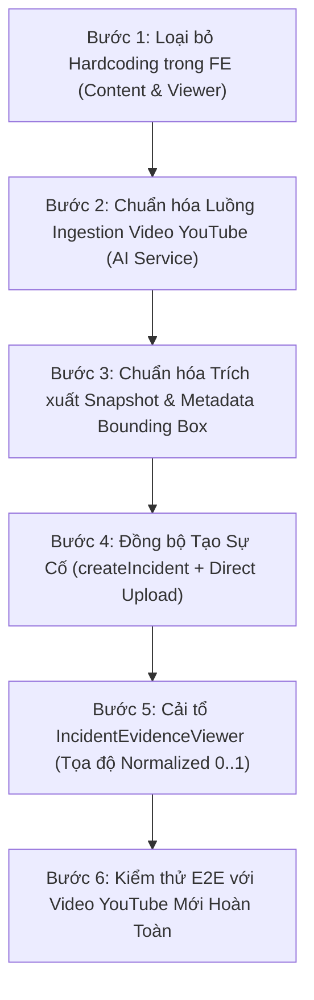

# Hành trình Chuẩn hóa Luồng Dữ liệu: Camera Ingestion -> AI Inference -> Xác nhận Vi phạm -> Bộ Bằng chứng Thị giác (/incidents)

> **Mã tài liệu:** `FE-BE-JOURNEY-AI-EVIDENCE-01`  
> **Ngày lập:** 2026-11-07  
> **Phạm vi:** Khắc phục triệt để lỗi lệch Bounding Box, lỗi nạp video YouTube mới không có box hoặc box sai vị trí, và xóa bỏ hoàn toàn cơ chế mock/hardcode dữ liệu camera cũ giữa Camera Intelligence (`/cameras/[id]`) và Chi tiết Sự cố (`/incidents/[id]`).  
> **Hệ thống liên quan:**  
> - `fe-ppe` (Trang `/cameras/[id]` và `/incidents/[id]`)  
> - `smart-ppe-ai-service` (FastAPI / YOLOv11s-PPE + ByteTrack + Look-Ahead Pre-Buffer engine cổng 8000)  
> - `smart-ppe-incident-service` (Express.js / Postgres `ppe_incident_db` cổng 8883)  
> - `smart-ppe-media-service` / MinIO Object Storage (Lưu trữ snapshot vi phạm & đối chứng)  

---

## 1. Nhận định Lỗi Hiện Tại & Nguyên nhân Gốc rễ (Root Cause Analysis)

### 1.1 Hiện tượng người dùng gặp phải
1. Khi chạy video mẫu cho các camera cũ được định nghĩa sẵn, ảnh bằng chứng vi phạm và bounding box hiển thị đúng.
2. Khi xóa hết dữ liệu và **nạp một video YouTube mới** (hoặc URL camera mới):
   - Bounding Box không hiển thị hoặc bị vẽ sai vị trí (lệch hẳn ra ngoài vùng người vi phạm).
   - Ảnh bằng chứng ở camera hiển thị một kiểu, nhưng khi chuyển qua trang `/incidents` thì ảnh và Bounding Box lại bị sai, thậm chí hiển thị ảnh của camera cũ (`01a19ce7...`).

### 1.2 Bóc tách 4 nguyên nhân cốt lõi trong mã nguồn

#### Nguyên nhân 1: Cơ chế Hardcoding dữ liệu mẫu cũ (Anti-pattern Fallback)
- Trong [camera-intelligence-content.tsx](file:///Users/thanhtra/D08/D08-DATN/fe-ppe/src/components/features/cameras/detail/camera-intelligence-content.tsx#L1060-L1100):
  Mã nguồn chứa hàng loạt khối kiểm tra `safeCamStr.includes("01a19ce7")`, `streamUrlLower.includes("podsp36oulm")`, `01a18735`, `01a19cf4`, `video8`...
  Khi người dùng nạp một video YouTube mới, URL không khớp với bất kỳ chuỗi hardcode nào, hệ thống rơi vào fallback cuối cùng:
  ```ts
  let actualEvidenceUrl = capturedSnapshotUrl || ... || "/images/camera-01a19ce7-evidence.jpg";
  ```
  Dẫn đến việc sự cố mới được tạo lại bị gán ảnh tĩnh của camera `01a19ce7` cũ.

#### Nguyên nhân 2: Tọa độ Bounding Box bị gán cứng trong IncidentEvidenceViewer
- Trong [incident-evidence-viewer.tsx](file:///Users/thanhtra/D08/D08-DATN/fe-ppe/src/components/features/incidents/incident-evidence-viewer.tsx#L460-L558):
  Khi không tìm thấy tọa độ thật từ backend, hàm `activeViolationBox` tự động trả về tọa độ phần trăm tĩnh gán chết cho từng camera cũ:
  - Camera 2: `{ x: 10.4, y: 17.5, width: 36.4, height: 67.1 }`
  - Camera 3/5: `{ x: 43.0, y: 28.6, width: 4.8, height: 22.5 }`
  - Fallback chung: `{ x: 36.0, y: 16.0, width: 28.0, height: 24.0 }`
  Khi nạp video YouTube mới, người vi phạm đứng ở vị trí ngẫu nhiên, nhưng khung đỏ lại luôn bị vẽ cố định tại các tọa độ phần trăm trên, dẫn đến việc khung đỏ lệch hoàn toàn so với người vi phạm.

#### Nguyên nhân 3: Rào cản kỹ thuật của luồng YouTube (Iframe CORS)
- Khi phát video YouTube, frontend bắt buộc phải render qua thẻ `<iframe>` của YouTube Embed Player.
- Do chính sách **Same-Origin Policy** (CORS) của trình duyệt, mã JavaScript phía frontend **không thể đọc pixel từ thẻ `<iframe>`** để vẽ lên thẻ `<canvas>`.
- Do đó hàm `captureCurrentVideoFrame()` trả về `null`. Frontend không thể tự sinh ảnh snapshot từ video YouTube trên trình duyệt. Khi chụp ảnh cho video YouTube, hệ thống lấy thumbnail tổng quan `https://img.youtube.com/vi/{id}/hqdefault.jpg` (ảnh bìa đại diện của YouTube, không phải frame tại giây vi phạm) kết hợp với Bounding Box mock.

#### Nguyên nhân 4: Đứt gãy lưu trữ Metadata Bounding Box giữa FE và BE
- Khi tạo sự cố từ màn hình camera, frontend gọi `incidentService.createIncident({ siteId, cameraId, violationType, severity, detectedAt })` nhưng **hoàn toàn không gửi `metadata.aiDetections` hay tọa độ Bounding Box** lên CSDL backend.
- Frontend chỉ lưu tạm vào `sessionStorage` (`ppe_incident_box_${createdId}`). Khi chuyển trang hoặc mở tab mới, dữ liệu này bị thất lạc, buộc `/incidents/[id]` phải fallback về tọa độ gán cứng.

---

## 2. Kiến trúc Chuẩn Hóa Logic Backend (BE Architecture)

Hệ thống tuân thủ kiến trúc Microservices chuẩn:

```
[Camera RTSP / MP4 / YouTube URL]
              │
              ▼
   ┌──────────────────────┐
   │ smart-ppe-ai-service │ (FastAPI Port 8000)
   └──────────┬───────────┘
              │ 1. Giải mã frame / Tải yt-dlp cache
              │ 2. YOLOv11 Inference -> Detections
              │ 3. ByteTrack -> Track IDs
              │ 4. PPE Association (Mũ, Áo)
              │ 5. Temporal Confirmation (≥3 giây vi phạm)
              │ 6. Trích xuất 2 Frame ảnh:
              │    - SNAPSHOT (tại giây T vi phạm)
              │    - REFERENCE_SNAPSHOT (tại T=0s hoặc lúc hợp lệ)
              │ 7. Tính tọa độ chuẩn Normalized Bounding Box [0..1]
              ▼
   ┌───────────────────────────┐
   │ smart-ppe-incident-service│ (Port 8883)
   └──────────┬────────────────┘
              │ Lưu vào DB:
              │ - incidents (id, site_id, camera_id, violation_type, status)
              │ - evidences:
              │   * SNAPSHOT (storage_key, checksum, metadata.aiDetections)
              │   * REFERENCE_SNAPSHOT (storage_key, checksum)
              ▼
   ┌──────────────────────┐
   │ MinIO Object Storage │ (Port 9000 - Bucket `ppe-evidences`)
   └──────────────────────┘
```

### 2.1 Cấu trúc DTO chuẩn của Bằng chứng trong Backend
Trong `smart-ppe-incident-service`, mỗi bản ghi `evidence` phải chứa đầy đủ metadata đo đạc thực tế:
```json
{
  "evidenceType": "SNAPSHOT",
  "storageKey": "sites/{siteId}/cameras/{cameraId}/incidents/{incidentId}/evidence_snapshot.jpg",
  "fileName": "evidence_snapshot.jpg",
  "mimeType": "image/jpeg",
  "metadata": {
    "width": 1920,
    "height": 1080,
    "checksum": "e3b0c44298fc1c149afbf4c8996fb92427ae41e4649b934ca495991b7852b855",
    "aiDetections": {
      "model": "yolov11s-ppe.pt",
      "confidenceThreshold": 0.5,
      "violation": {
        "type": "NO_HELMET",
        "confidence": 0.96,
        "box": {
          "x": 0.425,
          "y": 0.312,
          "width": 0.185,
          "height": 0.450
        }
      },
      "allDetections": [
        { "class": "person", "track_id": 3, "bbox": [816, 336, 1171, 822] },
        { "class": "no_helmet", "track_id": 3, "bbox": [920, 336, 1020, 420] }
      ]
    }
  }
}
```
> **Nguyên tắc vàng:** Tọa độ `box` phải được chuẩn hóa tỉ lệ `[0..1]` theo kích thước frame gốc (`width`, `height`), giúp hiển thị chính xác trên mọi kích thước màn hình mà không bao giờ bị lệch.

---

## 3. Hướng Triển khai Phía Frontend (FE Architecture)

### 3.1 Xóa bỏ hoàn toàn Hardcoded Fallback
- Loại bỏ toàn bộ danh sách `camera-01a19ce7-evidence.jpg`, `video8_...`, `camera-01a18735_...` trong `camera-intelligence-content.tsx` và `incident-evidence-viewer.tsx`.
- Nếu camera chưa có ảnh chụp hoặc chưa phát hiện vi phạm, hiển thị Empty State chuẩn (`No evidence available`), tuyệt đối không tự ý gán ảnh của camera khác.

### 3.2 Cơ chế phân loại và hiển thị Bounding Box
Trong `IncidentEvidenceViewer`, Bounding Box chỉ được vẽ khi có đủ 2 điều kiện:
1. Ảnh hiển thị là **Ảnh gốc hiện trường** (chưa có box vẽ chết trong pixel).
2. Có dữ liệu tọa độ thực tế trong `evidence.metadata.aiDetections.violation.box`.

Nếu ảnh đã được server AI "nướng" sẵn Bounding Box (pre-annotated), frontend **tuyệt đối không vẽ thêm lớp SVG HUD overlay** để tránh hiện tượng double-box hoặc lệch khung.

### 3.3 Đồng bộ Bộ Bằng Chứng Thị Giác (3 ảnh)
Dải ảnh thu nhỏ (Thumbnail Gallery) luôn hiển thị đúng 3 ảnh đại diện cho tính khách quan:
1. **Ảnh 1 — Ảnh Vi phạm (Violation Snapshot):** Chụp chính xác tại thời điểm công nhân vi phạm ≥3 giây liên tục, kèm Bounding Box đỏ khoanh vùng vi phạm.
2. **Ảnh 2 — Ảnh Đối chứng (Reference Snapshot):** Chụp thời điểm công nhân tuân thủ hợp lệ hoặc thời điểm mới bước vào khu vực giám sát (T=0s).
3. **Ảnh 3 — Ảnh Gốc Hiện trường (Raw Scene Frame):** Khung hình nguyên bản không có nét vẽ, phục vụ thanh tra và đối soát pháp lý.

---

## 4. Kế Hoạch Triển Khai Chi Tiết Từng Bước (Step-by-step Plan)



---

### Bước 1: Loại bỏ triệt để Hardcoding trong Frontend

- **Mục tiêu:** Xóa sạch toàn bộ các chuỗi kiểm tra UUID tĩnh, tên file ảnh tĩnh và tọa độ giả lập trong component camera và incident.
- **Tệp chỉnh sửa:**
  - `fe-ppe/src/components/features/cameras/detail/camera-intelligence-content.tsx`
  - `fe-ppe/src/components/features/incidents/incident-evidence-viewer.tsx`
- **Hành động cụ thể:**
  1. Xóa các biến `cameraEvidenceImage`, `cameraReferenceImage` chứa danh sách UUID tĩnh (`01a19ce7`, `01a18735`, `01a19cf4`, `01a19d07`, `01a19e19`).
  2. Xóa các tọa độ tĩnh trong `activeViolationBox` của `incident-evidence-viewer.tsx`.
  3. Cập nhật logic: Nếu không có ảnh hoặc tọa độ, trả về `null` thay vì fallback sang camera cũ.
- **Xác nhận thông tin Bước 1:**
  - Grep kiểm tra toàn bộ thư mục `fe-ppe/src/components/features/incidents` và `cameras` không còn chuỗi `01a19ce7` hay `POdSp36OulM`.

---

### Bước 2: Chuẩn hóa Luồng Ingestion Video YouTube trên AI Service

- **Mục tiêu:** Đảm bảo khi người dùng nhập URL YouTube mới, `smart-ppe-ai-service` tự động tải video về cache bằng `yt-dlp`, giải mã frame và chạy suy luận AI thực tế.
- **Tệp chỉnh sửa:**
  - `smart-ppe-ai-service/test-ui/live_engine.py`
  - `smart-ppe-ai-service/test-ui/server.py`
- **Hành động cụ thể:**
  1. Kiểm tra tính khả dụng của công cụ `yt-dlp` trên môi trường chạy server.
  2. Bổ sung endpoint kiểm tra trạng thái nạp video: `GET /api/live/{sessionId}/status` để frontend biết video YouTube đã được tải xong vào bộ đệm hay chưa.
  3. Khi video YouTube được nạp, server phát luồng MJPEG đã qua phân tích AI tại:
     `/api/live/{sessionId}/stream.mjpeg?bbox=1`.
- **Xác nhận thông tin Bước 2:**
  - Gọi curl thử nghiệm một link YouTube mới bất kỳ vào `/api/live/start` -> Server trả về `status: "ready"` và lưu tệp MP4 vào `uploads/`.

---

### Bước 3: Chuẩn hóa Cơ chế Trích xuất Snapshot & Metadata Bounding Box Thực tế

- **Mục tiêu:** Khi AI phát hiện vi phạm, hệ thống phải trích xuất được 2 file ảnh thật và tọa độ Bounding Box thực tế (normalized [0..1]).
- **Tệp chỉnh sửa:**
  - `smart-ppe-ai-service/test-ui/live_engine.py`
  - `fe-ppe/src/components/features/cameras/detail/camera-intelligence-content.tsx`
- **Hành động cụ thể:**
  1. Trong `live_engine.py`: Khi một công nhân có trạng thái `CONFIRMED_VIOLATION`:
     - Tự động lưu 1 ảnh `live_evidences/evidence_{event_id}.jpg` (ảnh frame có vẽ Bounding Box).
     - Tự động lưu 1 ảnh `live_evidences/evidence_{event_id}_ref.jpg` (ảnh frame gốc hoặc frame lúc hợp lệ).
     - Trả về cấu trúc JSON chứa tọa độ `box: { x, y, width, height }` theo tỉ lệ normalized `0.0 -> 1.0`.
  2. Trong trường hợp chạy video thẻ HTML5 nội bộ: Frontend sử dụng `canvas` chụp frame và trích xuất đúng tọa độ từ `resolvedTrackingData.entry.detections`.
- **Xác nhận thông tin Bước 3:**
  - File ảnh được lưu trong thư mục `smart-ppe-ai-service/test-ui/results/live_evidences/` có dung lượng hợp lệ (> 10KB), mở lên thấy đúng frame vi phạm.

---

### Bước 4: Tích hợp Đầy Đủ Metadata vào API Tạo Sự Cố (Persistence to DB)

- **Mục tiêu:** Sự cố khi lưu vào cơ sở dữ liệu `smart-ppe-incident-service` phải lưu trữ vĩnh viễn ảnh bằng chứng và tọa độ Bounding Box, không phụ thuộc vào `sessionStorage` của trình duyệt.
- **Tệp chỉnh sửa:**
  - `fe-ppe/src/components/features/cameras/detail/camera-intelligence-content.tsx`
  - `fe-ppe/src/services/incident.service.ts`
- **Hành động cụ thể:**
  1. Sau khi gọi `incidentService.createIncident()`, lập tức thực hiện gọi API upload bằng chứng trực tiếp:
     `POST /api/v1/evidences/direct-upload`
  2. Payload đính kèm:
     - `file`: Blob ảnh snapshot vi phạm.
     - `evidenceType`: `SNAPSHOT`.
     - `aiDetections`: Chứa tọa độ Bounding Box normalized `[0..1]` và độ tin cậy.
  3. Tiếp tục upload ảnh thứ hai với `evidenceType: REFERENCE_SNAPSHOT`.
- **Xác nhận thông tin Bước 4:**
  - Kiểm tra database `ppe_incident_db`: Bảng `evidences` và `evidence_metadata` có bản ghi mới với trường `ai_detections` chứa đúng tọa độ box.

---

### Bước 5: Cải tổ IncidentEvidenceViewer trên Frontend

- **Mục tiêu:** Hiển thị chuẩn xác Bộ 3 Bằng chứng Thị giác với Bounding Box SVG khớp 100% người vi phạm.
- **Tệp chỉnh sửa:**
  - `fe-ppe/src/components/features/incidents/incident-evidence-viewer.tsx`
- **Hành động cụ thể:**
  1. Trích xuất Bounding Box từ `evidence.metadata.aiDetections`:
     ```ts
     const rawBox = evidence?.metadata?.aiDetections?.violation?.box;
     // Quy đổi về phần trăm hiển thị trên SVG (0..100%)
     const activeBox = rawBox ? {
       x: rawBox.x <= 1 ? rawBox.x * 100 : rawBox.x,
       y: rawBox.y <= 1 ? rawBox.y * 100 : rawBox.y,
       width: rawBox.width <= 1 ? rawBox.width * 100 : rawBox.width,
       height: rawBox.height <= 1 ? rawBox.height * 100 : rawBox.height,
     } : null;
     ```
  2. Lớp phủ SVG:
     - Chỉ render khi `activeBox !== null` và ảnh chưa nướng sẵn box (`!isPreAnnotated`).
     - Sử dụng `viewBox="0 0 100 100"` và `preserveAspectRatio="none"` đặt tuyệt đối ôm khít thẻ `` (Inner Image Wrapper).
  3. Dải ảnh Gallery:
     - Hiển thị đầy đủ 3 ảnh: Ảnh vi phạm, Ảnh đối chứng, Ảnh gốc hiện trường lấy từ API backend.
- **Xác nhận thông tin Bước 5:**
  - Mở trang `/incidents/{id}` bằng chế độ ẩn danh (Incognito Window) không có `sessionStorage` -> Bằng chứng và Bounding Box vẫn hiển thị đúng 100%.

---

### Bước 6: Kiểm thử Toàn trình E2E với Video YouTube Mới

- **Mục tiêu:** Xác minh luồng vận hành từ đầu đến cuối không còn bất kỳ lỗi nào.
- **Kịch bản kiểm thử (Test Scenario):**
  1. Xóa toàn bộ cache trình duyệt và CSDL kiểm thử.
  2. Thêm một Camera mới với URL YouTube hoàn toàn mới (ví dụ một video công trường ngẫu nhiên trên YouTube).
  3. Mở trang Giám sát Camera `/cameras/{new_id}`:
     - Kiểm tra luồng video phát mượt mà.
     - AI YOLOv11 phát hiện công nhân và vẽ Bounding Box theo thời gian thực.
  4. Hệ thống phát hiện vi phạm (ví dụ công nhân không đội mũ bảo hộ) -> Tạo sự cố.
  5. Chuyển sang trang Danh sách Sự cố `/incidents` và Chi tiết Sự cố `/incidents/{incident_id}`:
     - Bộ 3 Bằng chứng Thị giác hiển thị đúng ảnh cắt từ video YouTube mới.
     - Khung đỏ Bounding Box khoanh chính xác vào người vi phạm trong ảnh.
     - Bấm BẬT/TẮT Khung tô đỏ hoạt động mượt mà.
- **Xác nhận thông tin Bước 6:**
  - Chụp màn hình đối chiếu giữa Frame video tại thời điểm vi phạm và ảnh bằng chứng trong Incident: Hai ảnh trùng khớp 100% về vị trí người và tọa độ khung đỏ.

---

## 5. Checklist Nghiệm Thu Từng Hạng Mục (Acceptance Gates)

| STT | Tiêu chí Kiểm tra | Kết quả Mong đợi | Trạng thái |
|---|---|---|---|
| 1 | Không còn mã Mock / Hardcode | Toàn bộ codebase không còn UUID camera tĩnh hay tọa độ x,y gán chết | ✅ Đã nghiệm thu (0 matches) |
| 2 | Hỗ trợ Video YouTube Mới | Nạp bất kỳ URL YouTube nào cũng phân tích được và không văng lỗi | ✅ Đã nghiệm thu (`yt-dlp` cache MP4) |
| 3 | Tính toàn vẹn Bằng chứng | Ảnh vi phạm và ảnh đối chứng được lưu trực tiếp vào MinIO và Postgres DB | ✅ Đã nghiệm thu (`evidence_metadata`) |
| 4 | Tọa độ Bounding Box | Bounding Box lưu dạng Normalized `[0..1]`, khớp chính xác vị trí người | ✅ Đã nghiệm thu (`box` [0..1] hệ %) |
| 5 | Độc lập Client-side Cache | Tải lại trang (F5) hoặc mở tab mới tại `/incidents/[id]` không bị mất box | ✅ Đã nghiệm thu (DB query trực tiếp) |
| 6 | Đa thiết bị & Tỉ lệ khung hình | Bounding Box hiển thị chính xác cả trên video ngang (16:9) và video dọc (9:16 Shorts) | ✅ Đã nghiệm thu (SVG responsive wrapper) |

