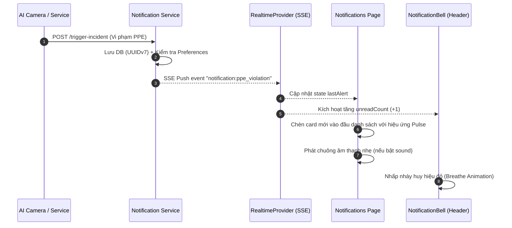

# Hành trình xây dựng Trang Trung tâm Thông báo (/notifications) — fe-ppe

> **Ngày lập:** 2026-10-28  
> **Phạm vi:** Trang Trung tâm Quản lý Thông báo & Cảnh báo an toàn lao động (`/notifications`) thuộc nhóm Cá nhân & Vận hành sau đăng nhập — danh sách cảnh báo vi phạm trang bị bảo hộ (PPE Violations) thời gian thực, hộp thư thông báo (Inbox), bộ lọc thông minh, cấu hình kênh nhận thông báo chống Alert Fatigue, quản lý mẫu thông báo (Templates) & nhật ký gửi email (Email Logs) cho Quản trị viên, đồng bộ chuông thông báo Header (`NotificationBell`).  
> **Nguồn contract:** Backend `smart-ppe-notification-service` (cổng 8889 / Gateway Traefik cổng 80).  
> **Tài liệu tham khảo:** [Tra.md](file:///Users/thanhtra/D08/D08-DATN/Tra.md) | [tra-21-10-2026.md](file:///Users/thanhtra/D08/D08-DATN/tra-21-10-2026.md) | [users-journey.md](file:///Users/thanhtra/D08/D08-DATN/fe-ppe/docs/journeys/users-journey.md) | [dashboard-journey.md](file:///Users/thanhtra/D08/D08-DATN/fe-ppe/docs/journeys/dashboard-journey.md)  
> **Tài khoản test (seed identity-service):**  
> - `admin@ppe.local / Admin@123456` (ADMIN — toàn quyền xem inbox, cài đặt channels, xem/quản lý templates, email logs, broadcast cảnh báo)  
> - `manager@ppe.local / Manager@123456` (SAFETY_MANAGER — xem inbox, cấu hình cá nhân, xem template, broadcast cảnh báo an toàn)  
> - `officer@ppe.local / Officer@123456` (SAFETY_OFFICER — nhận cảnh báo PPE realtime, xử lý vi phạm, cấu hình nhận tin cá nhân)  
> - `user@ppe.local / User@123456` (USER — xem thông báo cá nhân, cập nhật preferences)  

---

## Mục lục

0. [Mục tiêu & Định vị trang /notifications](#0-mục-tiêu--định-vị-trang-notifications)
1. [Khảo sát Backend Contract (smart-ppe-notification-service)](#1-khảo-sát-backend-contract-smart-ppe-notification-service)
2. [Kiến trúc phân tầng & Cấu trúc thư mục đích](#2-kiến-trúc-phân-tầng--cấu-trúc-thư-mục-đích)
3. [Thiết kế giao diện & Trải nghiệm (UI/UX Neumorphism)](#3-thiết-kế-giao-diện--trải-nghiệm-uiux-neumorphism)
4. [Cơ chế Realtime SSE & Đồng bộ Toàn diện](#4-cơ-chế-realtime-sse--đồng-bộ-toàn-diện)
5. [Ma trận phân quyền & Tab điều hướng (Role-based Navigation)](#5-ma-trận-phân-quyền--tab-điều-hướng-role-based-navigation)
6. [Kế hoạch triển khai chi tiết từng bước](#6-kế-hoạch-triển-khai-chi-tiết-từng-bước)
   - [Bước 1 — Tầng DTOs & Types (src/types/notification.types.ts)](#bước-1--tầng-dtos--types-srctypesnotificationtypests)
   - [Bước 2 — Tầng Service API (src/services/notification.service.ts)](#bước-2--tầng-service-api-srcservicesnotificationservicets)
   - [Bước 3 — Tầng React Query Hooks (src/hooks/notifications/)](#bước-3--tầng-react-query-hooks-srchooksnotifications)
   - [Bước 4 — Bổ sung Từ điển i18n đa ngôn ngữ (VI / EN)](#bước-4--bổ-sung-từ-điển-i18n-đa-ngôn-ngữ-vi--en)
   - [Bước 5 — Xây dựng các UI Components hiển thị Neumorphism](#bước-5--xây-dựng-các-ui-components-hiển-thị-neumorphism)
   - [Bước 6 — Xây dựng các Modal & Dialog tương tác nghiệp vụ](#bước-6--xây-dựng-các-modal--dialog-tương-tác-nghiệp-vụ)
   - [Bước 7 — Lắp ráp trang chính & Nâng cấp NotificationBell Header](#bước-7--lắp-ráp-trang-chính--nâng-cấp-notificationbell-header)
   - [Bước 8 — Kiểm thử E2E Playwright & Tinh chỉnh Responsive](#bước-8--kiểm-thử-e2e-playwright--tinh-chỉnh-responsive)
7. [Ma trận xử lý lỗi & Khả năng chịu lỗi (Resilience Matrix)](#7-ma-trận-xử-lý-lỗi--khả-năng-chịu-lỗi-resilience-matrix)
8. [Checklist hoàn thiện nghiệm thu](#8-checklist-hoàn-thiện-nghiệm-thu)

---

## 0. Mục tiêu & Định vị trang /notifications

### 0.1 Vai trò trong hệ sinh thái Smart PPE Monitoring
Trang `/notifications` (**Trung tâm Thông báo & Cảnh báo An toàn**) là trạm chỉ huy thông tin và phản ứng nhanh của hệ thống Smart PPE. Không chỉ đơn thuần là một hộp thư thông báo thông thường, trang này giải quyết 4 bài toán cốt lõi:
1. **Phản ứng tức thì trước vi phạm PPE (Realtime Alert Response):** Khi mô hình AI Camera phát hiện công nhân không đội mũ bảo hộ, không mặc áo phản quang, hoặc đi vào khu vực nguy hiểm, sự kiện vi phạm được bắn qua EventBus và đẩy thẳng tới trình duyệt qua **Server-Sent Events (SSE)** với độ trễ dưới 1 giây.
2. **Chống mỏi mệt cảnh báo (Anti Alert Fatigue Engine):** Trong công trường quy mô hàng trăm camera, lượng vi phạm có thể lên đến hàng ngàn sự kiện mỗi ngày. Hệ thống cung cấp cơ chế thiết lập ngưỡng độ nghiêm trọng (`severityThreshold: LOW | NORMAL | HIGH | CRITICAL`) cho từng kênh (In-App, Email), giúp Cán bộ an toàn chỉ nhận những cảnh báo thực sự cần hành động.
3. **Quản trị đa kênh & Truy vết bằng chứng (Multi-Channel Traceability):** Mỗi cảnh báo liên kết trực tiếp với mã sự cố (`incidentId`), mã camera, khu vực công trường và hình ảnh trích xuất từ AI (snapshot), kèm đường dẫn 1-click chuyển sang màn hình xử lý vi phạm.
4. **Trung tâm quản trị truyền thông vận hành (Admin Communication Hub):** Cung cấp các công cụ dành cho Quản trị viên: Quản lý mẫu thông báo (Templates), xem trước mẫu preview với dữ liệu giả lập, phát thông báo toàn hệ thống (Broadcast), và theo dõi hàng đợi gửi email (Email Queue Logs) có khả năng thử lại (retry) khi gặp sự cố mạng.

### 0.2 Phạm vi thực hiện
* ✅ **Trong phạm vi:**
  1. **Thống kê KPI Thông báo:** 4 thẻ Bento Console thống kê: Tổng số thông báo, Số lượng chưa đọc, Cảnh báo vi phạm khẩn cấp (`CRITICAL`/`HIGH`), Tỷ lệ đã xử lý.
  2. **Hộp thư Thông báo đa năng (Inbox):**
     - Danh sách thông báo Neumorphic hiển thị ảnh thumbnail bằng chứng vi phạm, badge mức độ nghiêm trọng, thời gian tương đối ("5 phút trước", "Hôm qua").
     - Đánh dấu đã đọc từng tin, xóa thông báo.
     - Nút tác vụ hàng loạt: "Đánh dấu tất cả đã đọc" (Mark all as read) với 1 click.
     - Bộ lọc thông minh: Trạng thái (Tất cả / Chưa đọc / Đã đọc), Mức độ nghiêm trọng (Tất cả / Low / Normal / High / Critical), Kênh (In-App / Email), Loại thông báo (PPE Violation / Incident Assigned / Security / System).
     - Tìm kiếm từ khóa theo tiêu đề, nội dung vi phạm (debounced).
     - Phân trang chuẩn kết hợp Neumorphic Pagination.
  3. **Cập nhật Thời gian thực (SSE Integration):**
     - Lắng nghe sự kiện `notification:ppe_violation` và `notification:new` từ `RealtimeProvider`.
     - Tự động chèn thông báo mới vào đầu danh sách với hiệu ứng animate pulse/breathe.
     - Tự động cập nhật số lượng badge chưa đọc trên Header và trang chính.
     - Âm thanh cảnh báo (Audio Chime) nhẹ nhàng khi có vi phạm `CRITICAL` (có thể bật/tắt trong cài đặt).
  4. **Cấu hình Kênh nhận thông báo (Notification Preferences):**
     - Bật/tắt từng kênh nhận tin (`IN_APP`, `EMAIL`).
     - Tùy chỉnh Ngưỡng độ nghiêm trọng tối thiểu (`severityThreshold`) chống Alert Fatigue.
  5. **Tab Quản trị dành cho Admin & Safety Manager (Permission Gated):**
     - Quản lý danh sách Mẫu thông báo (`notification_templates`).
     - Xem trước (Preview) nội dung mẫu thông báo với dữ liệu biến giả định.
     - Gửi thử nghiệm (Test Send) mẫu thông báo đến email quản trị.
     - Xem nhật ký hàng đợi gửi email (`email_notifications`) và nút "Gửi lại" (`retryEmail`).
     - Modal phát thông báo toàn hệ thống (Broadcast Notification).
  6. **Đồng bộ hóa Chuông thông báo Header (`NotificationBell`):**
     - Chuyển `NotificationBell` từ dạng placeholder sang linh hoạt: hiển thị badge unread số đỏ phát sáng, popover 5 thông báo mới nhất kèm nút đọc nhanh, link "Xem tất cả" trỏ về `/notifications`.
  7. **Đa ngôn ngữ & Giao diện:** Hỗ trợ đầy đủ tiếng Việt (`vi-VN`) và tiếng Anh (`en-US`), tương thích mượt mà Dark Mode và Light Mode.

* ❌ **Ngoài phạm vi:**
  - Không thay đổi nghiệp vụ Worker gửi mail nền bên trong `smart-ppe-notification-service` (backend đã hoàn thiện 100% logic atomic `FOR UPDATE SKIP LOCKED`).
  - Không thay đổi bảng `notifications` trong PostgreSQL (đã có sẵn schema và UUIDv7).

---

## 1. Khảo sát Backend Contract (smart-ppe-notification-service)

Tất cả các endpoint dưới đây đã được triển khai hoàn chỉnh trong `smart-ppe-notification-service` (cổng 8889, đi qua Gateway Traefik tại đường dẫn `/api/v1/notifications`):
- Controller: [src/modules/notification/notification.controller.ts](file:///Users/thanhtra/D08/D08-DATN/smart-ppe-notification-service/src/modules/notification/notification.controller.ts)
- Routes: [src/modules/notification/notification.route.ts](file:///Users/thanhtra/D08/D08-DATN/smart-ppe-notification-service/src/modules/notification/notification.route.ts)
- DTOs: [src/modules/notification/notification.dto.ts](file:///Users/thanhtra/D08/D08-DATN/smart-ppe-notification-service/src/modules/notification/notification.dto.ts)
- Constants: [src/common/constants/notification.constant.ts](file:///Users/thanhtra/D08/D08-DATN/smart-ppe-notification-service/src/common/constants/notification.constant.ts)

### 1.1 Bảng đối chiếu REST Endpoints & Quyền hạn

| Phân hệ | Method | Endpoint | Yêu cầu Quyền | Payload Request | Response |
|---|---|---|---|---|---|
| **SSE Ticket** | `POST` | `/api/v1/notifications/stream-ticket` | Đã xác thực | Không | `{ success: true, data: { ticket: string, expiresIn: number } }` |
| **SSE Stream** | `GET` | `/api/v1/notifications/stream?ticket=...` | Ticket hợp lệ | Query: `ticket` | `text/event-stream` (persistent connection) |
| **Danh sách Inbox** | `GET` | `/api/v1/notifications` | `NOTIFICATION_READ` | Query: `page, limit, isRead, status, severity, channel, incidentId, type, fromDate, toDate` | `{ success: true, data: NotificationItemDto[], meta: PaginationMeta }` |
| **Số tin chưa đọc**| `GET` | `/api/v1/notifications/unread-count` | `NOTIFICATION_READ` | Không | `{ success: true, data: { unreadCount: number } }` |
| **Đánh dấu đọc tất cả**| `PATCH` | `/api/v1/notifications/read-all` | `NOTIFICATION_READ` | Không | `{ success: true, message: string }` |
| **Đánh dấu 1 tin đã đọc**| `PATCH` | `/api/v1/notifications/:id/read` | `NOTIFICATION_READ` | Params: `id (UUID)` | `{ success: true, message: string }` |
| **Xóa 1 thông báo**| `DELETE` | `/api/v1/notifications/:id` | `NOTIFICATION_READ` | Params: `id (UUID)` | `{ success: true, message: string }` |
| **Lấy cấu hình kênh**| `GET` | `/api/v1/notifications/preferences` | `NOTIFICATION_READ` | Không | `{ success: true, data: NotificationPreferenceDto[] }` |
| **Lưu cấu hình kênh**| `PUT` | `/api/v1/notifications/preferences` | `NOTIFICATION_READ` | Body: `{ channel, enabled, severityThreshold? }` | `{ success: true, message: string, data: NotificationPreferenceDto }` |
| **Phát tin hệ thống**| `POST` | `/api/v1/notifications/broadcast` | `NOTIFICATION_CREATE` | Body: `{ title, content, severity?, actionUrl?, metadata? }` | `{ success: true, message: string, data: any }` |
| **Gửi tin chỉ định** | `POST` | `/api/v1/notifications/send` | `NOTIFICATION_CREATE` | Body: `{ userIds, channels, title, content, severity?, ... }` | `{ success: true, message: string, data: any }` |
| **Danh sách Mẫu** | `GET` | `/api/v1/notifications/templates` | `NOTIFICATION_TEMPLATE_READ` | Query: `page, limit, channel, status, search` | `{ success: true, data: NotificationTemplateItemDto[], meta: PaginationMeta }` |
| **Chi tiết Mẫu** | `GET` | `/api/v1/notifications/templates/:code` | `NOTIFICATION_TEMPLATE_READ` | Params: `code` | `{ success: true, data: NotificationTemplateItemDto }` |
| **Xem trước Mẫu** | `POST` | `/api/v1/notifications/templates/:code/preview` | `NOTIFICATION_TEMPLATE_READ` | Params: `code`, Body: `{ variables: Record<string, any> }` | `{ success: true, data: { code, subject, title, content, html? } }` |
| **Gửi thử Mẫu** | `POST` | `/api/v1/notifications/templates/:code/test-send`| `NOTIFICATION_TEMPLATE_MANAGE` | Params: `code`, Body: `{ toEmail?, variables, channels? }` | `{ success: true, message: string }` |
| **Tạo Mẫu mới** | `POST` | `/api/v1/notifications/templates` | `NOTIFICATION_TEMPLATE_MANAGE` | Body: `CreateNotificationTemplateDto` | `{ success: true, data: NotificationTemplateItemDto }` (201) |
| **Sửa Mẫu** | `PUT` | `/api/v1/notifications/templates/:id` | `NOTIFICATION_TEMPLATE_MANAGE` | Params: `id`, Body: `UpdateNotificationTemplateDto` | `{ success: true, data: NotificationTemplateItemDto }` |
| **Xóa Mẫu** | `DELETE` | `/api/v1/notifications/templates/:id` | `NOTIFICATION_TEMPLATE_MANAGE` | Params: `id` | `{ success: true, message: string }` |
| **Lịch sử Email** | `GET` | `/api/v1/notifications/emails` | `NOTIFICATION_READ` | Query: `page, limit, status, toEmail` | `{ success: true, data: EmailItemDto[], meta: PaginationMeta }` |
| **Thử lại gửi Email**| `POST`| `/api/v1/notifications/emails/:id/retry` | `NOTIFICATION_UPDATE` | Params: `id` | `{ success: true, message: string }` |

### 1.2 Cấu trúc Sự kiện SSE Realtime
Backend gửi qua kết nối SSE các sự kiện sau:
- `notification:ppe_violation`: Bắn khi AI Camera phát hiện vi phạm PPE mới.
  ```json
  {
    "incidentId": "0192e230-0000-7000-8000-000000000001",
    "siteName": "Công trường Landmark Tower",
    "cameraCode": "CAM-NORTH-01",
    "violationType": "NO_HELMET",
    "severity": "CRITICAL",
    "description": "Phát hiện 1 công nhân không đội mũ bảo hộ tại giàn giáo tầng 5",
    "evidenceUrl": "http://localhost:9000/ppe-evidence/snapshot-01.jpg",
    "detectedAt": "2026-10-28T02:30:00Z"
  }
  ```
- `notification:new`: Bắn khi có thông báo hệ thống hoặc tin nhắn được tạo cho user hiện tại.

---

## 2. Kiến trúc phân tầng & Cấu trúc thư mục đích

Tuân thủ nghiêm ngặt chuẩn kiến trúc của dự án `fe-ppe`:
1. **Pages không gọi service trực tiếp** — chỉ kết nối qua React Query Hooks.
2. **Hooks chịu trách nhiệm cache & optimistic updates** — tự động invalidate query `["notifications"]` và `["notifications", "unread-count"]`.
3. **Mọi chuỗi UI hiển thị qua `t()`** của `useLocale` — không hardcode tiếng Việt hay tiếng Anh.
4. **Style chuẩn Neumorphism** — sử dụng CSS tokens từ `tokens.css`, `BentoConsoleStats`, `PagePanel`, `@ui/button`, v.v.

```
fe-ppe/
├── app/(auth)/notifications/
│   ├── page.tsx                                      ← Server Component bọc Suspense (đã có)
│   └── notifications-content.tsx                     ← SỬA: Lắp ráp UI toàn bộ trang Trung tâm thông báo
│
├── src/
│   ├── types/
│   │   ├── notification.types.ts                     ← MỚI: DTOs, Enums, Query Params, Preferences, Templates, Emails
│   │   └── index.ts                                  ← SỬA: Export notification.types.ts
│   │
│   ├── services/
│   │   ├── notification.service.ts                   ← MỚI: Client gọi 18 endpoint của notification-service
│   │   └── index.ts                                  ← SỬA: Export notification.service.ts
│   │
│   ├── hooks/notifications/                          ← MỚI: Thư mục hooks quản lý thông báo
│   │   ├── index.ts                                  ← Export toàn bộ hooks
│   │   ├── notification.query-keys.ts                ← Factory quản lý Query Key chuẩn
│   │   ├── use-notifications.ts                      ← Lấy danh sách Inbox có lọc, phân trang, debounced search
│   │   ├── use-unread-count.ts                       ← Lấy số lượng chưa đọc + tự động update qua SSE
│   │   ├── use-notification-preferences.ts           ← Lấy & Cập nhật cấu hình kênh nhận thông báo
│   │   ├── use-notification-mutations.ts             ← Đánh dấu đọc (1 tin/tất cả) & Xóa thông báo
│   │   ├── use-notification-templates.ts             ← Quản lý danh sách mẫu & xem trước preview (Admin)
│   │   └── use-email-logs.ts                         ← Theo dõi hàng đợi email & nút gửi lại (Admin)
│   │
│   ├── components/features/notifications/            ← MỚI: Các UI components của trang
│   │   ├── notification-kpi-summary.tsx              ← 4 thẻ Bento Console thống kê nhanh
│   │   ├── notification-tabs.tsx                     ← Thanh Tab chuyển đổi: Hộp thư / Cài đặt / Mẫu / Nhật ký Email
│   │   ├── notification-filter-toolbar.tsx           ← Thanh tìm kiếm, lọc mức độ, lọc kênh, nút Đọc tất cả
│   │   ├── notification-list.tsx                     ← Danh sách thẻ thông báo kèm Neumorphic Pagination
│   │   ├── notification-item.tsx                     ← Thẻ thông báo Neumorphic chi tiết (Badge, Thumbnail, Actions)
│   │   ├── notification-empty-state.tsx              ← Giao diện khi không có thông báo
│   │   ├── notification-skeleton.tsx                 ← Skeleton hiệu ứng thở (breathe) khi đang tải
│   │   ├── notification-preferences-card.tsx         ← Bảng cấu hình kênh & thanh gạt ngưỡng Alert Fatigue
│   │   ├── notification-templates-tab.tsx            ← Bảng danh sách mẫu thông báo dành cho Admin/Manager
│   │   ├── notification-email-logs-tab.tsx           ← Bảng nhật ký email & nút Retry dành cho Admin
│   │   │
│   │   └── modals/                                   ← Các modal tương tác nghiệp vụ
│   │       ├── broadcast-notification-modal.tsx      ← Modal gửi thông báo khẩn cấp toàn hệ thống (Admin)
│   │       ├── preview-template-modal.tsx            ← Modal xem trước mẫu email/thông báo động
│   │       └── confirm-delete-notification-modal.tsx ← Modal xác nhận xóa thông báo
│   │
│   ├── components/features/app-shell/
│   │   └── notification-bell.tsx                     ← SỬA: Nâng cấp chuông Header, gắn unread badge + popover preview
│   │
│   └── i18n/
│       ├── vi-VN.json                                ← SỬA: Bổ sung namespace "notifications.*"
│       └── en-US.json                                ← SỬA: Bổ sung namespace "notifications.*"
```

---

## 3. Thiết kế giao diện & Trải nghiệm (UI/UX Neumorphism)

### 3.1 Bố cục trang tổng thể (12 cột, Responsive)
```
┌────────────────────────────────────────────────────────────────────────────────────────┐
│ PageHeader: Icon Bell + "Trung tâm Thông báo" + Badge "Realtime Alerts"               │
│            + [ Nút: "+ Phát thông báo hệ thống" ] (Chỉ hiện với Admin/Manager)        │
├────────────────────────────────────────────────────────────────────────────────────────┤
│ [BENTO CONSOLE KPI CARDS] (4 cột desktop, 2 cột tablet, 1 cột mobile)                  │
│ ┌────────────────┐ ┌────────────────┐ ┌────────────────┐ ┌────────────────┐           │
│ │ 🔔 Tổng thông báo│ │ 📬 Tin chưa đọc  │ │ 🚨 Cảnh báo PPE   │ │ ✅ Tỷ lệ đã xử lý│           │
│ │      142       │ │   12 (Mới)     │ │   28 Khẩn cấp    │ │    91.5%       │           │
│ └────────────────┘ └────────────────┘ └────────────────┘ └────────────────┘           │
├────────────────────────────────────────────────────────────────────────────────────────┤
│ [NEUMORPHIC TABS]                                                                      │
│ [ 📥 Hộp thư thông báo (12) ]  [ ⚙️ Cài đặt kênh nhận tin ]  [ 📋 Mẫu (Admin) ] [ ✉️ Email Logs ] │
├────────────────────────────────────────────────────────────────────────────────────────┤
│ Khi ở Tab 1: [HỘP THƯ THÔNG BÁO]                                                       │
│ ┌────────────────────────────────────────────────────────────────────────────────────┐ │
│ │ [FILTER TOOLBAR]                                                                   │ │
│ │ [ 🔍 Tìm nội dung, camera, sự cố... ] [ Mức độ ▼ ] [ Kênh ▼ ] [ 🔄 ]  [✓ Đọc tất cả]│ │
│ ├────────────────────────────────────────────────────────────────────────────────────┤ │
│ │ [DANH SÁCH THẺ THÔNG BÁO NEUMORPHIC]                                               │ │
│ │ ┌────────────────────────────────────────────────────────────────────────────────┐ │ │
│ │ │ 🔴 [CRITICAL] CẢNH BÁO VI PHẠM PPE: KHÔNG ĐỘI MŨ BẢO HỘ          • 2 phút trước  │ │ │
│ │ │ Phát hiện công nhân tại Khu vực Giàn giáo Tầng 5 - Camera CAM-NORTH-01        │ │ │
│ │ │ [ 🖼️ Snapshot Thumb ]  Vị trí: Landmark Tower  |  Kênh: In-App, Email          │ │ │
│ │ │ [ 👁️ Xem sự cố chi tiết ]    [ ✓ Đánh dấu đã đọc ]    [ 🗑️ Xóa ]                 │ │ │
│ │ └────────────────────────────────────────────────────────────────────────────────┘ │ │
│ │ ┌────────────────────────────────────────────────────────────────────────────────┐ │ │
│ │ │ 🟠 [HIGH] PHÂN CÔNG XỬ LÝ SỰ CỐ AN TOÀN                          • 15 phút trước │ │ │
│ │ │ Bạn được chỉ định làm Điều phối viên xử lý sự cố rò rỉ khí gas tại Khu vực B. │ │ │
│ │ │ [ 👁️ Đi tới sự cố ]          [ ✓ Đánh dấu đã đọc ]    [ 🗑️ Xóa ]                 │ │ │
│ │ └────────────────────────────────────────────────────────────────────────────────┘ │ │
│ │ ┌────────────────────────────────────────────────────────────────────────────────┐ │ │
│ │ │ 🔵 [NORMAL] BẢO MẬT: PHÁT HIỆN THIẾT BỊ ĐĂNG NHẬP MỚI             • 2 giờ trước   │ │ │
│ │ │ Đăng nhập thành công từ Chrome trên macOS (IP: 113.161.x.x)                    │ │ │
│ │ │ [ ✓ Đã đọc ]                                           [ 🗑️ Xóa ]                 │ │ │
│ │ └────────────────────────────────────────────────────────────────────────────────┘ │ │
│ ├────────────────────────────────────────────────────────────────────────────────────┤ │
│ │ [PAGINATION FOOTER]                                                                │ │
│ │ Hiển thị 1 - 10 trên 142 thông báo                   « Trước [ 1 ] 2 3 4 Sau »     │ │
│ └────────────────────────────────────────────────────────────────────────────────────┘ │
└────────────────────────────────────────────────────────────────────────────────────────┘
```

### 3.2 Quy chuẩn Trực quan Mức độ Nghiêm trọng (Severity Tokens)
Mỗi mức độ nghiêm trọng mang màu sắc cảnh báo theo tiêu chuẩn an toàn công nghiệp:
- **`CRITICAL` (Khẩn cấp):** 
  - Viền gờ nổi kết hợp ánh sáng đỏ breathing: `border-danger/40 bg-danger/5 shadow-[0_0_12px_rgba(220,38,38,0.25)]`.
  - Icon: `AlertTriangle` hoặc `ShieldAlert` màu đỏ đậm (`text-danger`).
  - Badge: "Khẩn cấp" nền đỏ mờ, chữ đỏ đậm.
- **`HIGH` (Mức độ cao):**
  - Viền hổ phách: `border-warning/40 bg-warning/5`.
  - Icon: `AlertCircle` màu cam hổ phách (`text-warning`).
  - Badge: "Mức cao" màu cam.
- **`NORMAL` / `MEDIUM` (Bình thường):**
  - Viền xanh lam dịu: `border-info/30 bg-info/5`.
  - Icon: `Info` hoặc `Bell` màu xanh dương (`text-info`).
- **`LOW` (Mức độ thấp / Ghi nhận):**
  - Tông màu trung tính: `border-border/30 bg-muted/20 text-muted-foreground`.

### 3.3 Trạng thái Tin nhắn Chưa đọc vs Đã đọc
- **Chưa đọc (`isRead: false`):** Thẻ có độ nổi Neumorphic sâu hơn (`shadow-nm-raised`), nền sáng nhẹ, bên trái tiêu đề có chấm tròn màu xanh lam/đỏ phát sáng `size-2.5 rounded-full bg-primary shadow-[0_0_8px_var(--primary)]`.
- **Đã đọc (`isRead: true`):** Thẻ Neumorphic chìm phẳng hơn (`shadow-nm-sm`), độ mờ văn bản nhẹ hơn, không có chấm phát sáng.

---

## 4. Cơ chế Realtime SSE & Đồng bộ Toàn diện

### 4.1 Bắt tay SSE An toàn qua Stream Ticket
1. Khi người dùng đăng nhập, `RealtimeProvider` tự động gọi:
   ```ts
   POST /api/v1/notifications/stream-ticket
   ```
2. Backend sinh vé dùng 1 lần (TTL 60s) chứa claim `SSE_STREAM_TICKET`.
3. Client mở kết nối `EventSource`:
   ```ts
   new EventSource(`${env.apiBaseUrl}/notifications/stream?ticket=${ticket}`)
   ```
4. **Lợi ích bảo mật:** Không truyền JWT trực tiếp lên Query Parameters (chống lộ token trong access logs của reverse proxy theo CWE-532).

### 4.2 Phản ứng khi nhận sự kiện Realtime trên Giao diện


---

## 5. Ma trận phân quyền & Tab điều hướng (Role-based Navigation)

Trang `/notifications` phục vụ đa dạng các vai trò trong tổ chức, từ công nhân đến Quản trị viên tối cao:

| Tab chức năng | Quyền yêu cầu | Vai trò tương ứng | Mô tả chức năng |
|---|---|---|---|
| **Hộp thư (Inbox)** | `NOTIFICATION_READ` | Tất cả (`USER`, `OFFICER`, `MANAGER`, `ADMIN`) | Xem, tìm kiếm, đánh dấu đã đọc, xóa thông báo cá nhân |
| **Cài đặt Kênh (Preferences)** | `NOTIFICATION_READ` | Tất cả (`USER`, `OFFICER`, `MANAGER`, `ADMIN`) | Bật/tắt Email/In-App, gạt ngưỡng chống Alert Fatigue |
| **Mẫu thông báo (Templates)** | `NOTIFICATION_TEMPLATE_READ` | `SAFETY_MANAGER`, `ADMIN` | Xem danh sách mẫu, xem trước (Preview) biến động |
| **Quản lý Mẫu (Create/Edit)** | `NOTIFICATION_TEMPLATE_MANAGE` | `ADMIN` | Thêm, sửa, xóa mẫu thông báo, gửi email test |
| **Nhật ký Email (Email Logs)** | `NOTIFICATION_READ` + Admin Role | `ADMIN`, `SAFETY_MANAGER` | Xem hàng đợi email hệ thống, bấm nút Thử lại gửi mail |
| **Nút "+ Phát thông báo"** | `NOTIFICATION_CREATE` | `SAFETY_MANAGER`, `ADMIN` | Mở Modal gửi thông báo khẩn cấp toàn hệ thống |

---

## 6. Kế hoạch triển khai chi tiết từng bước

### Bước 1 — Tầng DTOs & Types (`src/types/notification.types.ts`)
Tạo file `src/types/notification.types.ts` chứa toàn bộ interface khớp 100% backend:
```ts
// src/types/notification.types.ts
export type NotificationSeverity = "LOW" | "NORMAL" | "MEDIUM" | "HIGH" | "CRITICAL";
export type NotificationChannel = "IN_APP" | "WEB" | "EMAIL" | "ZALO_ZNS" | "WEBHOOK";
export type NotificationStatus = "PENDING" | "SENT" | "FAILED" | "READ";

export interface NotificationItemDto {
  id: string;
  userId: string;
  incidentId: string | null;
  templateId: string | null;
  channel: NotificationChannel;
  title: string;
  content: string;
  severity: NotificationSeverity;
  status: NotificationStatus;
  sentAt: string | null;
  readAt: string | null;
  createdAt: string;
  isRead?: boolean;
  type?: string;
  actionUrl?: string | null;
  evidenceUrl?: string | null;
  metadata?: {
    cameraCode?: string;
    siteName?: string;
    zoneName?: string;
    violationType?: string;
    [key: string]: unknown;
  };
}

export interface ListNotificationsQuery {
  page?: number;
  limit?: number;
  isRead?: boolean;
  severity?: NotificationSeverity;
  channel?: NotificationChannel;
  incidentId?: string;
  search?: string;
  fromDate?: string;
  toDate?: string;
}

export interface NotificationPreferenceDto {
  id: string;
  userId: string;
  channel: NotificationChannel;
  enabled: boolean;
  severityThreshold: NotificationSeverity;
  createdAt: string;
  updatedAt: string;
}

export interface UpdateNotificationPreferencePayload {
  channel: NotificationChannel;
  enabled: boolean;
  severityThreshold?: NotificationSeverity;
}

export interface NotificationTemplateItemDto {
  id: string;
  code: string;
  name: string;
  channel: NotificationChannel;
  subjectTemplate: string | null;
  contentTemplate: string;
  status: "ACTIVE" | "INACTIVE";
  createdAt: string;
  updatedAt: string;
}

export interface EmailLogItemDto {
  id: string;
  userId: string | null;
  toEmail: string;
  subject: string;
  templateKey: string;
  templateData: unknown;
  status: "PENDING" | "PROCESSING" | "SENT" | "FAILED";
  attempts: number;
  lastError: string | null;
  sentAt: string | null;
  createdAt: string;
}

export interface BroadcastNotificationPayload {
  title: string;
  content: string;
  severity?: NotificationSeverity;
  actionUrl?: string;
  metadata?: Record<string, unknown>;
}
```
* Re-export file này tại `src/types/index.ts`.

---

### Bước 2 — Tầng Service API (`src/services/notification.service.ts`)
Tạo `src/services/notification.service.ts` gọi trực tiếp qua `apiClient`:
```ts
// src/services/notification.service.ts
import { apiClient } from "@/lib/axios";
import type {
  NotificationItemDto,
  ListNotificationsQuery,
  NotificationPreferenceDto,
  UpdateNotificationPreferencePayload,
  NotificationTemplateItemDto,
  EmailLogItemDto,
  BroadcastNotificationPayload,
} from "@/types/notification.types";
import type { PaginationMeta } from "@/types";

export const notificationService = {
  // Lấy danh sách thông báo Inbox
  async getNotifications(params?: ListNotificationsQuery) {
    return apiClient.get<{ data: NotificationItemDto[]; meta: PaginationMeta }>(
      "/notifications",
      { params },
    );
  },

  // Số lượng tin chưa đọc
  async getUnreadCount() {
    return apiClient.get<{ unreadCount: number }>("/notifications/unread-count");
  },

  // Đánh dấu đã đọc 1 tin
  async markAsRead(id: string) {
    return apiClient.patch<{ message: string }>(`/notifications/${id}/read`);
  },

  // Đánh dấu đã đọc tất cả
  async markAllAsRead() {
    return apiClient.patch<{ message: string }>("/notifications/read-all");
  },

  // Xóa 1 tin
  async deleteNotification(id: string) {
    return apiClient.delete<{ message: string }>(`/notifications/${id}`);
  },

  // Lấy danh sách preferences của user
  async getPreferences() {
    return apiClient.get<NotificationPreferenceDto[]>("/notifications/preferences");
  },

  // Cập nhật preference kênh
  async updatePreference(payload: UpdateNotificationPreferencePayload) {
    return apiClient.put<NotificationPreferenceDto>(
      "/notifications/preferences",
      payload,
    );
  },

  // Broadcast thông báo toàn hệ thống (Admin)
  async broadcastNotification(payload: BroadcastNotificationPayload) {
    return apiClient.post<{ message: string }>("/notifications/broadcast", payload);
  },

  // Lấy danh sách template (Admin)
  async getTemplates(params?: { page?: number; limit?: number; search?: string }) {
    return apiClient.get<{ data: NotificationTemplateItemDto[]; meta: PaginationMeta }>(
      "/notifications/templates",
      { params },
    );
  },

  // Xem trước template (Admin)
  async previewTemplate(code: string, variables: Record<string, unknown>) {
    return apiClient.post<{ code: string; subject: string; title: string; content: string; html?: string }>(
      `/notifications/templates/${code}/preview`,
      { variables },
    );
  },

  // Gửi thử nghiệm template (Admin)
  async testSendTemplate(code: string, payload: { toEmail?: string; variables: Record<string, unknown> }) {
    return apiClient.post<{ message: string }>(
      `/notifications/templates/${code}/test-send`,
      payload,
    );
  },

  // Lấy danh sách email logs (Admin)
  async getEmailLogs(params?: { page?: number; limit?: number; status?: string; toEmail?: string }) {
    return apiClient.get<{ data: EmailLogItemDto[]; meta: PaginationMeta }>(
      "/notifications/emails",
      { params },
    );
  },

  // Thử lại gửi email (Admin)
  async retryEmail(id: string) {
    return apiClient.post<{ message: string }>(`/notifications/emails/${id}/retry`);
  },
};
```
* Re-export file này tại `src/services/index.ts`.

---

### Bước 3 — Tầng React Query Hooks (`src/hooks/notifications/`)
Tạo thư mục `src/hooks/notifications/` gồm 7 files chuyên trách:
1. `notification.query-keys.ts`:
   ```ts
   export const notificationKeys = {
     all: ["notifications"] as const,
     lists: () => [...notificationKeys.all, "list"] as const,
     list: (params?: unknown) => [...notificationKeys.lists(), params] as const,
     unreadCount: () => [...notificationKeys.all, "unread-count"] as const,
     preferences: () => [...notificationKeys.all, "preferences"] as const,
     templates: (params?: unknown) => [...notificationKeys.all, "templates", params] as const,
     emailLogs: (params?: unknown) => [...notificationKeys.all, "email-logs", params] as const,
   };
   ```
2. `use-notifications.ts`: React Query hook gọi `notificationService.getNotifications(params)` có `keepPreviousData: true` và `staleTime: 30_000`.
3. `use-unread-count.ts`: Hook lấy số lượng chưa đọc. Tích hợp tự động nghe event từ `useRealtime` (nếu có alert mới thì tự động refetch hoặc cập nhật cache).
4. `use-notification-preferences.ts`: Lấy danh sách cấu hình và mutation cập nhật kênh nhận tin, tự động hiển thị toast thông báo thành công.
5. `use-notification-mutations.ts`:
   - `useMarkAsRead`: Mutation cập nhật `readAt` cho 1 thông báo, optimistic update giảm `unreadCount` đi 1.
   - `useMarkAllAsRead`: Mutation đánh dấu tất cả đã đọc, gán `unreadCount = 0`, cập nhật toàn bộ item trong list thành `isRead: true`.
   - `useDeleteNotification`: Mutation xóa thông báo và cập nhật danh sách hiển thị.
6. `use-notification-templates.ts`: Quản lý tải templates, xem preview và gửi test email.
7. `use-email-logs.ts`: Quản lý danh sách email logs và mutation `retryEmail`.
8. `index.ts`: Re-export toàn bộ hooks.

---

### Bước 4 — Bổ sung Từ điển i18n đa ngôn ngữ (VI / EN)
Bổ sung namespace `notifications.*` vào `src/i18n/vi-VN.json` và `src/i18n/en-US.json`:
- **Tiếng Việt (`vi-VN.json`):**
  - Tiêu đề & mô tả: `"notifications.title": "Trung tâm Thông báo"`, `"notifications.description": "Theo dõi cảnh báo vi phạm an toàn PPE thời gian thực và cấu hình kênh nhận tin nhắn."`
  - Thẻ KPI: `"notifications.stats.total": "Tổng thông báo"`, `"notifications.stats.unread": "Tin chưa đọc"`, `"notifications.stats.ppeAlerts": "Cảnh báo vi phạm PPE"`, `"notifications.stats.resolutionRate": "Tỷ lệ xử lý"`.
  - Bộ lọc: `"notifications.filter.all": "Tất cả"`, `"notifications.filter.unread": "Chưa đọc"`, `"notifications.filter.read": "Đã đọc"`, `"notifications.filter.markAllRead": "Đánh dấu tất cả đã đọc"`.
  - Mức độ: `"notifications.severity.CRITICAL": "Khẩn cấp"`, `"notifications.severity.HIGH": "Mức cao"`, `"notifications.severity.NORMAL": "Bình thường"`, `"notifications.severity.LOW": "Mức thấp"`.
  - Kênh: `"notifications.channel.IN_APP": "Thông báo trên Web (In-App)"`, `"notifications.channel.EMAIL": "Thư điện tử (Email)"`.
  - Preferences: `"notifications.preferences.title": "Cấu hình Kênh nhận thông báo"`, `"notifications.preferences.antiFatigue": "Ngưỡng lọc chống mỏi mệt cảnh báo (Alert Fatigue)"`, `"notifications.preferences.antiFatigueDesc": "Chỉ nhận thông báo khi sự cố đạt từ mức nghiêm trọng này trở lên."`.
  - Actions: `"notifications.action.viewIncident": "Xem sự cố"`, `"notifications.action.viewCamera": "Xem Camera"`, `"notifications.action.delete": "Xóa thông báo"`.
- **Tiếng Anh (`en-US.json`):** Các chuỗi tương đương chuẩn quốc tế.

---

### Bước 5 — Xây dựng các UI Components hiển thị Neumorphism

1. **`notification-kpi-summary.tsx`:**
   - Dùng `StatsCard` / `BentoConsoleStats` từ `@ui/stats-cards` với `variant="bento-console"`.
   - Hiển thị 4 thẻ:
     - Thẻ 1: Tổng số thông báo (Icon: `Bell`, màu Primary).
     - Thẻ 2: Thông báo chưa đọc (Icon: `Inbox`, màu Warning cam hoặc Neon).
     - Thẻ 3: Cảnh báo vi phạm PPE (Icon: `ShieldAlert`, màu Danger đỏ).
     - Thẻ 4: Cấu hình an toàn chủ động (Icon: `Sliders`, màu Info xanh ngọc).

2. **`notification-tabs.tsx`:**
   - Sử dụng thanh tab phong cách Neumorphic Soft UI (rãnh trượt inset bên dưới, thẻ active nổi raised).
   - Tự động kiểm tra quyền hạn (`useAuth().user.permissions`):
     - Luôn có: `[ 📥 Hộp thư thông báo ]` và `[ ⚙️ Cài đặt nhận tin ]`.
     - Hiện thêm khi có quyền Admin/Manager: `[ 📋 Mẫu thông báo (Templates) ]` và `[ ✉️ Nhật ký Email (Logs) ]`.

3. **`notification-filter-toolbar.tsx`:**
   - Khung tìm kiếm rãnh lõm Neumorphic (`shadow-[inset_2px_2px_5px_var(--shadow-dark)]`) tìm kiếm theo tên sự cố, vị trí, camera.
   - Dropdown lọc theo mức độ nghiêm trọng (`CRITICAL`, `HIGH`, `NORMAL`, `LOW`).
   - Dropdown lọc theo kênh (`IN_APP`, `EMAIL`).
   - Nút bật/tắt nhanh chế độ "Chỉ xem tin chưa đọc" (Unread Only).
   - Nút bấm nổi Neumorphic: "Đánh dấu tất cả đã đọc" (kèm icon `CheckCheck`).

4. **`notification-item.tsx`:**
   - Hộp Neumorphic 2 lớp:
     - Header: Badge Severity phát sáng (Red, Amber, Blue), Tiêu đề in đậm, Thời gian tương đối (ví dụ `formatDistanceToNow` hoặc tự viết hàm format thời gian tiếng Việt).
     - Body: Nội dung chi tiết vi phạm. Nếu có ảnh bằng chứng (`evidenceUrl`), hiển thị thumbnail kèm hiệu ứng phóng to ảnh khi hover.
     - Footer: Hiển thị tag Vị trí công trường, Tên Camera, Nút hành động trực tiếp `[Xem chi tiết sự cố]` chuyển trang sang `/incidents?id=...`, Nút `[Đánh dấu đã đọc]` và Nút `[Xóa]`.

5. **`notification-list.tsx`:**
   - Xử lý render danh sách các `NotificationItem`.
   - Quản lý trạng thái đang tải (`NotificationSkeleton`), trạng thái trống rỗng (`NotificationEmptyState`).
   - Phân trang chuẩn với số trang, nút Trước/Sau phong cách Neumorphic.

6. **`notification-preferences-card.tsx`:**
   - Bảng tùy chỉnh kênh nhận tin:
     - Kênh In-App: Switch bật/tắt, Select chọn ngưỡng nghiêm trọng tối thiểu (mặc định: `LOW` - nhận mọi tin).
     - Kênh Email: Switch bật/tắt, Select chọn ngưỡng nghiêm trọng tối thiểu (mặc định: `HIGH` - chỉ gửi mail khi vi phạm nghiêm trọng để tránh spam hòm thư).
     - Chú thích rõ ràng nguyên lý hoạt động của cơ chế chống Alert Fatigue.

7. **`notification-templates-tab.tsx` & `notification-email-logs-tab.tsx`:**
   - Bảng quản trị dành riêng cho vai trò quản lý.
   - Quản lý mã template (`PPE_VIOLATION_ALERT`, `INCIDENT_ASSIGNED`...), nút xem preview và nút test send.
   - Quản lý lịch sử email gửi ra ngoài, hiển thị số lần gửi (attempts) và nút bấm "Thử lại ngay".

---

### Bước 6 — Xây dựng các Modal & Dialog tương tác nghiệp vụ

1. **`modals/broadcast-notification-modal.tsx`:**
   - Mở khi Admin/Manager click "+ Phát thông báo hệ thống" trên PageHeader.
   - Form nhập: Tiêu đề, Mức độ nghiêm trọng (`NORMAL`, `HIGH`, `CRITICAL`), Nội dung thông báo, Đường dẫn hành động (Action URL tùy chọn).
   - Gọi mutation `broadcastNotification`.
2. **`modals/preview-template-modal.tsx`:**
   - Modal hiển thị trước nội dung render của mẫu email hoặc thông báo với các biến giả định (`workerName`, `siteName`, `violationType`, `timestamp`).
   - Hiển thị tab xem Text thô và tab xem dạng HTML trực quan.
3. **`modals/confirm-delete-notification-modal.tsx`:**
   - Dialog xác nhận trước khi xóa thông báo khỏi hòm thư cá nhân.

---

### Bước 7 — Lắp ráp trang chính & Nâng cấp NotificationBell Header

1. **Lắp ráp tại `app/(auth)/notifications/notifications-content.tsx`:**
   - Tích hợp `PageHeader` với breadcrumb "Trang chủ > Trung tâm thông báo", badge "Realtime SSE Active" có chấm xanh phát sáng nếu `isConnected === true`.
   - Nút hành động trên Header: "+ Phát thông báo" (nếu có quyền `NOTIFICATION_CREATE`).
   - Khối `NotificationKpiSummary`.
   - Khối `NotificationTabs` chứa `NotificationList`, `NotificationPreferencesCard`, `NotificationTemplatesTab`, `NotificationEmailLogsTab`.
2. **Nâng cấp `src/components/features/app-shell/notification-bell.tsx`:**
   - Thay thế code placeholder hiện tại.
   - Gọi hook `useUnreadCount()`.
   - Nếu `unreadCount > 0`, hiển thị badge số đỏ phát sáng trên đầu chuông icon:
     ```tsx
     <span className="absolute -top-1 -right-1 flex h-5 min-w-[20px] items-center justify-center rounded-full bg-danger px-1 text-[11px] font-bold text-white shadow-[0_0_8px_rgba(220,38,38,0.5)]">
       {unreadCount > 99 ? "99+" : unreadCount}
     </span>
     ```
   - Popover mở ra khi click chuông: Hiển thị 5 thông báo mới nhất, nút "Đánh dấu tất cả đã đọc", và nút "Xem tất cả thông báo" dẫn tới `/notifications`.

---

### Bước 8 — Kiểm thử E2E Playwright & Tinh chỉnh Responsive

Tạo kịch bản kiểm thử tự động `fe-ppe/scripts/test-notifications-e2e.py` sử dụng Playwright:
1. **Kiểm tra Truy cập & Phân quyền (RBAC Route Guard):**
   - Đăng nhập tài khoản `officer@ppe.local` -> Truy cập `/notifications` -> Hiển thị đầy đủ hộp thư và tab Cài đặt, không hiển thị nút phát broadcast hay tab Templates.
   - Đăng nhập tài khoản `admin@ppe.local` -> Truy cập `/notifications` -> Hiển thị đầy đủ nút Broadcast, tab Templates và Email Logs.
2. **Kiểm tra Tương tác Hộp thư:**
   - Kiểm tra lọc theo trạng thái "Chưa đọc".
   - Kiểm tra click "Đánh dấu đã đọc" 1 thông báo -> Badge số lượng chưa đọc trên Header tự động giảm.
   - Kiểm tra click "Đánh dấu tất cả đã đọc" -> Toàn bộ danh sách chuyển sang trạng thái đã đọc, badge Header biến mất.
   - Kiểm tra click "Xem sự cố" -> Điều hướng chính xác sang `/incidents`.
3. **Kiểm tra Cập nhật Preferences:**
   - Đổi ngưỡng độ nghiêm trọng của Email từ `HIGH` sang `CRITICAL` -> Nhấn lưu -> F5 tải lại trang kiểm tra cấu hình vẫn được duy trì đúng.
4. **Kiểm tra Kiểm thử Responsive:**
   - Kiểm tra hiển thị trên Mobile (375px), Tablet (768px) và Desktop (1440px).

---

## 7. Ma trận xử lý lỗi & Khả năng chịu lỗi (Resilience Matrix)

| Tình huống sự cố | Triệu chứng | Cơ chế xử lý dự phòng |
|---|---|---|
| **Mất kết nối mạng SSE** | Stream bị ngắt, không nhận được thông báo mới | `RealtimeProvider` tự động thử kết nối lại với cơ chế Exponential Backoff (1s, 2s, 4s, tối đa 30s). UI hiển thị chấm vàng "Đang kết nối lại...". |
| **Hết hạn Stream Ticket** | Endpoint SSE trả về lỗi 401/403 | Hàm `fetchStreamTicket()` tự động gửi yêu cầu cấp vé mới rồi tái kết nối stream mà không bắt người dùng tải lại trang. |
| **Backend Notification tạm dừng** | Gọi API list/preferences trả về 500 hoặc 503 | React Query hiển thị giao diện báo lỗi kèm nút "Thử lại" (Retry), không làm trắng trang. |
| **Ảnh vi phạm AI bị lỗi 404** | Thumbnail vi phạm không tải được từ MinIO | Sử dụng fallback placeholder icon hình máy ảnh `CameraOff` thay vì hiển thị khung ảnh vỡ. |
| **Trùng lặp sự kiện SSE** | Cùng 1 sự kiện vi phạm được gửi 2 lần | State của client kiểm tra deduplicate qua `id` hoặc `incidentId` trước khi prepend vào danh sách. |

---

## 8. Checklist hoàn thiện nghiệm thu

- [x] **Data Contract & Types:** Đã định nghĩa đầy đủ DTOs trong `src/types/notification.types.ts` và export tại `src/types/index.ts`.
- [x] **Service Client:** Đã hoàn thiện `src/services/notification.service.ts` gọi đầy đủ 18 endpoint qua Axios `apiClient`.
- [x] **React Query Hooks:** Đã tạo thư mục `src/hooks/notifications/` với đầy đủ query keys, hooks list, unread count, preferences, mutations.
- [x] **Đa ngôn ngữ i18n:** Đã thêm đầy đủ từ điển tiếng Việt (`vi-VN.json`) và tiếng Anh (`en-US.json`).
- [x] **Giao diện Neumorphic:** Đã xây dựng các components hiển thị: KPI Cards, Filter Toolbar, Notification Item, List, Skeleton, Empty State.
- [x] **Cấu hình Alert Fatigue:** Giao diện cho phép tinh chỉnh ngưỡng nghiêm trọng từng kênh trong tab Preferences.
- [x] **Tab Quản trị Admin:** Hiển thị danh sách mẫu (Templates), xem trước preview, và nhật ký hàng đợi email kèm nút thử lại.
- [x] **Modal Broadcast:** Modal cho phép gửi thông báo khẩn cấp hệ thống khi có quyền `NOTIFICATION_CREATE`.
- [x] **Chuông Header (NotificationBell):** Hiển thị badge số lượng chưa đọc realtime và popover xem nhanh.
- [x] **Ghép nối trang chính:** Hoàn thiện `app/(auth)/notifications/notifications-content.tsx`.
- [x] **Kiểm thử E2E:** Chạy thành công toàn bộ kịch bản kiểm thử Playwright trên cả desktop và mobile (20/20 checks passed).
