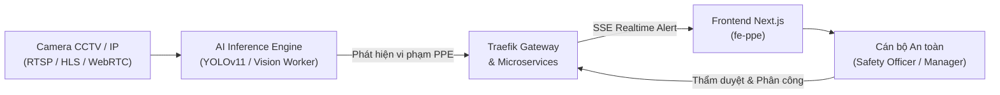
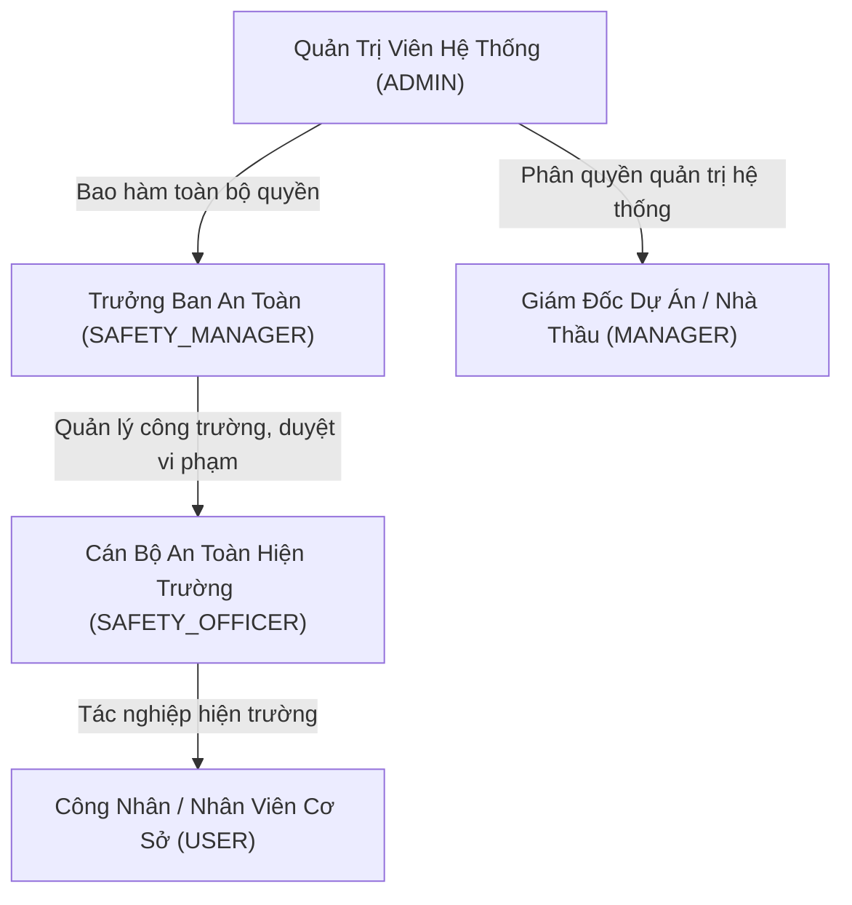
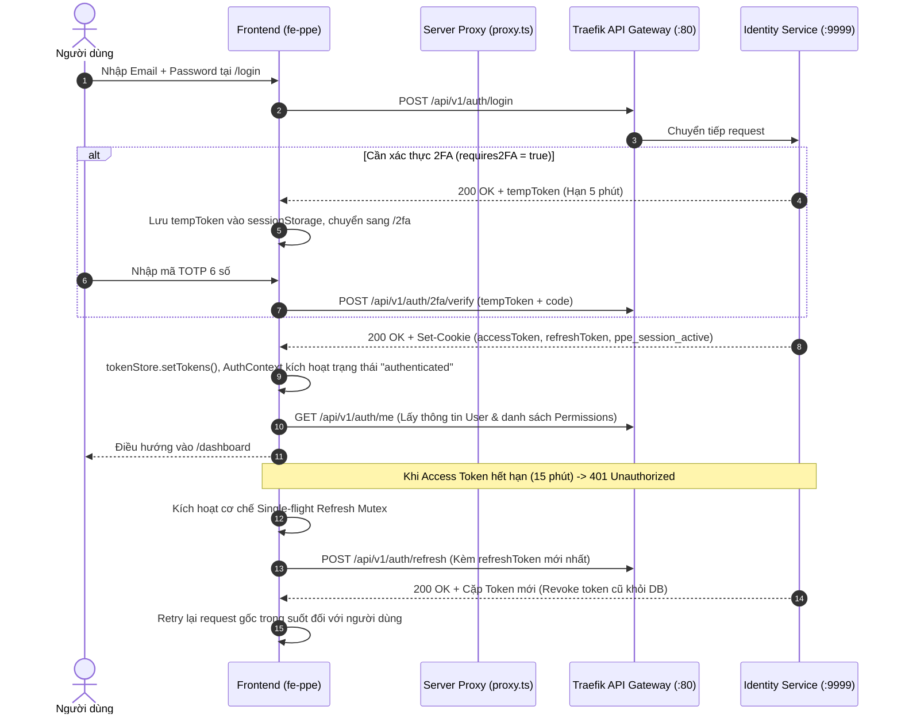
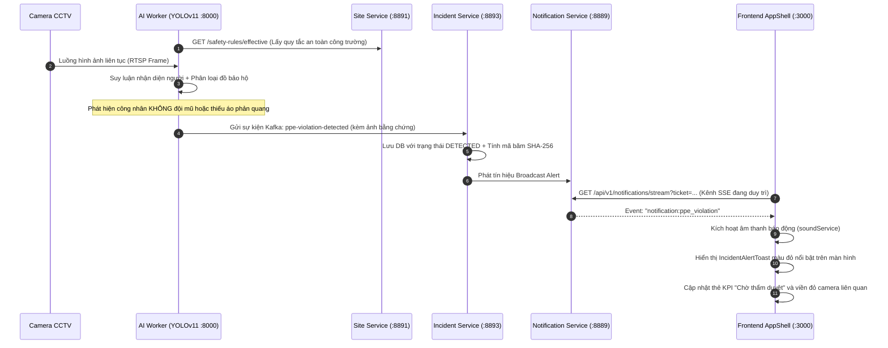
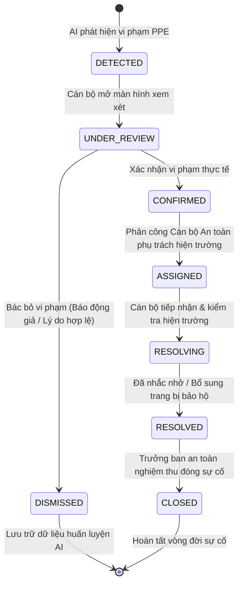
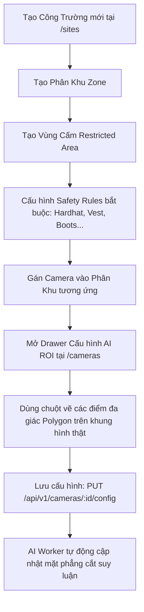
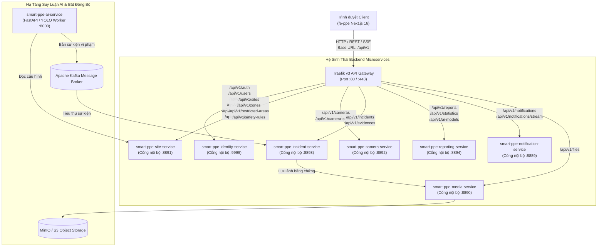

# TỔNG QUAN HỆ THỐNG GIÁM SÁT TRANG BỊ BẢO HỘ LAO ĐỘNG THÔNG MINH (SMART PPE MONITORING)
*Tài liệu kiểm thử & chuyển giao kỹ thuật* · *Phiên bản:* 1.0.0

---

## 1. MỤC TIÊU VÀ CÁC TÍNH NĂNG CỐT LÕI

Hệ thống **Smart PPE Monitoring System** là giải pháp phần mềm chuyên dụng hỗ trợ các nhà thầu xây dựng, ban chỉ huy an toàn công trường và doanh nghiệp công nghiệp giám sát tự động, liên tục và thời gian thực việc tuân thủ các quy định về Trang thiết bị Bảo hộ Cá nhân (Personal Protective Equipment - PPE) của người lao động tại các khu vực thi công rủi ro cao.

### 1.1. Các nhóm tính năng chính của hệ thống
1. **Giám sát Thị giác AI Thời gian thực (Real-time AI Vision Monitoring)**:
   - Tiếp nhận luồng video trực tiếp từ các camera an ninh tại công trường qua các giao thức HLS/RTSP/WebRTC.
   - Ứng dụng mô hình AI Deep Learning (YOLOv11/YOLOv8) để nhận diện người lao động và kiểm tra tức thời các trang thiết bị bảo hộ bắt buộc: Mũ bảo hộ (`HELMET`), Áo phản quang (`SAFETY_VEST`), Găng tay bảo hộ (`GLOVES`), Giày/Ủng bảo hộ (`BOOTS`), Kính bảo vệ mắt (`SAFETY_GLASSES`), và Dây an toàn trên cao (`SAFETY_HARNESS`).
   - Khoanh vùng nhận diện theo đa giác tùy chỉnh (AI ROI - Region of Interest Canvas) cho từng camera để loại trừ các khu vực công cộng ngoài ý muốn.

2. **Quản lý Vòng đời Sự cố Vi phạm (Incident Lifecycle Governance)**:
   - Tự động bắt giữ ảnh chụp bằng chứng (Evidence Snapshot) tại khung hình phát hiện vi phạm, lưu trữ trên Object Storage (MinIO/S3) và tính toán mã băm SHA-256 để chống làm giả hoặc can thiệp dữ liệu.
   - Quy trình thẩm duyệt khép kín 6 trạng thái: `DETECTED` (Mới phát hiện) $\rightarrow$ `UNDER_REVIEW` (Đang xem xét) $\rightarrow$ `CONFIRMED` (Xác nhận vi phạm) / `DISMISSED` (Bác bỏ / Báo động giả) $\rightarrow$ `RESOLVING` (Đang khắc phục) $\rightarrow$ `RESOLVED` (Đã xử lý) $\rightarrow$ `CLOSED` (Nghiệm thu đóng).
   - Phân công cán bộ an toàn phụ trách hiện trường, theo dõi thời gian xử lý trung bình (MTTR) và dòng sự kiện thảo luận (Incident Comments Timeline).

3. **Số hóa & Quản trị Không gian Công trường (Site Spatial Governance)**:
   - Quản trị đa công trường (`Sites`), phân khu thi công (`Zones`) và các khu vực giới hạn nguy hiểm cao (`Restricted Areas`).
   - Cấu hình quy chuẩn an toàn động (Safety Rules): Thiết lập các trang bị bảo hộ bắt buộc riêng biệt cho từng công trường hoặc kế thừa theo mặc định toàn hệ thống.

4. **Trung tâm Chỉ huy Điều hành & Cảnh báo Tức thời (Command Center & Realtime Hub)**:
   - Cơ chế Server-Sent Events (SSE) đẩy thông tin sự cố vi phạm tới trình duyệt trong vòng $<500\text{ms}$.
   - Phát âm thanh còi báo động khẩn cấp (`soundService`), hiển thị thẻ cảnh báo động đỏ viền neumorphic (`IncidentAlertToast`) và số đếm chưa đọc trên chuông thông báo.
   - Bảng điều khiển tích hợp mô hình 3D tương tác nón bảo hộ lao động (`HelmetShowcase` sử dụng Three.js/Fiber) và 4 bảng biểu đồ giám sát tác chiến theo giờ trong ngày.

5. **Phân tích Báo cáo An toàn & Đo lường Hiệu năng AI (Safety Analytics & AI Metrics)**:
   - Xuất báo cáo chuyên nghiệp định dạng PDF và Excel phục vụ thanh tra an toàn và nghiệm thu định kỳ.
   - Thống kê tỷ lệ tuân thủ PPE toàn dự án, ma trận phân bổ vi phạm, xếp hạng các camera điểm nóng có tần suất vi phạm cao.
   - Bảng điều khiển quản trị mô hình AI (Model Governance): Giám sát chỉ số mAP50, độ trễ suy luận (Latency ms), tốc độ xử lý khung hình (FPS), ma trận nhầm lẫn (Confusion Matrix Heatmap) và tính năng triển khai phiên bản mô hình trực tiếp từ giao diện.
   - Phòng thí nghiệm AI Sandbox: Kiểm thử suy luận trực tiếp với file video hoặc ảnh tải lên từ máy tính cá nhân.

6. **Bảo mật, Định danh & Quản trị Nền tảng (Identity, RBAC & Platform Ops)**:
   - Xác thực đa yếu tố (TOTP 2FA) qua ứng dụng Authenticator (Google Authenticator / Authy) kèm mã sao lưu khẩn cấp (Backup Codes).
   - Đăng nhập một chạm qua Google OAuth 2.0 và liên kết tài khoản mạng xã hội.
   - Phân quyền động đa tầng (Dynamic RBAC) trên 21 miền tài nguyên hệ thống.
   - Nhật ký kiểm toán an ninh (Audit Logs) truy vết mọi thao tác nhạy cảm, thay đổi cấu hình và lịch sử thẩm duyệt sự cố.
   - Quản lý chế độ bảo trì hệ thống (Maintenance Mode) với màn hình khóa toàn trang và cơ chế cho phép quản trị viên vượt rào (Maintenance Bypass).

---

## 2. VAI TRÒ NGƯỜI DÙNG VÀ CÁC PHÂN HỆ CHỨC NĂNG

### 2.1. Phân cấp 5 Vai trò Người dùng (User Roles)
Hệ thống thiết lập sẵn 5 vai trò theo quy chuẩn quản trị an toàn lao động:

| Tên vai trò (Role Name) | Ký hiệu mã | Trách nhiệm chính trong hệ thống | Phạm vi truy cập Frontend |
| :--- | :--- | :--- | :--- |
| **Quản Trị Viên Hệ Thống** | `ADMIN` | Toàn quyền kiểm soát hệ thống, tài khoản, vai trò, cấu hình hạ tầng, camera, mô hình AI, nhật ký kiểm toán và chế độ bảo trì. | Toàn bộ 31 màn hình giao diện. Không bị giới hạn bất kỳ tính năng nào. |
| **Trưởng Ban An Toàn** | `SAFETY_MANAGER` | Quản trị an toàn lao động: tạo công trường, camera, cấu hình quy tắc an toàn, thẩm duyệt vi phạm (Xác nhận/Bác bỏ), phân công cán bộ, xuất báo cáo tổng hợp. | Giám sát (`/dashboard`, `/incidents`, `/cameras`, `/sites`), Báo cáo (`/reports`, `/ai-metrics`), Thông báo và Cài đặt cá nhân. Bị ẩn menu Quản trị (`/users`, `/roles`, `/system`). |
| **Cán Bộ An Toàn** | `SAFETY_OFFICER` | Giám sát hiện trường thời gian thực, tiếp nhận sự cố được phân công, thực hiện khắc phục vi phạm, ghi nhận trao đổi, kiểm tra nhịp tim camera. | Xem Dashboard, danh sách sự cố, chi tiết sự cố được phân công, xem luồng camera trực tiếp, xem không gian công trường. Bị chặn quyền xóa dữ liệu và xuất báo cáo. |
| **Giám Đốc / Quản Lý** | `MANAGER` | Giám sát tổng thể hoạt động, quản lý nhân sự, xem thống kê báo cáo kiểm toán, cấu hình vận hành và kênh thông báo. | Quản lý người dùng (`/users`), xem vai trò (`/roles`), nhật ký kiểm toán (`/audit-logs`), cấu hình hệ thống (`/system`). |
| **Công Nhân / Nhân Viên** | `USER` | Người dùng cơ sở, xem thông tin tài khoản cá nhân, lịch sử thông báo gửi tới mình, cập nhật mật khẩu và bảo mật 2FA. | Chỉ truy cập Dashboard tổng quan (chế độ xem rút gọn), Thông báo (`/notifications`), Hồ sơ cá nhân (`/settings/profile`) và Bảo mật (`/settings/security`). |

---

### 2.2. Phân rã 4 Nhóm Phân Hệ Chức Năng (Navigation Groups)
Cấu trúc điều hướng thanh bên (`AppSidebar`) phân bổ các tính năng vào 4 nhóm nghiệp vụ chính:

```mermaid
flowchart TD
    Root["Hệ Thống Smart PPE"]
    
    Root --> G1["1. Nhóm Giám Sát (Monitoring)"]
    G1 --> G1_1["Bảng Điều Khiển Tổng Quan (/dashboard)"]
    G1 --> G1_2["Quản Lý Sự Cố Vi Phạm (/incidents)"]
    G1 --> G1_3["Hạ Tầng Camera & Tường Video (/cameras)"]
    G1 --> G1_4["Không Gian Công Trường (/sites)"]

    Root --> G2["2. Nhóm Phân Tích (Analytics)"]
    G2 --> G2_1["Báo Cáo An Toàn Lao Động (/reports)"]
    G2 --> G2_2["Đo Lường Hiệu Năng AI (/ai-metrics)"]
    G2 --> G2_3["Phòng Thí Nghiệm AI Sandbox (/ai-metrics/test)"]

    Root --> G3["3. Nhóm Quản Trị (Admin)"]
    G3 --> G3_1["Quản Lý Người Dùng (/users)"]
    G3 --> G3_2["Vai Trò & Phân Quyền (/roles)"]
    G3 --> G3_3["Nhật Ký Kiểm Toán (/audit-logs)"]
    G3 --> G3_4["Cấu Hình Tham Số Hệ Thống (/system)"]
    G3 --> G3_5["Chế Độ Bảo Trì Nền Tảng (/maintenance)"]

    Root --> G4["4. Nhóm Cá Nhân (Personal)"]
    G4 --> G4_1["Trung Tâm Thông Báo (/notifications)"]
    G4 --> G4_2["Hồ Sơ Cá Nhân (/settings/profile)"]
    G4 --> G4_3["Bảo Mật 2FA & Phiên (/settings/security)"]
```

---

## 3. CÁC LUỒNG NGHIỆP VỤ CỐT LÕI (CORE BUSINESS WORKFLOWS)

### 3.1. Luồng 1: Xác Thực, Phân Quyền & Duy Trì Phiên Làm Việc (Auth Flow)
Quy trình xác thực an toàn đảm bảo tính bảo mật cao, kết hợp giữa Access Token lưu trong bộ nhớ (In-memory) và Refresh Token tự động luân phiên (Rotation) qua Cookie HTTP-only:

---

### 3.2. Luồng 2: Phát Hiện Vi Phạm PPE & Đẩy Cảnh Báo Thời Gian Thực
Luồng dữ liệu thời gian thực từ camera công trường đến cán bộ an toàn qua kênh Server-Sent Events (SSE):

---

### 3.3. Luồng 3: Vòng Đời Thẩm Duyệt & Xử Lý Sự Cố Vi Phạm
Quy trình nghiệp vụ xử lý từ lúc sự cố được phát hiện cho tới khi được đóng và lưu trữ:

---

### 3.4. Luồng 4: Cấu Hình Không Gian & Vùng Quan Tâm AI (AI ROI Canvas)
Quy trình thiết lập vùng giám sát trọng yếu giúp camera AI tập trung vào khu vực thi công nguy hiểm:

---

## 4. KIẾN TRÚC HỆ THỐNG VÀ TƯƠNG TÁC FRONTEND – BACKEND

### 4.1. Bản Đồ Định Tuyến Traefik Gateway & 10 Backend Microservices
Hệ thống Frontend `fe-ppe` không gọi trực tiếp tới từng cổng nội bộ của các microservice mà giao tiếp tập trung thông qua **Traefik v3 API Gateway** tại cổng tiêu chuẩn (80/443). Gateway chịu trách nhiệm định tuyến theo tiền tố URL (Path Prefix):

### 4.2. Cấu Trúc Phân Tầng Ứng Dụng Frontend (`fe-ppe`)
Frontend được thiết kế theo mô hình phân tầng chặt chẽ (Clean Layered Architecture):

1. **Tầng Giao Diện Người Dùng (Presentation Layer)**:
   - Thư mục `app/`: Next.js 16 App Router segments, định nghĩa routes và layouts (`(public)` layout, `(auth)` layout).
   - Thư mục `src/components/ui/`: Thư viện Neumorphism Design System (Button, Card, Badge, Modal, Drawer, Table, StatsCard, Toaster, SegmentedControl, Skeleton).
   - Thư mục `src/components/features/`: Các component nghiệp vụ chuyên biệt gắn liền với từng domain (dashboard, incidents, cameras, sites, reports, ai-metrics, users, roles, system...).

2. **Tầng Trạng Thái & Quản Lý Dữ Liệu (State & Data Management Layer)**:
   - Thư mục `src/contexts/`: `AuthContext` (phiên đăng nhập), `SiteContext` (lưu trữ siteId đang chọn vào LocalStorage), `RealtimeContext` (lắng nghe SSE).
   - Thư mục `src/providers/`: Bọc ứng dụng với QueryClientProvider, ThemeProvider (Dark/Light Neumorphism), LocaleProvider (vi-VN / en-US), PrefetchProvider.
   - Thư mục `src/hooks/`: Đóng gói các hàm gọi `@tanstack/react-query` v5 (`useQuery`, `useMutation`), phân chia Query Keys rõ ràng theo chuẩn phân cấp (`domainKeys.all()`, `domainKeys.detail(id)`).

3. **Tầng Tích Hợp Dịch Vụ & Mạng (Service & Network Layer)**:
   - Thư mục `src/services/`: 13 file service đại diện cho các miền nghiệp vụ, chịu trách nhiệm gọi Axios và định nghĩa kiểu dữ liệu.
   - Thư mục `src/lib/axios.ts`: Axios instance trung tâm gắn Bearer token, xử lý refresh token single-flight chống nghẽn phiên, chuẩn hóa lỗi `ApiError` và tự động hiển thị thông báo lỗi hệ thống.
   - Thư mục `src/lib/token.ts`: Bộ lưu trữ Access Token trong bộ nhớ RAM, bảo vệ chống tấn công XSS.

4. **Tầng Định Nghĩa Kiểu & Hợp Đồng Dữ Liệu (Contract & Types Layer)**:
   - Thư mục `src/types/`: 13 file TypeScript interfaces & DTOs đồng bộ 100% với backend controllers, Prisma schemas và thư viện `smart-ppe-shared-contracts`.
