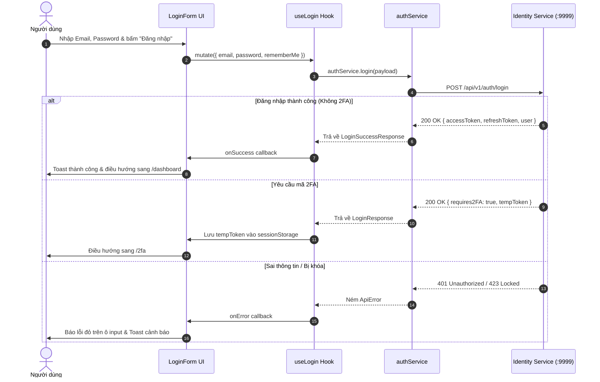

# TÀI LIỆU THIẾT KẾ GIAO DIỆN VÀ ĐẶC TẢ TƯƠNG TÁC UI (UI DESIGN DOCUMENTATION)
*Tài liệu kiểm thử chuyên sâu cho toàn bộ màn hình hệ thống Frontend `fe-ppe`* · *Phiên bản:* 1.0.0

---

## MỤC LỤC DANH MỤC MÀN HÌNH

### PHẦN I: NHÓM XÁC THỰC CÔNG KHAI & BẢO MẬT (PUBLIC AUTH & RECOVERY)
1. [Màn hình 1: Đăng nhập Hệ thống (`/login`)](#1-màn-hình-đăng-nhập-hệ-thống-login)
2. [Màn hình 2: Đăng ký Tài khoản Mới (`/register`)](#2-màn-hình-đăng-ký-tài-khoản-mới-register)
3. [Màn hình 3: Quên Mật khẩu (`/forgot-password`)](#3-màn-hình-quên-mật-khẩu-forgot-password)
4. [Màn hình 4: Đặt lại Mật khẩu Mới (`/reset-password`)](#4-màn-hình-đặt-lại-mật-khẩu-mới-reset-password)
5. [Màn hình 5: Xác thực Hai Yếu tố TOTP (`/2fa`)](#5-màn-hình-xác-thực-hai-yếu-tố-totp-2fa)
6. [Màn hình 6: Kích hoạt & Xác minh Email (`/verify-email`)](#6-màn-hình-kích-hoạt--xác-minh-email-verify-email)
7. [Màn hình 7: Xác nhận Vô hiệu hóa Tài khoản (`/verify-email/deactivate`)](#7-màn-hình-xác-nhận-vô-hiệu-hóa-tài-khoản-verify-emaildeactivate)
8. [Màn hình 8: Tiếp nhận Callback Google OAuth (`/auth/callback`)](#8-màn-hình-tiếp-nhận-callback-google-oauth-authcallback)
9. [Màn hình 9: Đổi Mật khẩu Bắt buộc / Định kỳ (`/change-password`)](#9-màn-hình-đổi-mật-khẩu-bắt-buộc--định-kỳ-change-password)

### PHẦN II: NHÓM GIÁM SÁT & AN TOÀN HIỆN TRƯỜNG (MONITORING & TACTICAL OPS)
10. [Màn hình 10: Bảng Điều khiển Tác chiến & Tổng quan (`/dashboard`)](#10-màn-hình-bảng-điều-khiển-tác-chiến--tổng-quan-dashboard)
11. [Màn hình 11: Quản lý & Điều phối Sự cố Vi phạm (`/incidents`)](#11-màn-hình-quản-lý--điều-phối-sự-cố-vi-phạm-incidents)
12. [Màn hình 12: Chi tiết Sự cố & Giám định Bằng chứng AI (`/incidents/[id]`)](#12-màn-hình-chi-tiết-sự-cố--giám-định-bằng-chứng-ai-incidentsid)
13. [Màn hình 13: Quản lý Camera & Tường Video Đa luồng (`/cameras`)](#13-màn-hình-quản-lý-camera--tường-video-đa-luồng-cameras)
14. [Màn hình 14: Trạm Thị giác AI Thời gian thực (`/cameras/[id]`)](#14-màn-hình-trạm-thị-giác-ai-thời-gian-thực-camerasid)
15. [Màn hình 15: Quản lý Không gian Công trường (`/sites`)](#15-màn-hình-quản-lý-không-gian-công-trường-sites)
16. [Màn hình 16: Trung tâm Điều hành Chi tiết Công trường (`/sites/[id]`)](#16-màn-hình-trung-tâm-điều-hành-chi-tiết-công-trường-sitesid)

### PHẦN III: NHÓM BÁO CÁO, PHÂN TÍCH & TRÍ TUỆ NHÂN TẠO (ANALYTICS & AI GOVERNANCE)
17. [Màn hình 17: Báo cáo & Phân tích An toàn Lao động (`/reports`)](#17-màn-hình-báo-cáo--phân-tích-an-toàn-lao-động-reports)
18. [Màn hình 18: Đo lường Hiệu năng & Quản trị Mô hình AI (`/ai-metrics`)](#18-màn-hình-đo-lường-hiệu-năng--quản-trị-mô-hình-ai-ai-metrics)
19. [Màn hình 19: Phòng Thí nghiệm Thử nghiệm AI Sandbox (`/ai-metrics/test`)](#19-màn-hình-phòng-thí-nghiệm-thử-nghiệm-ai-sandbox-ai-metricstest)

### PHẦN IV: NHÓM QUẢN TRỊ HỆ THỐNG & ĐỊNH DANH (SYSTEM ADMINISTRATION & RBAC)
20. [Màn hình 20: Quản lý Người dùng & Phiên Đăng nhập (`/users`)](#20-màn-hình-quản-lý-người-dùng--phiên-đăng-nhập-users)
21. [Màn hình 21: Vai trò & Ma trận Phân quyền Động (`/roles`)](#21-màn-hình-vai-trò--ma-trận-phân-quyền-động-roles)
22. [Màn hình 22: Nhật ký Kiểm toán Hệ thống (`/audit-logs`)](#22-màn-hình-nhật-ký-kiểm-toán-hệ-thống-audit-logs)
23. [Màn hình 23: Cấu hình Tham số Vận hành & Cờ Tính năng (`/system`)](#23-màn-hình-cấu-hình-tham-số-vận-hành--cờ-tính-năng-system)
24. [Màn hình 24: Quản trị Chế độ Bảo trì Nền tảng (`/maintenance`)](#24-màn-hình-quản-trị-chế-độ-bảo-trì-nền-tảng-maintenance)

### PHẦN V: NHÓM TRUNG TÂM CÁ NHÂN & KHUNG VẬN HÀNH (PERSONAL & APP SHELL)
25. [Màn hình 25: Trung tâm Thông báo & Mẫu Cảnh báo (`/notifications`)](#25-màn-hình-trung-tâm-thông-báo--mẫu-cảnh-báo-notifications)
26. [Màn hình 26: Cài đặt Hồ sơ Cá nhân (`/settings/profile`)](#26-màn-hình-cài-đặt-hồ-sơ-cá-nhân-settingsprofile)
27. [Màn hình 27: Cài đặt Bảo mật, 2FA, OAuth & Phiên (`/settings/security`)](#27-màn-hình-cài-đặt-bảo-mật-2fa-oauth--phiên-settingssecurity)
28. [Khung Ứng dụng Toàn cục & Thành phần Điều hướng (`AppShell`)](#28-khung-ứng-dụng-toàn-cục--thành-phần-điều-hướng-appshell)
29. [Màn hình Chặn Quyền Truy cập (`403 Forbidden`)](#29-màn-hình-chặn-quyền-truy-cập-403-forbidden)
30. [Màn hình Trang Không Tồn tại (`404 Not Found`)](#30-màn-hình-trang-không-tồn-tại-404-not-found)
31. [Màn hình Chế độ Bảo trì Toàn hệ thống (`MaintenanceScreen`)](#31-màn-hình-chế-độ-bảo-trì-toàn-hệ-thống-maintenancescreen)

---

# PHẦN I: NHÓM XÁC THỰC CÔNG KHAI & BẢO MẬT (PUBLIC AUTH & RECOVERY)

---

## 1. Màn hình Đăng nhập Hệ thống (`/login`)

### A. Screen Overview
- **Tên màn hình & Route**: Đăng nhập Hệ thống (`/login`).
- **Mục đích nghiệp vụ**: Cửa ngõ xác thực người dùng bằng Email/Mật khẩu hoặc Google OAuth 2.0; cấp phát phiên làm việc an toàn và chuyển tiếp theo vai trò.
- **Vai trò truy cập**: Người dùng công khai (Public / Unauthenticated). Người đã đăng nhập vào sẽ bị Route Guard lớp 1 (`proxy.ts`) và lớp 2 (`PublicGuard`) tự động chuyển tiếp về `/` (tương ứng `/dashboard`).
- **Màn hình liên quan**: `/register`, `/forgot-password`, `/2fa`, `/change-password`, `/dashboard`.

### B. Layout & Components
- **Bố cục tổng quan**: Bọc trong `AuthShell` với thiết kế Neumorphic bề mặt phẳng mềm, gồm tiêu đề ứng dụng, khẩu hiệu an toàn, biểu mẫu nhập liệu và liên kết chân trang.
- **UI Components & Trách nhiệm**:
  - `LoginForm` (`src/components/features/auth/forms/login-form.tsx`): Biểu mẫu đăng nhập chính sử dụng `react-hook-form` kết hợp `zodResolver`.
  - Ô nhập `email`: Kiểm tra định dạng email hợp lệ, hỗ trợ tự động điền email đã lưu (`REMEMBERED_EMAIL_KEY`).
  - Ô nhập `password`: Input bảo mật có nút ẩn/hiện mật khẩu (icon Eye/EyeOff).
  - Checkbox `rememberMe`: Ghi nhớ đăng nhập (lưu cookie `ppe_remember_me=1` hạn 30 ngày và `localStorage`).
  - Nút `Đăng nhập` (Submit Button): Biểu tượng ổ khóa, hiển thị spinner xoay khi đang gửi request.
  - Nút `Đăng nhập bằng Google` (Social OAuth): Chuyển hướng sang Google Identity Consent Screen.
  - Widget `TurnstileField`: Cloudflare Turnstile CAPTCHA chống tấn công dò quét brute-force (tự ẩn nếu thiếu `turnstileSiteKey`).

### C. UI States
- **Initial**: Hiển thị form trống hoặc điền sẵn email nếu người dùng từng tích chọn "Ghi nhớ". Nút submit khả dụng.
- **Loading**: Khi bấm submit, nút bị disabled, nhãn chuyển thành "Đang xử lý...", spinner quay tròn.
- **Success (Không có 2FA)**: Thông báo toast "Đăng nhập thành công", dọn sạch lỗi, điều hướng về param `?next=...` hoặc `/dashboard`.
- **Success (Có 2FA)**: Nhận phản hồi `{ requires2FA: true, tempToken }`, lưu `tempToken` vào `sessionStorage`, tự động điều hướng sang `/2fa`.
- **Error (Sai mật khẩu)**: Hiển thị thông báo lỗi dưới ô mật khẩu hoặc toast đỏ "Thông tin đăng nhập không chính xác".
- **Account Locked**: Thông báo "Tài khoản bị tạm khóa do nhập sai 5 lần. Vui lòng thử lại sau 15 phút".

### D. UI–Service–API Mapping
| UI Component | User Action | FE Hook/Function | Backend Service | Method | Endpoint | Request Data | Response Data | UI Behavior |
| :--- | :--- | :--- | :--- | :---: | :--- | :--- | :--- | :--- |
| `LoginForm` | Submit Form | `useLogin` / `authService.login` | Identity Service | `POST` | `/api/v1/auth/login` | `{ email, password, rememberMe, captchaToken }` | `{ accessToken, refreshToken, user, requires2FA?, tempToken? }` | Nếu requires2FA=true $\rightarrow$ chuyển `/2fa`. Ngược lại lưu token, cập nhật AuthContext, chuyển `/dashboard`. |
| `GoogleButton` | Click Đăng nhập Google | `authService.getGoogleUrl` | Identity Service | `GET` | `/api/v1/auth/google/url` | `{ redirectUri, state }` | `{ url: string }` | Chuyển hướng `window.location.href` sang đường dẫn Google OAuth. |
| `TurnstileField` | Tự động xác thực | Cloudflare API | Third-party | `POST` | `challenges.cloudflare.com` | `{ sitekey }` | `{ token }` | Cập nhật giá trị `captchaToken` vào form state. |

### E. Navigation & User Flows
- **Thành công**: `/login` $\rightarrow$ `/dashboard` (hoặc đường dẫn được chỉ định trong tham số query `?next=...`).
- **Yêu cầu 2FA**: `/login` $\rightarrow$ `/2fa` (mang theo `tempToken`).
- **Quên mật khẩu**: Bấm "Quên mật khẩu?" $\rightarrow$ `/forgot-password`.
- **Đăng ký**: Bấm "Đăng ký ngay" $\rightarrow$ `/register`.

### F. Interaction Diagram


---

## 2. Màn hình Đăng ký Tài khoản Mới (`/register`)

### A. Screen Overview
- **Tên màn hình & Route**: Đăng ký Tài khoản (`/register`).
- **Mục đích nghiệp vụ**: Cho phép nhân sự mới đăng ký tài khoản tham gia hệ thống giám sát an toàn.
- **Vai trò truy cập**: Khách công khai (Unauthenticated).
- **Màn hình liên quan**: `/login`, `/verify-email`.

### B. Layout & Components
- **Bố cục**: Neumorphic Box tập trung với các ô nhập: Họ và tên (`fullName`), Địa chỉ Email (`email`), Mật khẩu (`password`), Xác nhận mật khẩu (`confirmPassword`), Checkbox Điều khoản sử dụng.
- **Thành phần đặc biệt**: `PasswordChecklist` hiển thị trực quan các yêu cầu độ mạnh mật khẩu (Tối thiểu 8 ký tự, có chữ hoa, chữ thường, số và ký tự đặc biệt).

### C. UI States
- **Validation Error**: Báo đỏ tức thì khi mật khẩu không khớp hoặc email sai định dạng.
- **Submitting**: Nút đăng ký disabled kèm loader.
- **Success**: Hiển thị màn hình thông báo kiểm tra hòm thư kích hoạt hoặc chuyển tiếp sang `/verify-email?email=...`.

### D. UI–Service–API Mapping
| UI Component | User Action | FE Hook/Function | Backend Service | Method | Endpoint | Request Data | Response Data | UI Behavior |
| :--- | :--- | :--- | :--- | :---: | :--- | :--- | :--- | :--- |
| `RegisterForm` | Submit Đăng ký | `useRegister` / `authService.register` | Identity Service | `POST` | `/api/v1/auth/register` | `{ email, password, fullName }` | `{ message: string }` | Toast thông báo thành công, chuyển hướng người dùng sang `/verify-email?email=...`. |

### E. Navigation & User Flows
- Nhập thông tin $\rightarrow$ Submit thành công $\rightarrow$ Chuyển sang `/verify-email?email=...`.
- Đã có tài khoản $\rightarrow$ Click "Đăng nhập ngay" $\rightarrow$ Chuyển `/login`.

---

## 3. Màn hình Quên Mật khẩu (`/forgot-password`)

### A. Screen Overview
- **Tên màn hình & Route**: Quên Mật khẩu (`/forgot-password`).
- **Mục đích nghiệp vụ**: Tiếp nhận yêu cầu cấp lại mật khẩu qua email cho người dùng bị mất quyền truy cập.
- **Vai trò truy cập**: Public.

### B. Layout & Components
- `ForgotPasswordForm`: Nhập duy nhất trường `email`, nút "Gửi liên kết khôi phục", nút quay lại đăng nhập.

### C. UI States & D. Mapping
| UI Component | User Action | FE Hook/Function | Backend Service | Method | Endpoint | Request Data | Response Data | UI Behavior |
| :--- | :--- | :--- | :--- | :---: | :--- | :--- | :--- | :--- |
| `ForgotPasswordForm` | Gửi yêu cầu | `useForgotPassword` | Identity Service | `POST` | `/api/v1/auth/forgot-password` | `{ email }` | `{ message: string }` | Hiển thị thông báo hướng dẫn người dùng kiểm tra hộp thư email. |

---

## 4. Màn hình Đặt lại Mật khẩu Mới (`/reset-password`)

### A. Screen Overview
- **Tên màn hình & Route**: Đặt lại Mật khẩu (`/reset-password?token=...`).
- **Mục đích**: Nhận token từ liên kết email, cho phép nhập mật khẩu mới và xác nhận cập nhật.

### B. Layout & C. UI States
- Lấy token từ URL search param. Nếu thiếu token $\rightarrow$ Hiển thị cảnh báo lỗi liên kết không hợp lệ.
- Form gồm `newPassword`, `confirmPassword` và `PasswordChecklist`.

### D. UI–Service–API Mapping
| UI Component | User Action | FE Hook/Function | Backend Service | Method | Endpoint | Request Data | Response Data | UI Behavior |
| :--- | :--- | :--- | :--- | :---: | :--- | :--- | :--- | :--- |
| `ResetPasswordForm` | Xác nhận mật khẩu mới | `useResetPassword` | Identity Service | `POST` | `/api/v1/auth/reset-password` | `{ token, password }` | `{ message: string }` | Toast thành công, điều hướng về `/login`. |

---

## 5. Màn hình Xác thực Hai Yếu tố TOTP (`/2fa`)

### A. Screen Overview
- **Tên màn hình & Route**: Xác thực 2 bước (`/2fa`).
- **Mục đích**: Xác thực bước thứ 2 sau khi đăng nhập tài khoản có bật bảo mật TOTP.
- **Điều kiện tiên quyết**: Có `tempToken` được lưu tạm trong `sessionStorage` từ màn hình đăng nhập. Nếu truy cập trực tiếp không có `tempToken` $\rightarrow$ Tự động đá về `/login`.

### B. Layout & Components
- `TwoFactorForm`: Ô nhập mã OTP 6 số (hoặc mã sao lưu 10 ký tự), nút xác thực, nút "Sử dụng mã sao lưu", nút hủy quay lại đăng nhập.

### D. UI–Service–API Mapping
| UI Component | User Action | FE Hook/Function | Backend Service | Method | Endpoint | Request Data | Response Data | UI Behavior |
| :--- | :--- | :--- | :--- | :---: | :--- | :--- | :--- | :--- |
| `TwoFactorForm` | Nhập mã & Xác nhận | `useVerify2FA` | Identity Service | `POST` | `/api/v1/auth/2fa/verify` | `{ tempToken, code }` | `{ accessToken, refreshToken, user }` | Xóa tempToken khỏi sessionStorage, lưu token chính thức và điều hướng vào `/dashboard`. |

---

## 6. Màn hình Kích hoạt & Xác minh Email (`/verify-email`)

### A. Screen Overview
- **Route**: `/verify-email` hoặc `/verify-email?token=...`.
- **Mục đích**: Tự động gửi token kích hoạt lên backend nếu mở từ email; hoặc cho phép gửi lại email kích hoạt (`resendVerification`).

### D. UI–Service–API Mapping
| UI Component | User Action | FE Hook/Function | Backend Service | Method | Endpoint | Request Data | Response Data | UI Behavior |
| :--- | :--- | :--- | :--- | :---: | :--- | :--- | :--- | :--- |
| Auto-trigger / Link | Mở trang có token | `authService.verifyEmail` | Identity Service | `GET` | `/api/v1/auth/verify-email` | `?token=...` | `{ message: string }` | Hiển thị màn hình kích hoạt thành công + nút Đăng nhập. |
| `ResendButton` | Bấm gửi lại mã | `useResendVerification` | Identity Service | `POST` | `/api/v1/auth/resend-verification` | `{ email }` | `{ message: string }` | Toast thông báo đã gửi lại email thành công. |

---

## 7. Màn hình Xác nhận Vô hiệu hóa Tài khoản (`/verify-email/deactivate`)

### A. Screen Overview
- **Route**: `/verify-email/deactivate?token=...`.
- **Đặc thù kỹ thuật**: Thuộc nhóm public nhưng xử lý cho cả người dùng đang đăng nhập bấm link từ hòm thư cá nhân. Đã được cấu hình ngoại lệ (Exception) trong `proxy.ts` và `PublicGuard` để không bị redirect về `/`.
- **Tự động gọi**: `POST /api/v1/auth/deactivate/confirm` ngay khi component mount (có ref guard chống StrictMode duplicate call).
- **Thành công**: Xóa sạch toàn bộ token, revoke phiên làm việc, hiển thị màn hình thông báo tạm biệt an toàn.

---

## 8. Màn hình Tiếp nhận Callback Google OAuth (`/auth/callback`)

### A. Screen Overview
- **Route**: `/auth/callback?code=...&state=...`.
- **Chức năng kép**:
  1. *Chế độ Đăng nhập*: `state` khớp sessionStorage $\rightarrow$ Gọi `POST /api/v1/auth/google` $\rightarrow$ Nhận phiên $\rightarrow$ Chuyển `/dashboard` (hoặc `/2fa`).
  2. *Chế độ Liên kết*: `state` bắt đầu bằng `link:` $\rightarrow$ Người dùng đang đăng nhập liên kết Google từ Cài đặt bảo mật $\rightarrow$ Gọi `POST /api/v1/auth/social/link` $\rightarrow$ Chuyển về `/settings/security`.

---

## 9. Màn hình Đổi Mật khẩu Bắt buộc / Định kỳ (`/change-password`)

### A. Screen Overview
- **Route**: `/change-password`.
- **Cơ chế cưỡng chế (Forced Change)**: Khi `user.mustChangePassword === true` (tài khoản mới khởi tạo từ Admin hoặc chính sách mật khẩu hết hạn), Route Guard tầng 2 tại `AuthLayout` tự động giam người dùng ở màn hình này, chặn truy cập toàn bộ menu khác.
- **Thành công**: Backend tự động revoke toàn bộ Refresh Token của phiên hiện tại, xóa sạch phiên, ép người dùng đăng nhập lại bằng mật khẩu mới.

---

# PHẦN II: NHÓM GIÁM SÁT & AN TOÀN HIỆN TRƯỜNG (MONITORING & TACTICAL OPS)

---

## 10. Màn hình Bảng Điều khiển Tác chiến & Tổng quan (`/dashboard`)

### A. Screen Overview
- **Tên màn hình & Route**: Bảng Điều khiển Tác chiến Tổng quan (`/dashboard`).
- **Mục đích nghiệp vụ**: Trung tâm chỉ huy an toàn lao động, hiển thị các chỉ số KPI theo thời gian thực, mô hình tương tác 3D trang bị bảo hộ, danh sách cảnh báo vi phạm mới nhất, biểu đồ phân tích vi phạm và trạng thái sức khỏe mô hình AI.
- **Vai trò truy cập**: Mở cho mọi người dùng đã xác thực. Tuy nhiên, các khối nội dung bên trong được phân quyền hiển thị theo quyền chi tiết:
  - Khối Báo cáo & Xếp hạng: Yêu cầu `PPE_REPORTING_READ`.
  - Nút Xuất báo cáo nhanh: Yêu cầu `PPE_REPORTING_EXPORT`.
  - Khối Cảnh báo vi phạm & Thẩm duyệt: Yêu cầu `PPE_INCIDENT_READ` & `PPE_INCIDENT_REVIEW`.
  - Khối Trạng thái AI: Yêu cầu `PPE_AI_METRICS_READ` hoặc `PPE_MODEL_READ`.
- **Màn hình liên quan**: `/incidents`, `/cameras`, `/sites`, `/reports`, `/ai-metrics`.

### B. Layout & Components
```
┌────────────────────────────────────────────────────────────────────────────┐
│ PageHeader: Tiêu đề, Badge Trực tiếp (SSE), Bộ lọc Site, Nút Xuất Báo Cáo  │
├────────────────────────────────────────────────────────────────────────────┤
│ 3D HelmetShowcase: Mô hình 3D Nón Bảo Hộ tương tác góc xoay (Three.js)    │
├────────────────────────────────────────────────────────────────────────────┤
│ DashboardKpiRibbon: [Tổng vi phạm] [Tỷ lệ tuân thủ %] [Camera] [Công trường]│
├──────────────────────────────────────┬─────────────────────────────────────┤
│ Cột Trái (7 phần):                   │ Cột Phải (5 phần):                  │
│ • DashboardLiveIncidents             │ • Segmented Switcher (Donut/Hotspot)│
│   - Danh sách vi phạm mới nhất       │ • ReportViolationDonut: Tỷ lệ đồ PPE│
│   - Nút Thẩm duyệt nhanh             │ • ReportCameraRanking: Top camera   │
│   - Highlight đỏ khi có SSE vi phạm  │ • DashboardAiStatusCard: YOLO mAP50 │
├──────────────────────────────────────┴─────────────────────────────────────┤
│ DashboardOperationalSuite: 4 Biểu đồ phân tích vận hành theo giờ thi công │
└────────────────────────────────────────────────────────────────────────────┘
```

- **Các Modal tích hợp**:
  - `ReviewIncidentModal`: Mở nhanh khi bấm "Thẩm duyệt" trên danh sách vi phạm.
  - `GenerateReportModal`: Mở khi bấm nút "Xuất báo cáo" trên thanh Header.

### C. UI States
- **Initial Loading**: Hiển thị khung Skeleton cho toàn bộ Ribbon KPI, 3D Canvas và Biểu đồ.
- **Realtime Alert State**: Khi nhận sự kiện SSE `notification:ppe_violation`, thẻ vi phạm mới được chèn lên đầu danh sách với hiệu ứng viền đỏ phát sáng Neumorphic (`ring-2 ring-danger animate-pulse`), âm thanh cảnh báo tự động phát.
- **Empty State**: Khi công trường không có vi phạm nào, hiển thị biểu tượng lá chắn xanh cùng thông điệp "Khu vực thi công đang được bảo vệ an toàn 100%".

### D. UI–Service–API Mapping
| UI Component | User Action | FE Hook/Function | Backend Service | Method | Endpoint | Request Data | Response Data | UI Behavior |
| :--- | :--- | :--- | :--- | :---: | :--- | :--- | :--- | :--- |
| `PageHeader` | Chọn Công trường | `SiteContext.setSiteId` | Local Storage | N/A | Cục bộ | `{ siteId }` | N/A | Tự động làm mới cache toàn bộ query có gán `siteId`. |
| `DashboardKpiRibbon` | Tải trang / Render | `useReportSummary` | Reporting Service | `GET` | `/api/v1/statistics/summary` | `?siteId=...` | `{ totalViolations, complianceRate, openIncidents, activeCameras }` | Điền số liệu vào 4 thẻ chỉ số KPI tổng quan. |
| `ReportViolationDonut`| Chuyển tab Donut | `useViolationDistribution` | Reporting Service | `GET` | `/api/v1/statistics/by-violation` | `?siteId=...` | `Array<{ type, count, percentage }>` | Vẽ biểu đồ vành khăn tỷ lệ thiếu mũ, áo, ủng... |
| `ReportCameraRanking`| Chuyển tab Hotspots | `useCameraRankings` | Reporting Service | `GET` | `/api/v1/statistics/by-camera` | `?siteId=...&limit=5` | `Array<{ cameraId, cameraName, violationCount }>` | Hiển thị bảng thanh xếp hạng camera vi phạm nhiều nhất. |
| `DashboardLiveIncidents`| Tải danh sách vi phạm| `useIncidents` | Incident Service | `GET` | `/api/v1/incidents` | `?limit=6&sortBy=createdAt&order=desc` | `{ items: IncidentItem[], meta }` | Hiển thị danh sách thẻ vi phạm mới nhất có ảnh thumbnail. |
| `ReviewModal` | Xác nhận / Bác bỏ | `useReviewIncident` | Incident Service | `POST` | `/api/v1/incidents/:id/review` | `{ action: "CONFIRM"\|"DISMISS", note }` | `{ success: true }` | Toast thông báo, đóng modal, chuyển trạng thái sự cố sang CONFIRMED / DISMISSED. |
| `DashboardAiStatusCard`| Tải thông tin Model | `useActiveModelVersion` | Reporting Service | `GET` | `/api/v1/ai-models/active` | None | `{ name, version, mAP50, latencyMs, fps }` | Cập nhật nhịp tim và độ chính xác mô hình YOLO. |
| `ExportReportButton` | Submit xuất báo cáo | `useGenerateReport` | Reporting Service | `POST` | `/api/v1/reports/export` | `{ templateId, siteId, format, from, to }` | `{ jobId, downloadUrl }` | Khởi động tác vụ xuất báo cáo, tải file tự động. |

---

## 11. Màn hình Quản lý & Điều phối Sự cố Vi phạm (`/incidents`)

### A. Screen Overview
- **Tên màn hình & Route**: Quản lý Sự cố Vi phạm (`/incidents`).
- **Mục đích nghiệp vụ**: Phân loại, tìm kiếm, lọc đa tiêu chí, thẩm duyệt hàng loạt và điều phối cán bộ an toàn xử lý các sự cố không tuân thủ PPE.
- **Quyền truy cập bắt buộc**: `PPE_INCIDENT_READ`.
- **Màn hình liên quan**: `/incidents/[id]`, `/dashboard`, `/cameras`.

### B. Layout & Components
- `IncidentKpiSummary`: 4 thẻ Bento KPI (Tổng số vi phạm, Chờ thẩm duyệt, Đang xử lý, Vi phạm khẩn cấp). Click vào thẻ sẽ đồng bộ URL param `?stat=...` và kích hoạt bộ lọc tương ứng.
- `IncidentFilterToolbar`: Bộ lọc đa năng (Lọc theo Công trường, Phân khu, Trạng thái vòng đời, Mức độ nghiêm trọng `CRITICAL/HIGH/MEDIUM/LOW`, Loại vi phạm `NO_HELMET/NO_VEST...`, Khoảng ngày, và Ô tìm kiếm debounced 300ms).
- `IncidentTable`: Bảng dữ liệu Neumorphic hiển thị ảnh thumbnail, mã sự cố, vị trí (Site/Zone/Camera), loại vi phạm, mức độ nguy hiểm (Badge đổi màu), trạng thái và nút tác vụ ngữ cảnh.
- **Các Modal thao tác**:
  - `ReviewIncidentModal`: Thẩm duyệt xác nhận hoặc bác bỏ vi phạm.
  - `AssignIncidentModal`: Phân công cán bộ phụ trách từ danh sách người dùng.
  - `ResolveIncidentModal`: Ghi nhận giải pháp khắc phục.
  - `CloseIncidentDialog`: Nghiệm thu đóng sự cố an toàn.

### D. UI–Service–API Mapping
| UI Component | User Action | FE Hook/Function | Backend Service | Method | Endpoint | Request Data | Response Data | UI Behavior |
| :--- | :--- | :--- | :--- | :---: | :--- | :--- | :--- | :--- |
| `IncidentTable` | Đổi trang / Lọc | `useIncidents` | Incident Service | `GET` | `/api/v1/incidents` | `?page&limit&status&severity&type&siteId&search` | `{ items: IncidentItem[], meta: PaginationMeta }` | Cập nhật bảng dữ liệu, đổi trang mượt mà không reload. |
| `AssignIncidentModal` | Phân công cán bộ | `useAssignOfficer` | Incident Service | `POST` | `/api/v1/incidents/:id/assignments` | `{ assignedToUserId, notes, deadline }` | `{ id, incidentId, assignedTo }` | Đóng modal, toast thành công, trạng thái sự cố đổi thành ASSIGNED. |
| `IncidentTable` (Xóa) | Xóa sự cố rác | `useDeleteIncident` | Incident Service | `DELETE` | `/api/v1/incidents/:id` | None | `{ message: string }` | Xóa bản ghi khỏi danh sách, invalidate cache. |

---

## 12. Màn hình Chi tiết Sự cố & Giám định Bằng chứng AI (`/incidents/[id]`)

### A. Screen Overview
- **Tên màn hình & Route**: Chi tiết Sự cố & Giám định Bằng chứng (`/incidents/[id]`).
- **Mục đích**: Hồ sơ pháp lý hoàn chỉnh của một vụ vi phạm an toàn lao động. Cung cấp bộ bằng chứng thị giác kép (Dual-Snapshot), khung nhận diện Bounding Box chuẩn hóa dạng toán học `[0..1]` co giãn đa độ phân giải, quy trình xử lý 6 bước, thông tin cán bộ phụ trách, dòng thảo luận hiện trường và tính năng kiểm tra tính toàn vẹn bằng chứng bằng mã băm SHA-256.

### B. Layout & Components
- `IncidentLifecycleStepper`: Trục 6 bước trực quan hóa tiến trình vòng đời vi phạm (`DETECTED` $\rightarrow$ `UNDER_REVIEW` $\rightarrow$ `CONFIRMED` $\rightarrow$ `ASSIGNED` $\rightarrow$ `RESOLVING` $\rightarrow$ `RESOLVED` $\rightarrow$ `CLOSED`).
- `IncidentEvidenceViewer`: Trình chiếu bộ bằng chứng thị giác kép chuẩn hóa:
  - **Ảnh vi phạm (`SNAPSHOT`)**: Khung hình bắt giữ tại giây T phát hiện vi phạm thực tế, vẽ khung Bounding Box màu đỏ xung quanh vùng cơ thể thiếu bảo hộ (Mũ, Áo...) hoặc vị trí bước chân vào vùng cấm.
  - **Ảnh đối chứng (`REFERENCE_SNAPSHOT`)**: Khung hình tại thời điểm T=0 (khởi tạo luồng) hoặc khung hình khi công nhân tuân thủ đầy đủ trang bị, dùng để đối chiếu chứng minh hành vi vi phạm.
  - **Chuẩn hóa Tọa độ Normalized Bounding Box `[0..1]`**: Khắc phục triệt để lỗi lệch box do khác biệt độ phân giải màn hình hoặc tỷ lệ khung hình. Tọa độ lưu dạng `[ymin, xmin, ymax, xmax]` tương đối, tự động scale khớp 100% trên mọi kích thước ảnh.
  - **Loại bỏ hoàn toàn cơ chế Hardcode**: Không còn fallback ảnh camera cũ `01a19ce7` hay tọa độ phần trăm tĩnh. Mọi dữ liệu trích xuất trực tiếp từ trường `metadata.aiDetections` trong CSDL backend.
- `IncidentChecksumVerifier`: Công cụ kiểm tra mã băm SHA-256 đối chiếu trực tiếp giữa file trên Object Storage và bản ghi trong Database nhằm đảm bảo bằng chứng không bị chỉnh sửa giả mạo.
- `IncidentMetaCard` & `IncidentAssignmentCard`: Thông tin vị trí công trường, phân khu, loại vi phạm (`ViolationType`), mức độ nghiêm trọng (`SeverityLevel`), mốc thời gian và cán bộ được giao nhiệm vụ.
- `IncidentCommentsTimeline`: Khung trao đổi thảo luận hiện trường kèm chức năng gửi bình luận và mốc thời gian chi tiết.

### D. UI–Service–API Mapping
| UI Component | User Action | FE Hook/Function | Backend Service | Method | Endpoint | Request Data | Response Data | UI Behavior |
| :--- | :--- | :--- | :--- | :---: | :--- | :--- | :--- | :--- |
| Trình tải trang | Render chi tiết | `useIncidentDetail` | Incident Service | `GET` | `/api/v1/incidents/:id` | None | `IncidentItem` | Điền thông tin toàn diện vào stepper, thẻ meta, danh sách evidence và metadata AI. |
| `EvidenceViewer` | Lấy link tải ảnh SNAPSHOT | `incidentService.getEvidenceDownloadUrl`| Incident Service | `GET` | `/api/v1/evidences/:id/download-url` | None | `{ downloadUrl: string }` | Render ảnh vi phạm từ MinIO qua Pre-signed URL an toàn. |
| `EvidenceViewer` | Lấy link ảnh REFERENCE | `incidentService.getEvidenceDownloadUrl`| Incident Service | `GET` | `/api/v1/evidences/:refId/download-url` | None | `{ downloadUrl: string }` | Render ảnh đối chứng T=0 để so sánh song song. |
| `ChecksumVerifier` | Bấm kiểm tra băm | `useEvidenceIntegrity` | Incident Service | `GET` | `/api/v1/evidences/:id/verify-checksum` | None | `{ valid: boolean, calculatedChecksum, storedChecksum }` | Hiển thị huy hiệu xanh "Bằng chứng toàn vẹn 100%" hoặc đỏ "Cảnh báo sai lệch mã băm". |
| `CommentsTimeline` | Gửi bình luận mới | `useAddIncidentComment`| Incident Service | `POST` | `/api/v1/incidents/:id/comments` | `{ comment: string }` | `IncidentCommentItem` | Chèn bình luận vào dòng thời gian tức thì. |

---

## 13. Màn hình Quản lý Camera & Tường Video Đa luồng (`/cameras`)

### A. Screen Overview
- **Route**: `/cameras`.
- **Mục đích**: Quản lý vòng đời thiết bị ghi hình tại công trường, kiểm tra đường truyền và giám sát tường video trực tiếp nhiều luồng cùng lúc (Video Wall).
- **Quyền truy cập**: `PPE_CAMERA_READ` (Xem), `PPE_CAMERA_MANAGE` (Thêm/Sửa/Xóa/ROI).

### B. Layout & 3 Chế độ Xem (View Modes)
1. **Chế độ Lưới (`grid`)**: Thẻ card Neumorphic cho từng camera, có ảnh xem trước luồng, trạng thái kết nối (`ONLINE`/`OFFLINE`), độ trễ Ping ms và nút mở xem nhanh.
2. **Chế độ Bảng (`table`)**: Quản lý chi tiết địa chỉ RTSP/HLS/YouTube, vị trí phân khu, độ phân giải, FPS và các nút sửa/xóa/đo nhịp tim.
3. **Chế độ Tường Video (`wall`)**: Trình chiếu đồng thời nhiều camera theo bố cục ma trận linh hoạt (`1x1`, `2x2`, `3x3`), tự động tái kết nối luồng khi mạng chập chờn.

### C. Các Drawer & Modal chuyên sâu
- `CameraRoiDrawer` & `CameraRoiCanvas`: Cho phép người quản lý dùng chuột vẽ các đỉnh đa giác (Polygon ROI) trực tiếp trên khung hình camera để khoanh vùng khu vực AI cần quét PPE.
- `CameraHealthDialog`: Kiểm tra nhịp tim thời gian thực, đo độ trễ Ping thực tế đến thiết bị camera và xem nhật ký lỗi kết nối.

### D. UI–Service–API Mapping
| UI Component | User Action | FE Hook/Function | Backend Service | Method | Endpoint | Request Data | Response Data | UI Behavior |
| :--- | :--- | :--- | :--- | :---: | :--- | :--- | :--- | :--- |
| `CameraToolbar` | Tạo Camera mới | `useCreateCamera` | Camera Service | `POST` | `/api/v1/cameras` | `CreateCameraPayload` | `CameraItem` | Đóng modal, hiển thị camera mới trên danh sách. |
| `CameraRoiCanvas` | Lưu vùng đa giác ROI | `cameraService.updateCameraConfig` | Camera Service | `PUT` | `/api/v1/cameras/:id/config` | `{ roiPolygon: Point[] }` | `{ success: true }` | Lưu cấu hình vùng quét AI cho camera, thông báo thành công. |
| `HealthDialog` | Bấm Ping kiểm tra | `cameraService.pingCamera` | Camera Service | `POST` | `/api/v1/cameras/:id/ping` | None | `{ status: "ONLINE"\|"OFFLINE", latencyMs }` | Hiển thị kết quả độ trễ đường truyền ngay lập tức. |

---

## 14. Màn hình Trạm Thị giác AI Thời gian thực (`/cameras/[id]`)

### A. Screen Overview
- **Route**: `/cameras/[id]`.
- **Mục đích**: Trạm giám sát chuyên sâu 1 camera đơn lẻ. Tích hợp player phát video trực tiếp kèm lớp phủ đồ họa (Canvas Overlay) vẽ Bounding Boxes bám vết người lao động và đồ bảo hộ theo thời gian thực từ Engine AI.
- **Tính năng nổi bật**:
  - `CameraIntelligencePlayer`: Canvas 2D vẽ khung nhận diện màu sắc theo chuẩn an toàn (Xanh lá = Đầy đủ bảo hộ, Đỏ = Đang vi phạm, Vàng = Đang cảnh báo).
  - `CameraTelemetryTables`: Bảng số liệu suy luận trực tiếp (FPS thực tế, thời gian trễ mili-giây, số lượng người trong khung hình, danh sách sự kiện vi phạm vừa phát hiện).
  - **Bảng "Tóm tắt theo người (có mũ / có áo theo từng frame)" (`WorkerComplianceSummaryTable`)**:
    - Thống kê toàn bộ quá trình tuân thủ bảo hộ của từng công nhân (`Track ID`) qua toàn bộ các khung hình video.
    - Chuyển đổi sang thành phần bảng dùng chung `DataTable` Neumorphic.
    - **Phân trang hoàn chỉnh (Pagination)**: Hỗ trợ chuyển trang, chọn số lượng bản ghi hiển thị (5, 10, 20, 50 dòng/trang).
    - **Bộ lọc & Tìm kiếm**: Tìm kiếm theo mã nhận diện công nhân (`Track ID`), lọc theo loại trang bị (`Có Mũ / Không Mũ`, `Có Áo / Không Áo`, `Xâm nhập Vùng Cấm`).
    - **Sắp xếp linh hoạt**: Sắp xếp theo tỷ lệ tuân thủ %, số lần cảnh báo, hoặc thời điểm xuất hiện đầu tiên.
  - **Hỗ trợ Đa Nguồn Video Bất Kỳ (YouTube & RTSP)**: Cơ chế nạp video YouTube mới trích xuất frame qua Backend AI Ingestion Service, loại bỏ hoàn toàn hạn chế bảo mật cùng nguồn (CORS Iframe) của trình duyệt. Không còn bị lệch khung nhận diện khi nạp bất kỳ URL video mới nào.

---

## 15. Màn hình Quản lý Không gian Công trường (`/sites`)

### A. Screen Overview
- **Route**: `/sites`.
- **Mục đích**: Quản lý danh mục các dự án xây dựng/công trường thi công, phân khu làm việc và thiết lập chính sách an toàn.
- **Quyền truy cập**: `PPE_SITE_READ` (Xem), `PPE_SITE_MANAGE` (Thêm/Sửa/Xóa/Cấu hình).

### B. Layout & Components
- `SiteKpiSummary`: 4 thẻ đo lường (Tổng số công trường, Tổng số phân khu Zone, Vùng cấm nguy hiểm, Tỷ lệ tuân thủ trung bình).
- `SiteTable` & `SiteCardGrid`: Hiển thị danh sách công trường kèm badge trạng thái (`ACTIVE`, `INACTIVE`, `COMPLETED`, `ARCHIVED`).
- `SiteSafetyConfigModal`: Thiết lập các trang bị bảo hộ bắt buộc (`requiredPPE: ["HARD_HAT", "SAFETY_VEST", "BOOTS"...]`), ngưỡng tin cậy AI (`minConfidenceScore`), và phiên bản mô hình AI áp dụng cho riêng công trường này.
- `SiteZonesDrawer`: Quản lý danh sách các phân khu (`Zones`) và khu vực giới hạn nguy cơ sập đổ/nguy hiểm cao (`Restricted Areas`) trực thuộc công trường.

---

## 16. Màn hình Trung tâm Điều hành Chi tiết Công trường (`/sites/[id]`)

### A. Screen Overview
- **Route**: `/sites/[id]`.
- **Mục đích**: Bảng chỉ huy tác chiến riêng biệt cho từng công trường cụ thể.
- **Bố cục 6 Tabs chức năng**:
  1. `site-spatial-zones-tab`: Sơ đồ các phân khu và công cụ **Khoanh Vùng Cấm Đa Giác Bằng Chuột (Restricted Area Polygon Canvas)**:
     - Cho phép chọn camera bất kỳ trong công trường làm nền quan sát.
     - Click chuột trực tiếp trên khung hình video để đánh dấu các đỉnh đa giác khoanh vùng khu vực nguy hiểm cao (hố đào sâu, khu vực cẩu tháp, trạm biến áp).
     - Lưu tọa độ đa giác `polygonCoordinates: Point[]` trực tiếp vào CSDL backend, tự động đồng bộ sang AI Service để giám sát vi phạm `RESTRICTED_AREA`.
  2. `site-live-cameras-tab`: Các camera đang hoạt động trong công trường.
  3. `site-safety-rules-tab`: Cấu hình quy tắc an toàn đặc thù áp dụng tại công trường.
  4. `site-incidents-tab`: Lịch sử các vi phạm an toàn xảy ra tại công trường này.
  5. `site-personnel-tab`: Danh sách cán bộ an toàn phụ trách.
  6. `site-analytics-tab`: Biểu đồ xu hướng vi phạm và tỷ lệ tuân thủ theo thời gian của riêng công trường.
  6. `site-analytics-tab`: Biểu đồ xu hướng vi phạm và tỷ lệ tuân thủ theo thời gian của riêng công trường.

---

# PHẦN III: NHÓM BÁO CÁO, PHÂN TÍCH & TRÍ TUỆ NHÂN TẠO (ANALYTICS & AI GOVERNANCE)

---

## 17. Màn hình Báo cáo & Phân tích An toàn Lao động (`/reports`)

### A. Screen Overview
- **Route**: `/reports`.
- **Mục đích**: Phân tích dữ liệu tuân thủ trang bị an toàn, tạo mẫu báo cáo định kỳ (Ngày/Tuần/Tháng/Quý) và xuất file dữ liệu phục vụ thanh tra.
- **Quyền truy cập**: `PPE_REPORTING_READ` (Xem), `PPE_REPORTING_EXPORT` (Xuất file PDF/Excel).

### B. Layout & Components
- `ReportTrendChart`: Biểu đồ đường thể hiện xu hướng vi phạm an toàn theo thời gian (hỗ trợ nhóm theo `DAY`, `WEEK`, `MONTH`).
- `ReportViolationDonut`: Biểu đồ hình tròn phân loại vi phạm chiếm tỷ trọng cao nhất.
- `ReportCameraRanking`: Xếp hạng các camera ghi nhận nhiều lỗi nhất.
- `ReportTemplateCards`: Danh sách các mẫu báo cáo cấu hình sẵn (Báo cáo vi phạm tổng hợp, Báo cáo hiệu suất camera, Báo cáo tuân thủ nhà thầu).
- `ReportHistoryTable`: Lịch sử các lần xuất báo cáo, tiến độ xử lý và nút tải file về máy.
- `GenerateReportModal`: Hộp thoại thiết lập thông số xuất file: Chọn Mẫu, Chọn Công trường, Định dạng xuất (`PDF` / `EXCEL`), Khoảng ngày.

### D. UI–Service–API Mapping
| UI Component | User Action | FE Hook/Function | Backend Service | Method | Endpoint | Request Data | Response Data | UI Behavior |
| :--- | :--- | :--- | :--- | :---: | :--- | :--- | :--- | :--- |
| `ReportTrendChart` | Đổi mốc thời gian | `useViolationTrends` | Reporting Service | `GET` | `/api/v1/statistics/trends` | `?siteId&groupBy=DAY&from&to` | `Array<TrendItemDto>` | Cập nhật các cột mốc trên biểu đồ đường. |
| `GenerateReportModal`| Bấm "Xuất file" | `useGenerateReport` | Reporting Service | `POST` | `/api/v1/reports/export` | `GenerateReportDto` | `{ id, fileUrl, status }` | Thêm một tác vụ vào bảng lịch sử, tự động tải xuống khi hoàn thành. |
| `ReportHistoryTable`| Tải lại file cũ | `reportingService.downloadReportContent`| Reporting Service | `GET` | `/api/v1/reports/:id/content` | None | `Blob (application/pdf)` | Kích hoạt lưu file trực tiếp vào thư mục Downloads của máy tính. |

---

## 18. Màn hình Đo lường Hiệu năng & Quản trị Mô hình AI (`/ai-metrics`)

### A. Screen Overview
- **Route**: `/ai-metrics`.
- **Mục đích**: Đảm bảo tính minh bạch và độ tin cậy của thuật toán thị giác AI. Theo dõi chỉ số độ chính xác mAP50, thời gian suy luận (Inference Latency), ma trận nhầm lẫn và quản lý triển khai các phiên bản mô hình YOLO.
- **Quyền truy cập**: `PPE_AI_METRICS_READ` hoặc `PPE_MODEL_READ`.

### B. Layout & Components
- `ActiveModelBanner`: Hiển thị phiên bản mô hình đang hoạt động trên hệ thống (Ví dụ: `YOLOv11x-PPE v2.4`), ngày kích hoạt và tác giả triển khai.
- `AiMetricsKpiSummary`: 4 chỉ số vàng AI: Độ chuẩn xác trung bình `mAP@0.5`, Độ trễ suy luận trung bình `ms`, Tốc độ xử lý `FPS`, và Tổng số lượt suy luận (Inference Samples).
- `ConfusionMatrixHeatmap`: Bản đồ nhiệt ma trận nhầm lẫn giữa các lớp đối tượng (`Helmet`, `No-Helmet`, `Vest`, `No-Vest`, `Person`).
- `LatencyChartCard`: Biểu đồ phân bổ độ trễ suy luận AI theo thời gian.
- `ModelGovernanceTable`: Danh sách tất cả các phiên bản mô hình đã đăng ký trong Registry kèm nút "Triển khai" (`DeployModelDialog`).

### D. UI–Service–API Mapping
| UI Component | User Action | FE Hook/Function | Backend Service | Method | Endpoint | Request Data | Response Data | UI Behavior |
| :--- | :--- | :--- | :--- | :---: | :--- | :--- | :--- | :--- |
| `ActiveBanner` | Tải trang | `useActiveModelVersion` | Reporting Service | `GET` | `/api/v1/ai-models/active` | None | `AiModelVersionDto` | Hiển thị thẻ mô hình đang chạy thực tế. |
| `DeployModelDialog` | Xác nhận đổi Version | `useDeployModelVersion` | Reporting Service | `POST` | `/api/v1/ai-models/:id/deploy` | None | `AiModelVersionDto` | Cập nhật phiên bản mới, tự động xóa cache quy tắc an toàn của các camera. |

---

## 19. Màn hình Phòng Thí nghiệm Thử nghiệm AI Sandbox (`/ai-metrics/test`)

### A. Screen Overview
- **Route**: `/ai-metrics/test`.
- **Mục đích**: Cung cấp môi trường kiểm thử hộp cát (Sandbox) độc lập hoàn toàn cho Kỹ sư và Kiểm thử viên (QA/QC). Cho phép tải video/ảnh từ máy tính cá nhân lên để kiểm thử thuật toán phát hiện vi phạm PPE, thử nghiệm bám vết ByteTrack, hiệu chuẩn vùng quét AI ROI, và khoanh thử vùng cấm nguy hiểm mà không làm ảnh hưởng đến dữ liệu thực địa của công trường.
- **Quyền truy cập**: `PPE_AI_METRICS_READ` / `ADMIN` / `SAFETY_MANAGER`.

### B. Layout & Components
1. **Khu vực Tải tệp Đa phương tiện (`MediaUploadZone`)**: Hỗ trợ kéo thả hoặc duyệt chọn file video MP4/MKV hoặc ảnh JPG/PNG mẫu.
2. **Trình phát Video & Lớp Phủ Khung Nhận Diện (`SandboxVideoPlayer & OverlayCanvas`)**:
   - Trực tiếp render luồng suy luận của mô hình AI YOLO.
   - Vẽ các hộp nhận diện Bounding Box màu sắc: Xanh lục (Tuân thủ), Đỏ (Vi phạm).
   - Hiển thị nhãn nhận diện, độ tin cậy phần trăm và mã định danh theo dõi (`Track ID`).
3. **Công cụ Hiệu Chuẩn Vùng Nhận Diện AI (AI ROI Calibration Canvas)**:
   - Cho phép kiểm thử viên click chuột trực tiếp để vẽ các điểm nút tạo thành đa giác vùng quan tâm (ROI).
   - **Khắc phục triệt để lỗi màn hình đen**: Tự động trích xuất snapshot frame đầu tiên của video làm ảnh nền trực quan trên Canvas, giúp tester dễ dàng định vị các góc và ranh giới khi click chọn điểm.
   - Hỗ trợ nút "Đặt lại vùng ROI" (Reset ROI) và "Lưu hiệu chuẩn ROI".
4. **Công cụ Khoanh Vùng Cấm Nguy Hiểm Sandbox (Danger Zones Interactive Canvas)**:
   - Cho phép vẽ đa giác vùng cấm ảo ngay trên khung hình video thử nghiệm.
   - Mô phỏng kịch bản công nhân bước chân vào vùng nguy hiểm và kích hoạt cảnh báo tức thì `RESTRICTED_AREA`.
5. **Modal Cấu Hình & Tinh Chỉnh Tham Số AI (`AiModelTuningModal`)**:
   - Mở qua nút "Tinh chỉnh tham số AI" trên thanh công cụ Sandbox.
   - **Ngưỡng tin cậy (Confidence Threshold: 0.10 - 0.95)**: Điều chỉnh thanh trượt độc lập cho từng loại trang bị bảo hộ:
     - Mũ bảo hộ (`HARD_HAT`): Mặc định `0.45`
     - Áo phản quang (`SAFETY_VEST`): Mặc định `0.50`
     - Giày/Ủng bảo hộ (`BOOTS`): Mặc định `0.40`
     - Găng tay bảo hộ (`GLOVES`): Mặc định `0.35`
     - Kính bảo hộ (`GOGGLES`): Mặc định `0.35`
   - **Ngưỡng chồng lấn IOU (Intersection over Union: 0.10 - 0.90)**: Điều chỉnh bộ lọc Non-Maximum Suppression (NMS), mặc định `0.45`.
   - **Bộ đệm ByteTrack (Track Buffer Frames: 10 - 60)**: Số khung hình duy trì `track_id` khi công nhân bị che khuất tạm thời.
   - **Thời gian xác nhận vi phạm (Temporal Confirmation Seconds)**: Mặc định `3.0s` (hoặc 15-30 frames) để xác nhận vi phạm chính thức, loại trừ rung lắc.
   - Nút "Đặt lại mặc định" và "Áp dụng tham số".
6. **Thẻ Chỉ Số Telemetry Trực Tiếp (`SandboxTelemetryCards`)**: Đo lường tức thì FPS thực tế, thời gian trễ suy luận (ms), tổng số người trong khung hình và bảng tổng hợp các vi phạm phát hiện được.

### C. UI States
- **State 1 - Chưa có dữ liệu (Empty State)**: Khung viền nét đứt Neumorphic mời người dùng tải lên video/ảnh thử nghiệm.
- **State 2 - Đang nạp & Trích xuất (Loading / Ingesting State)**: Hiệu ứng Skeleton Shimmer cùng thanh tiến trình % giải mã video.
- **State 3 - Đang phát & Phân tích (Inference State)**: Video chạy mượt mà, Canvas cập nhật bounding boxes theo từng mili-giây.
- **State 4 - Lỗi giải mã (Error State)**: Thông báo lỗi định dạng video hoặc codec không được hỗ trợ kèm nút tải file khác.

### D. UI–Service–API Mapping
| UI Component | User Action | FE Hook/Function | Backend Service | Method | Endpoint | Request Data | Response Data | UI Behavior |
| :--- | :--- | :--- | :--- | :---: | :--- | :--- | :--- | :--- |
| `MediaUploadZone` | Tải video lên | `aiMetricsService.uploadTestMedia` | AI Service / Proxy | `POST` | `/api/ai-sandbox/upload` | `FormData (file)` | `{ fileUrl, duration, width, height }` | Tải xong, tự nạp video vào trình phát và trích frame nền. |
| `RoiCanvas` | Lưu vùng ROI Sandbox | `aiMetricsService.saveRoiConfig` | AI Service | `POST` | `/api/ai-sandbox/roi` | `{ roiPolygon: Point[] }` | `{ success: true }` | Cập nhật mặt phẳng cắt quét AI trên khung hình. |
| `DangerZoneCanvas` | Lưu Vùng Cấm Ảo | `aiMetricsService.saveDangerZones`| AI Service | `POST` | `/api/ai-sandbox/danger-zones` | `{ zones: DangerZone[] }` | `{ success: true }` | Kích hoạt cảnh báo vi phạm khi có đối tượng bước vào. |
| `AiModelTuningModal`| Áp dụng tham số mới | `aiMetricsService.updateModelParams` | AI Service | `POST` | `/api/ai-sandbox/tune-params` | `AiTuningParamsPayload` | `{ applied: true }` | Đóng modal, áp dụng ngưỡng phát hiện mới ngay lập tức. |

---

# PHẦN IV: NHÓM QUẢN TRỊ HỆ THỐNG & ĐỊNH DANH (SYSTEM ADMINISTRATION & RBAC)

---

## 20. Màn hình Quản lý Người dùng & Phiên Đăng nhập (`/users`)

### A. Screen Overview
- **Route**: `/users`.
- **Mục đích**: Quản trị tài khoản toàn hệ thống, tạo mới, chỉnh sửa thông tin, đặt lại mật khẩu, khóa/mở khóa tài khoản, xem các phiên thiết bị đang hoạt động và thu hồi quyền đăng nhập từ xa.
- **Quyền truy cập**: `USER_READ` (Xem), `USER_CREATE` (Thêm), `USER_UPDATE` (Sửa), `USER_DELETE` (Khóa/Xóa).

### B. Layout & Modals
- `UserKpiCards`: Thống kê tổng số tài khoản, người dùng đang hoạt động, tài khoản bị khóa và tỷ lệ kích hoạt.
- `UserTable`: Bảng quản lý người dùng kèm bộ lọc chức vụ và trạng thái.
- `CreateUserModal`: Thêm người dùng mới (Họ tên, Email, Mật khẩu khởi tạo, Vai trò ban đầu).
- `EditUserModal`: Cập nhật thông tin cá nhân và trạng thái hoạt động (`isActive`).
- `AdminResetPasswordModal`: Quản trị viên cấp lại mật khẩu ngẫu nhiên cho người dùng.
- `UserDetailModal`: Xem thông tin chi tiết, danh sách các phiên đăng nhập (Sessions) và thiết bị (Devices) của tài khoản được chọn, kèm nút đăng xuất thiết bị từ xa.

### D. UI–Service–API Mapping
| UI Component | User Action | FE Hook/Function | Backend Service | Method | Endpoint | Request Data | Response Data | UI Behavior |
| :--- | :--- | :--- | :--- | :---: | :--- | :--- | :--- | :--- |
| `CreateUserModal` | Tạo tài khoản | `useCreateUser` | Identity Service | `POST` | `/api/v1/users` | `CreateUserPayload` | `UserResponseDto` | Đóng modal, toast thành công, thêm bản ghi vào bảng. |
| `UserTable` | Khóa / Xóa tài khoản | `useDeleteUser` | Identity Service | `DELETE` | `/api/v1/users/:id` | None | `{ message: string }` | Chuyển trạng thái người dùng thành Inactive / Soft deleted. |
| `UserTable` | Khôi phục tài khoản | `useRestoreUser` | Identity Service | `POST` | `/api/v1/users/:id/restore` | None | `{ message: string }` | Mở lại quyền đăng nhập cho tài khoản. |
| `UserDetailModal` | Đăng xuất phiên từ xa | `userService.deleteSession` | Identity Service | `DELETE` | `/api/v1/users/:id/sessions/:sessionId` | None | `{ message: string }` | Hủy session khỏi DB, ép thiết bị mục tiêu đăng xuất. |

---

## 21. Màn hình Vai trò & Ma trận Phân quyền Động (`/roles`)

### A. Screen Overview
- **Route**: `/roles`.
- **Mục đích**: Quản lý các nhóm vai trò và ma trận phân quyền chi tiết trên 21 tài nguyên hệ thống theo mô hình Dynamic RBAC.
- **Quyền truy cập**: `ROLE_READ` (Xem), `ROLE_MANAGE` (Thêm/Sửa/Xóa/Gán quyền).

### B. Layout & Components
- `RoleKpiSummary`: 4 thẻ chỉ số (Tổng số vai trò, Vai trò hệ thống mặc định, Tổng số quyền hạn phân bổ, Số người dùng đã được phân quyền).
- `RoleCardGrid` & `RoleTable`: Hiển thị vai trò dạng thẻ hoặc dạng bảng.
- `PermissionMatrixDrawer`: Drawer mở ra ma trận toàn bộ quyền hạn phân loại theo 4 nhóm lớn (`MONITORING`, `ANALYTICS`, `IDENTITY`, `SYSTEM`). Cho phép tích chọn/bỏ chọn từng quyền và lưu đồng bộ.
- `CreateRoleModal` & `EditRoleModal`: Tạo vai trò tùy biến mới hoặc sửa tên/mô tả vai trò. (Lưu ý: Backend cấm xóa hoặc đổi tên đối với các vai trò mặc định hệ thống có `isSystem: true`).

### D. UI–Service–API Mapping
| UI Component | User Action | FE Hook/Function | Backend Service | Method | Endpoint | Request Data | Response Data | UI Behavior |
| :--- | :--- | :--- | :--- | :---: | :--- | :--- | :--- | :--- |
| `MatrixDrawer` | Lưu ma trận quyền | `useSyncRolePermissions` | Identity Service | `POST` | `/api/v1/rbac/roles/:id/permissions` | `{ permissionIds: string[] }` | `RoleDto` | Đồng bộ toàn bộ quyền của vai trò trong Database, cập nhật tức thì. |
| `CreateRoleModal` | Tạo vai trò mới | `useCreateRole` | Identity Service | `POST` | `/api/v1/rbac/roles` | `{ name, description, permissionIds }` | `RoleDto` | Tạo nhóm vai trò mới, toast thông báo thành công. |

---

## 22. Màn hình Nhật ký Kiểm toán Hệ thống (`/audit-logs`)

### A. Screen Overview
- **Route**: `/audit-logs`.
- **Mục đích**: Ghi nhận toàn bộ vết tích hoạt động an ninh (Audit Trail): Ai, Lúc nào, Thao tác gì, Trên tài nguyên nào, Địa chỉ IP nào, và Dữ liệu trước/sau thay đổi (Diff Viewer).
- **Quyền truy cập**: `AUDIT_LOG_READ`.

### B. Bố cục 3 Tabs chuyên biệt
1. `all`: Toàn bộ nhật ký hệ thống.
2. `config-changes`: Lọc riêng các thao tác can thiệp thay đổi cấu hình, tham số, cờ tính năng.
3. `incident-reviews`: Lọc riêng các thao tác thẩm duyệt, phê duyệt, bác bỏ sự cố vi phạm của cán bộ an toàn.
- `AuditDetailDrawer`: Mở chi tiết một bản ghi kiểm toán, hiển thị bảng so sánh đối chiếu Diff JSON (`audit-diff-viewer.tsx`) tô màu xanh lá (dữ liệu mới) và đỏ (dữ liệu cũ).
- `ExportAuditDialog`: Xuất nhật ký kiểm toán ra file Excel/CSV.

---

## 23. Màn hình Cấu hình Tham số Vận hành & Cờ Tính năng (`/system`)

### A. Screen Overview
- **Route**: `/system`.
- **Mục đích**: Quản trị các tham số cấu hình động toàn hệ thống và bật/tắt các cờ tính năng (Feature Flags) mà không cần build lại mã nguồn.
- **Quyền truy cập**: `SYSTEM_CONFIG_READ` (Xem), `SYSTEM_CONFIG_MANAGE` (Cập nhật).

### B. Bố cục 4 Tabs vận hành
1. `flags`: Danh sách cờ tính năng (Gạt bật/tắt tức thời qua switch Neumorphic, có Dialog xác nhận cảnh báo rủi ro).
2. `configs`: Bảng danh mục tham số cấu hình hệ thống (Key-Value, Kiểu dữ liệu `STRING`, `NUMBER`, `BOOLEAN`, `JSON`, Mô tả). Hỗ trợ thêm mới, sửa giá trị, xóa tham số.
3. `health`: Ma trận kiểm tra nhịp tim (Health Check Matrix) đo đạc tình trạng kết nối và độ trễ phản hồi của 10 Backend Microservices.
4. `platform`: Thông tin hạ tầng máy chủ, phiên bản môi trường Node/Next.js và thời gian hoạt động (Uptime).

---

## 24. Màn hình Quản trị Chế độ Bảo trì Nền tảng (`/maintenance`)

### A. Screen Overview
- **Route**: `/maintenance`.
- **Mục đích**: Bật/tắt chế độ bảo trì toàn bộ trang web khi nâng cấp hệ thống.
- **Quyền truy cập**: `MAINTENANCE_MANAGE`.

### B. Layout & Cơ chế Vận hành
- `MaintenanceControlPanel`: Giao diện cấu hình trạng thái (`ONLINE`, `SCHEDULED`, `MAINTENANCE`), thời gian bắt đầu dự kiến, thời gian kết thúc ước tính và thông điệp thông báo gửi đến người dùng.
- `MaintenancePreviewCard`: Xem trước màn hình khóa bảo trì sẽ hiển thị với người dùng thường.
- `MaintenanceAdminBanner`: Khi chế độ bảo trì đang bật, toàn bộ thanh Header của quản trị viên sẽ xuất hiện dải banner vàng cảnh báo "Hệ thống đang trong chế độ bảo trì".

---

# PHẦN V: NHÓM TRUNG TÂM CÁ NHÂN & KHUNG VẬN HÀNH (PERSONAL & APP SHELL)

---

## 25. Màn hình Trung tâm Thông báo & Mẫu Cảnh báo (`/notifications`)

### A. Screen Overview
- **Route**: `/notifications`.
- **Mục đích**: Quản lý hộp thư thông báo cá nhân, cấu hình tùy chọn nhận tin (Email, Web Push, Còi chuông) và quản trị các mẫu thông báo (Templates).
- **Quyền truy cập**: Mọi người dùng đã đăng nhập. Quản trị mẫu thông báo yêu cầu `NOTIFICATION_MANAGE`.

### B. Bố cục 4 Tabs
1. `notifications`: Hộp thư thông báo của người dùng, phân loại Tất cả / Chưa đọc / Cảnh báo PPE. Hỗ trợ đánh dấu đã đọc từng tin hoặc tất cả, và xóa thông báo.
2. `preferences`: Thẻ cấu hình nhận thông báo theo mức độ nghiêm trọng và kênh truyền.
3. `templates`: Quản lý các mẫu email/thông báo mẫu (Tạo mới, Sửa nội dung HTML/Handlebars, Xem trước mẫu với dữ liệu giả lập, Gửi thử nghiệm đến email cá nhân).
4. `emails`: Nhật ký gửi email của hệ thống, xem trạng thái chuyển phát thành công/thất bại và nút gửi lại (Retry).

---

## 26. Màn hình Cài đặt Hồ sơ Cá nhân (`/settings/profile`)

### A. Screen Overview
- **Route**: `/settings/profile`.
- **Mục đích**: Cập nhật thông tin tài khoản người dùng: Họ tên, Số điện thoại, Đơn vị công tác, Tải ảnh đại diện (Avatar Upload).
- **Cơ chế Avatar Upload**:
  1. FE gọi `POST /api/v1/auth/avatar/upload-url` lấy Pre-signed URL từ Object Storage.
  2. FE đẩy trực tiếp file nhị phân của ảnh lên Storage qua lệnh `PUT`.
  3. FE gọi `POST /api/v1/auth/avatar/confirm` để backend cập nhật URL chính thức vào hồ sơ người dùng.

---

## 27. Màn hình Cài đặt Bảo mật, 2FA, OAuth & Phiên (`/settings/security`)

### A. Screen Overview
- **Route**: `/settings/security`.
- **Mục đích**: Quản trị an ninh tài khoản cá nhân đa tầng.
- **Các khối chức năng (Panels)**:
  - `PasswordPanel`: Đổi mật khẩu cá nhân (Nhập mật khẩu cũ, mật khẩu mới, xác nhận).
  - `TwoFactorPanel`: Thiết lập hoặc hủy kích hoạt xác thực 2 bước TOTP. Quét mã QR, nhập mã 6 số để kích hoạt, nhận danh sách 10 mã sao lưu khẩn cấp (Backup Codes) kèm nút tải xuống file text.
  - `SocialPanel`: Liên kết hoặc hủy liên kết tài khoản Google OAuth 2.0.
  - `SessionsPanel`: Quản lý các thiết bị đang đăng nhập tài khoản hiện tại, xem IP, trình duyệt, thời gian hoạt động cuối và nút "Đăng xuất khỏi tất cả các thiết bị khác".
  - `DeactivatePanel`: Yêu cầu gửi email xác nhận vô hiệu hóa tài khoản cá nhân.

---

## 28. Khung Ứng dụng Toàn cục & Thành phần Điều hướng (`AppShell`)

### A. Tổng quan Bố cục
Khung ứng dụng bao bọc toàn bộ các màn hình đã xác thực, bao gồm:
1. `AppSidebar`: Thanh điều hướng bên trái phân nhóm theo 4 danh mục. Hỗ trợ thu gọn/mở rộng, tự động ẩn các mục menu mà vai trò của người dùng không có quyền truy cập.
2. `AppHeader`: Thanh tiêu đề phía trên gồm:
   - Nút ẩn/hiện Sidebar.
   - Breadcrumb đường dẫn trang hiện tại.
   - `SiteSelector`: Hộp chọn nhanh công trường làm việc (đồng bộ dữ liệu toàn web theo công trường được chọn).
   - `NotificationBell`: Chuông thông báo hiển thị số đếm chưa đọc dạng badge đỏ. Click mở nhanh danh sách thông báo mới nhất.
   - `ThemeToggle`: Nút chuyển đổi giao diện Sáng / Tối Neumorphism.
   - `UserMenu`: Menu tài khoản người dùng hiển thị ảnh đại diện, tên, badge vai trò, liên kết Cài đặt và nút Đăng xuất.
3. `IncidentAlertToast`: Khung thông báo vi phạm an toàn nổi bật xuất hiện tức thì khi có sự kiện vi phạm PPE từ kênh SSE thời gian thực.
4. `soundService`: Bộ phát âm thanh cảnh báo còi hú bằng Web Audio API khi nhận tín hiệu vi phạm mức độ `CRITICAL` hoặc `HIGH`.
5. **Cơ chế Chuyển Trang Tức Thì & Progressive Skeleton Loading**:
   - Khi click vào bất kỳ mục nào trên Sidebar, giao diện chuyển trang **ngay lập tức** (<50ms) thay vì bị khựng hoặc đóng băng giao diện.
   - Các thành phần dữ liệu nặng (Biểu đồ phân bổ vi phạm, Bảng điểm nóng camera, Thẻ chỉ số AI Telemetry, Bảng dữ liệu sự cố) hiển thị trạng thái `Skeleton Shimmer` riêng biệt, giữ nguyên đúng kích thước và cấu trúc lưới của màn hình.
   - Khi API trả về, các khối dữ liệu tự động thay thế skeleton một cách mượt mà, mang lại trải nghiệm liền mạch cho người dùng và kiểm thử viên.

---

## 29. Màn hình Chặn Quyền Truy cập (`403 Forbidden`)
- **Component**: `ForbiddenView` (`src/components/features/app-shell/forbidden-view.tsx`).
- **Kích hoạt**: Khi người dùng đã đăng nhập cố tình nhập URL của màn hình mà tài khoản không sở hữu quyền tương ứng trong `ROUTE_PERMISSIONS` (Ví dụ: Công nhân `USER` gõ `/roles` hoặc `/maintenance`).
- **Giao diện**: Thẻ cảnh báo Neumorphic hiển thị biểu tượng khiên bảo mật màu đỏ, thông điệp "Truy cập bị từ chối - Bạn không có quyền hạn truy cập tài nguyên này", kèm nút "Quay lại Bảng điều khiển".

---

## 30. Màn hình Trang Không Tồn tại (`404 Not Found`)
- **Components & Routes**:
  - `app/not-found.tsx` (Bắt lỗi 404 cấp Root toàn cục)
  - `app/(auth)/not-found.tsx` (Bắt lỗi 404 bên trong AppShell)
  - `src/components/features/not-found/not-found-view.tsx`
- **Kích hoạt**: Khi người dùng nhập sai URL bất kỳ (VD: `/duong-dan-khong-ton-tai`), hoặc truy cập vào một tài nguyên đã bị xóa.
- **Thiết kế & Bố cục Neumorphic**:
  - Khối Card Neumorphic dập nổi trung tâm với viền phát sáng nhẹ.
  - Số hiệu `404` kích thước lớn cách điệu biểu tượng cảnh báo an toàn.
  - Tiêu đề: "Không tìm thấy trang yêu cầu".
  - Mô tả hướng dẫn: "Đường dẫn bạn đang cố gắng truy cập có thể đã bị thay đổi, xóa bỏ hoặc tạm thời không khả dụng."
  - **Hệ thống 3 nút điều hướng phục hồi**:
    - Nút chính: "Về Bảng điều khiển" (Chuyển hướng về `/dashboard`).
    - Nút phụ 1: "Quay lại trang trước" (Gọi `router.back()`).
    - Nút phụ 2: "Báo cáo sự cố / Hỗ trợ kỹ thuật".

---

## 31. Màn hình Chế độ Bảo trì Toàn hệ thống (`MaintenanceScreen`)
- **Component**: `MaintenanceScreen` (`src/components/features/maintenance/maintenance-screen.tsx`).
- **Kích hoạt**: Khi cờ bảo trì hệ thống được bật (`maintenanceStatus.enabled === true`) và người dùng hiện tại KHÔNG có vai trò `ADMIN` hoặc quyền `MAINTENANCE_MANAGE` / `MAINTENANCE_BYPASS`.
- **Giao diện**: Màn hình khóa toàn bộ các trang, hiển thị biểu tượng cờ lê bảo dưỡng Neumorphic, đồng hồ đếm ngược thời gian dự kiến mở lại hệ thống, thông điệp của ban quản trị và nút "Thử lại kết nối".
