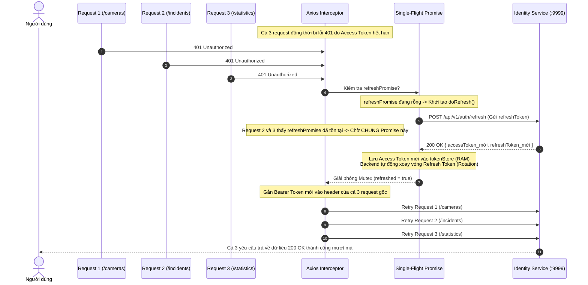

# TÀI LIỆU KỸ THUẬT VÀ KIẾN TRÚC MÃ NGUỒN FRONTEND (TECHNICAL DOCUMENTATION)
*Hệ thống Frontend Giám sát Trang bị Bảo hộ Thông minh `fe-ppe`* · *Phiên bản:* 1.0.0

---

## 1. NỀN TẢNG CÔNG NGHỆ VÀ THƯ VIỆN CỐT LÕI (TECH STACK)

Ứng dụng Frontend `fe-ppe` được xây dựng trên nền tảng web hiện đại với cấu hình công nghệ tối tân nhằm đảm bảo hiệu năng xử lý đồ họa thời gian thực, tính bảo mật cấp doanh nghiệp và trải nghiệm người dùng Neumorphism trực quan:

| Công nghệ / Thư viện | Phiên bản | Vai trò kỹ thuật trong dự án |
| :--- | :---: | :--- |
| **Next.js** | `16.4.2` | Framework nền tảng chạy App Router, hỗ trợ Turbopack Bundler, React Server Components (RSC) kết hợp cơ chế kiểm tra điều hướng tức thì (`instant-navigation`). |
| **React** | `19.3.0` | Thư viện UI cốt lõi hỗ trợ Hooks hiện đại, cơ chế `Suspense` bọc boundaries, xử lý trạng thái bất đồng bộ và kiểm soát render tối ưu. |
| **TailwindCSS** | `v4.x` | Framework CSS thế hệ mới tích hợp Turbopack (`@tailwindcss/turbopack`), quản lý hệ thống design tokens tùy biến tại `src/styles/tokens.css`. |
| **Neumorphism Design Tokens** | Custom | Hệ thống đổ bóng bề mặt kép (`--shadow-dark`, `--shadow-light`), hiệu ứng dập nổi (extruded), dập chìm (inset) và chuyển đổi mượt mà giữa Dark/Light theme. |
| **@tanstack/react-query** | `5.104.4` | Tầng quản trị trạng thái máy chủ (Server State Management), đồng bộ dữ liệu nền, kiểm soát bộ nhớ cache, hỗ trợ Prefetching khi rảnh rỗi (`requestIdleCallback`). |
| **@tanstack/react-table** | `9.3.1` | Thư viện xử lý bảng dữ liệu phức tạp (Sorting, Filtering, Pagination, Custom Cell Rendering) với hiệu năng cao. |
| **React Hook Form + Zod** | `7.90.0` / `4.6.7` | Quản lý form nhập liệu, tối ưu hóa re-render, ràng buộc và kiểm tra hợp lệ dữ liệu đầu vào theo Zod Schema nghiêm ngặt. |
| **Axios** | `1.20.0` | HTTP Client trung tâm được cấu hình Interceptors đa tầng: gắn token, giải nén dữ liệu (unwrap), cơ chế Mutex Refresh Token Single-flight và bẫy lỗi toàn cục. |
| **Three.js + React Three Fiber** | `0.187.0` / `9.8.2` | Render mô hình 3D Nón Bảo Hộ tương tác góc xoay (`HelmetShowcase`) trực tiếp trên Canvas WebGL tại Bảng điều khiển. |
| **Lucide React** | `1.59.0` | Bộ biểu tượng SVG đồng bộ, sắc nét, tối ưu dung lượng tải. |
| **React Hot Toast** | `2.6.1` | Hệ thống thông báo toast Neumorphic tùy biến đa trạng thái (Success, Error, Warning, Realtime Alert). |
| **QRCode** | `1.5.4` | Tạo mã QR Code phục vụ kích hoạt xác thực 2 bước (TOTP 2FA) trên ứng dụng di động. |
| **Cloudflare Turnstile** | Public Widget | Giải pháp xác minh người dùng thật (CAPTCHA) không gây phiền toái, bảo vệ các endpoint xác thực chống tấn công brute-force. |

---

## 2. KIẾN TRÚC THƯ MỤC DỰ ÁN (DIRECTORY STRUCTURE)

Dự án Frontend được tổ chức theo cấu trúc module hóa phân tầng rõ ràng (Feature-driven & Clean Architecture):

```
fe-ppe/
├── app/                                # Next.js 16 App Router Segments
│   ├── (public)/                       # Nhóm Route Công khai (Route Group)
│   │   ├── layout.tsx                  # Server Layout bọc PublicGuard
│   │   ├── public-guard.tsx            # Client Guard chặn người đã đăng nhập
│   │   ├── login/                      # Màn hình Đăng nhập (/login)
│   │   ├── register/                   # Màn hình Đăng ký (/register)
│   │   ├── forgot-password/            # Quên mật khẩu (/forgot-password)
│   │   ├── reset-password/             # Đặt lại mật khẩu (/reset-password)
│   │   ├── 2fa/                        # Nhập mã OTP 2FA (/2fa)
│   │   ├── verify-email/               # Kích hoạt email & xác nhận vô hiệu hóa
│   │   └── auth/callback/              # Callback tiếp nhận Google OAuth
│   ├── (auth)/                         # Nhóm Route Yêu cầu Đăng nhập (Authenticated)
│   │   ├── layout.tsx                  # Client Layout lớp 2 (Route Guard & Context Wrappers)
│   │   ├── not-found.tsx               # Màn hình 404 tùy biến
│   │   ├── [...catchAll]/              # Bắt các URL không tồn tại
│   │   ├── dashboard/                  # Bảng điều khiển chỉ huy (/dashboard)
│   │   ├── incidents/                  # Danh sách & Chi tiết sự cố (/incidents, /incidents/[id])
│   │   ├── cameras/                    # Quản lý Camera & Trạm AI (/cameras, /cameras/[id])
│   │   ├── sites/                      # Quản lý Công trường & Chi tiết (/sites, /sites/[id])
│   │   ├── reports/                    # Báo cáo & Phân tích (/reports)
│   │   ├── ai-metrics/                 # Đo lường AI & Sandbox (/ai-metrics, /ai-metrics/test)
│   │   ├── users/                      # Quản lý Người dùng (/users)
│   │   ├── roles/                      # Quản lý Vai trò & Phân quyền (/roles)
│   │   ├── audit-logs/                 # Nhật ký kiểm toán an ninh (/audit-logs)
│   │   ├── system/                     # Cấu hình tham số & Cờ tính năng (/system)
│   │   ├── maintenance/                # Quản trị chế độ bảo trì (/maintenance)
│   │   ├── notifications/              # Trung tâm thông báo (/notifications)
│   │   ├── settings/                   # Cài đặt Hồ sơ & Bảo mật (/settings/profile, /settings/security)
│   │   └── change-password/            # Cưỡng chế đổi mật khẩu (/change-password)
│   ├── api/                            # Next.js Internal API Route Handlers (AI Sandbox, Upload)
│   ├── globals.css                     # Import TailwindCSS v4 & tokens Neumorphism
│   ├── layout.tsx                      # Root Layout (bọc Theme, Locale, QueryClient)
│   └── page.tsx                        # Trang gốc điều phối ("/" -> /dashboard hoặc /login)
├── proxy.ts                            # Next.js 16 Server-side Proxy Guard (Lớp bảo vệ 1)
├── src/                                # Toàn bộ mã nguồn cốt lõi ứng dụng
│   ├── components/                     # Tầng Components giao diện
│   │   ├── ui/                         # Hệ thống Neumorphic UI Primitives (Button, Modal, Table...)
│   │   └── features/                   # Components nghiệp vụ chuyên sâu theo từng Domain
│   ├── config/                         # Cấu hình tĩnh ứng dụng
│   │   ├── env.ts                      # Đọc và xác thực biến môi trường Turbopack
│   │   ├── navigation.ts               # Danh mục Menu, Icons và Bản đồ Route Permissions
│   │   └── prefetch-jobs.ts            # Đăng ký các tác vụ nạp trước dữ liệu khi CPU rảnh
│   ├── contexts/                       # React Contexts quản trị trạng thái toàn cục
│   │   ├── AuthContext.tsx             # Lưu trữ thông tin MeDto, trạng thái phiên, hàm logout
│   │   ├── SiteContext.tsx             # Quản lý công trường đang chọn, đồng bộ LocalStorage
│   │   └── RealtimeContext.tsx         # Kênh lắng nghe Server-Sent Events (SSE)
│   ├── hooks/                          # Custom Hooks bọc TanStack React Query v5
│   │   ├── auth/                       # Hooks Đăng nhập, 2FA, Profile, Sessions
│   │   ├── cameras/                    # Hooks Camera CRUD, Ping, Streaming, ROI Config
│   │   ├── incidents/                  # Hooks Sự cố vi phạm, Vòng đời, Checksum, Phân công
│   │   ├── sites/                      # Hooks Công trường, Phân khu, Vùng cấm, Safety Rules
│   │   ├── reporting/                  # Hooks Báo cáo, Thống kê vi phạm, Xuất file
│   │   ├── ai-metrics/                 # Hooks Hiệu năng AI, Triển khai mô hình
│   │   ├── users/                      # Hooks Quản trị người dùng, Đặt lại mật khẩu
│   │   ├── rbac/                       # Hooks Danh mục Vai trò, Ma trận phân quyền
│   │   ├── system/                     # Hooks Cấu hình hệ thống, Feature Flags, Health
│   │   ├── maintenance/                # Hooks Trạng thái & Bật/Tắt chế độ bảo trì
│   │   ├── notifications/              # Hooks Hộp thư thông báo, Mẫu template, Âm thanh
│   │   └── audit/                      # Hooks Nhật ký kiểm toán, So sánh Diff JSON
│   ├── lib/                            # Thư viện tiện ích kỹ thuật
│   │   ├── axios.ts                    # Factory khởi tạo HTTP Client, Refresh Token Single-flight
│   │   ├── token.ts                    # Lưu trữ Access Token an toàn trong bộ nhớ RAM
│   │   ├── session-manager.ts          # Quản lý Cookie ppe_remember_me, ppe_session_active
│   │   ├── query-client.ts             # Khởi tạo React QueryClient với cấu hình mặc định
│   │   ├── event-bus.ts                # Bộ phát sự kiện nội bộ (auth:session-expired, maintenance)
│   │   ├── toast.ts                    # Đóng gói hàm gọi thông báo Toast
│   │   └── file-download.ts            # Hỗ trợ tải file nhị phân Blob về máy tính
│   ├── providers/                      # Các nhà cung cấp ngữ cảnh (Context Providers)
│   ├── services/                       # 13 File Service kết nối trực tiếp đến Backend API
│   ├── styles/                         # File định nghĩa biến CSS Neumorphic Tokens
│   ├── types/                          # 13 File TypeScript Contract định nghĩa DTOs chuẩn
│   └── i18n/                           # Từ điển bản địa hóa ngôn ngữ (`vi-VN.json`, `en-US.json`)
```

---

## 3. KIẾN TRÚC BẢO VỆ ROUTE 2 LỚP (TWO-TIER ROUTE GUARDS)

Để đảm bảo an toàn tuyệt đối và ngăn chặn hiện tượng nhấp nháy giao diện (FOUC), hệ thống áp dụng cơ chế bảo vệ phân tầng 2 lớp:

```mermaid
flowchart TD
    Req([Yêu cầu chuyển trang URL]) --> ProxyGuard["Lớp 1: Server Proxy (proxy.ts)<br>Chạy trên Server trước khi render HTML"]
    
    ProxyGuard -->|Có Cookie Phiên hợp lệ?| CheckPublic1{Route thuộc nhóm Public?}
    ProxyGuard -->|Không có Cookie Phiên| CheckProtected1{Route thuộc nhóm Protected?}
    
    CheckPublic1 -->|Đúng (login, register...)| RedirHome["Redirect về '/' -> Dashboard"]
    CheckPublic1 -->|Sai (Callback / Deactivate)| PassProxy1[Cho phép tải trang]
    
    CheckProtected1 -->|Đúng (dashboard, settings...)| RedirLogin["Redirect về '/login?next=...'"]
    CheckProtected1 -->|Sai| PassProxy2[Cho phép tải trang]
    
    PassProxy1 --> ClientGuard["Lớp 2: Client Layout Guard (AuthLayout)<br>Chạy trên Trình duyệt sau khi mount"]
    PassProxy2 --> ClientGuard
    
    ClientGuard --> CheckAuthStatus{useAuth().status}
    CheckAuthStatus -->|unauthenticated| KickLogin["Chuyển hướng về /login"]
    CheckAuthStatus -->|authenticated| CheckMustChange{mustChangePassword?}
    
    CheckMustChange -->|true & route != /change-password| ForceChange["Cưỡng chế chuyển sang /change-password"]
    CheckMustChange -->|false| CheckInactive{user.isActive == false?}
    
    CheckInactive -->|true| ShowInactiveScreen["Hiển thị màn hình Khóa tài khoản"]
    CheckInactive -->|false| CheckMaint{isMaintenanceActive & !isBypassed?}
    
    CheckMaint -->|true| ShowMaintScreen["Hiển thị màn hình Bảo trì toàn hệ thống"]
    CheckMaint -->|false| CheckPerms{Đủ quyền trong ROUTE_PERMISSIONS?}
    
    CheckPerms -->|Không đủ quyền| Show403["Hiển thị màn hình 403 ForbiddenView"]
    CheckPerms -->|Đủ quyền| RenderPage([Render Giao diện Chức năng])
```

### 3.1. Lớp 1: Server Proxy Guard (`fe-ppe/proxy.ts`)
- Chạy trước khi server Next.js sinh mã HTML (Optimistic Check).
- Kiểm tra sự hiện diện của Cookie xác thực: `accessToken` hoặc `refreshToken` đi kèm điều kiện `ppe_remember_me=1` hoặc `ppe_session_active=1`.
- Nếu chưa có cookie phiên mà truy cập các tiền tố bảo vệ (`/dashboard`, `/settings`, `/change-password`), proxy lập tức trả về HTTP 307 Redirect về `/login?next=...`.
- Ngoại lệ được thiết kế riêng:
  - `/verify-email/deactivate`: Cho phép người dùng đang đăng nhập bấm link trong email để xác nhận hủy tài khoản mà không bị đá về trang chủ.
  - `/auth/callback`: Tiếp nhận callback Google OAuth cho cả luồng đăng nhập (chưa có session) lẫn luồng liên kết tài khoản (đang có session).

### 3.2. Lớp 2: Client Layout Guard (`app/(auth)/layout.tsx`)
- Chạy trên trình duyệt sau khi phiên xác thực thực tế được phục hồi qua API `GET /api/v1/auth/me`.
- Kiểm tra toàn diện 4 điều kiện nghiệp vụ:
  1. Trạng thái `unauthenticated` $\rightarrow$ Điều hướng về `/login`.
  2. Cờ `mustChangePassword === true` $\rightarrow$ Giam người dùng tại `/change-password`.
  3. Cờ `isActive === false` $\rightarrow$ Hiển thị màn hình thông báo tài khoản bị tạm khóa kèm nút đăng xuất.
  4. Cờ `isMaintenanceActive === true` $\rightarrow$ Nếu người dùng không có vai trò `ADMIN` hoặc quyền `MAINTENANCE_BYPASS`, hiển thị màn hình `MaintenanceScreen` chặn toàn bộ thao tác.
  5. Đối chiếu quyền hạn: Kiểm tra `user.permissions` với bảng `ROUTE_PERMISSIONS` tại `src/config/navigation.ts`. Nếu thiếu quyền, render component `ForbiddenView` (403).

---

## 4. CƠ CHẾ QUẢN LÝ TOKEN & REFRESH TOKEN MUTEX (SINGLE-FLIGHT)

Hệ thống tuân thủ tiêu chuẩn bảo mật OWASP khắt khe nhất để chống tấn công XSS và CSRF:



### 4.1. Lưu trữ Token trong Bộ nhớ RAM (`src/lib/token.ts`)
- **Access Token**: Được lưu trong biến cục bộ (In-memory) của module `tokenStore`, hoàn toàn không ghi vào `localStorage` hay `sessionStorage`. Nhờ đó, mã độc XSS không thể đánh cắp token để mạo danh.
- Khi người dùng tải lại trang (F5), bộ nhớ RAM được làm sạch, `AuthContext` tự động sử dụng Cookie `refreshToken` để phục hồi phiên thông qua endpoint `GET /auth/me`.

### 4.2. Cơ chế Chống Xung Đột Xoay Vòng Refresh Token (Single-flight)
- Backend `smart-ppe-identity-service` áp dụng cơ chế **Refresh Token Rotation**: Mỗi khi sử dụng một refresh token để đổi phiên mới, token cũ lập tức bị xóa vĩnh viễn khỏi Database. Nếu phát hiện token cũ được gửi lại lần thứ hai, backend coi đây là dấu hiệu tấn công đánh cắp phiên và sẽ thu hồi (Revoke) toàn bộ phiên đăng nhập của người dùng.
- Để ngăn ngừa việc các request bất đồng bộ trên giao diện gửi đồng thời nhiều yêu cầu refresh token gây ra lỗi Token Reuse, hàm `refreshTokens()` tại `src/lib/axios.ts` áp dụng mô hình Mutex:
  ```typescript
  let refreshPromise: Promise<boolean> | null = null;

  function refreshTokens(): Promise<boolean> {
    if (!refreshPromise) {
      refreshPromise = doRefresh().finally(() => {
        refreshPromise = null;
      });
    }
    return refreshPromise;
  }
  ```
  Mọi request bị 401 sẽ cùng chờ kết quả của một promise duy nhất. Khi token mới được cấp phát, cờ `_retry = true` được đánh dấu và request gốc được gửi lại tự động.

---

## 5. KIẾN TRÚC QUẢN TRỊ TRẠNG THÁI & REACT QUERY CACHE

### 5.1. Cấu hình Chuẩn Hóa QueryClient (`src/lib/query-client.ts`)
```typescript
export const queryClient = new QueryClient({
  defaultOptions: {
    queries: {
      staleTime: 60 * 1000,        // Dữ liệu được coi là mới trong 60 giây
      gcTime: 5 * 60 * 1000,        // Lưu cache trong bộ nhớ 5 phút trước khi giải phóng
      retry: 1,                     // Thử lại tối đa 1 lần nếu gặp lỗi mạng
      refetchOnWindowFocus: false,  // Không tự động fetch lại khi chuyển đổi cửa sổ
    },
  },
});
```

### 5.2. Chuẩn Hóa Khóa Truy Vấn (Query Key Factories)
Để đảm bảo khả năng xóa cache (Invalidation) chính xác mà không làm ảnh hưởng đến các màn hình khác, toàn bộ Query Keys được định nghĩa theo mô hình phân cấp dạng Tuple:

- `incidentKeys.all`: `["incidents"]`
- `incidentKeys.lists()`: `["incidents", "list"]`
- `incidentKeys.list(params)`: `["incidents", "list", params]`
- `incidentKeys.details()`: `["incidents", "detail"]`
- `incidentKeys.detail(id)`: `["incidents", "detail", id]`
- `cameraKeys.all`: `["cameras"]`
- `siteKeys.all`: `["sites"]`
- `reportingKeys.summary(filter)`: `["reporting", "summary", filter]`

Khi một Mutation thay đổi trạng thái thành công (ví dụ: xác nhận vi phạm `useReviewIncident`), hook chỉ cần gọi:
```typescript
queryClient.invalidateQueries({ queryKey: incidentKeys.all });
queryClient.invalidateQueries({ queryKey: reportingKeys.all });
```
Toàn bộ danh sách sự cố và số liệu thống kê trên Bảng điều khiển sẽ tự động đồng bộ lại số liệu mới nhất.

### 5.3. Nạp Trước Dữ Liệu Khi Rảnh Rỗi (`PrefetchProvider`)
Để tăng tốc tối đa trải nghiệm chuyển trang của người dùng, `PrefetchProvider` (`src/providers/prefetch-provider.tsx`) kết hợp với `requestIdleCallback` để tải trước các dữ liệu danh mục khi CPU của máy tính đang rảnh rỗi mà không gây giật lag giao diện.

---

## 6. KIẾN TRÚC GIẢI NÉN VÀ BẪY LỖI HTTP TOÀN CỤC (AXIOS INTERCEPTORS)

### 6.1. Cơ chế Tự động Giải nén Dữ liệu (Auto Data Unwrapping)
Backend Microservices trả về định dạng bọc chuẩn:
```json
{
  "success": true,
  "data": { ... },
  "meta": { "page": 1, "limit": 10, "total": 100 }
}
```
Tại `src/lib/axios.ts`, response interceptor tự động xử lý:
1. Nếu phản hồi chứa `data` và `meta` (endpoint phân trang) $\rightarrow$ Trả về `{ data, meta }`.
2. Nếu phản hồi chỉ chứa `data` $\rightarrow$ Trả về trực tiếp đối tượng bên trong `data`.
3. Nếu không có `data` (endpoint thông báo) $\rightarrow$ Trả về nguyên bản đối tượng phản hồi.
Nhờ cơ chế này, các hàm Service phía Frontend nhận được trực tiếp kiểu dữ liệu DTO mong muốn mà không phải viết lặp lại mã `res.data.data`.

### 6.2. Lớp Đối tượng Chuẩn hóa Lỗi `ApiError`
Mọi lỗi phản hồi từ backend được chuyển đổi thành thể hiện của lớp `ApiError`:
```typescript
export class ApiError extends Error {
  readonly status: number;
  readonly code: string;
  readonly errors?: ApiErrorBody["errors"];
  readonly retryAfter?: number;
}
```

### 6.3. Ma trận Thông báo Lỗi Toàn Cục (Global Toast Policy)
Để tránh hiện tượng spam thông báo lỗi trên màn hình người dùng:
- **Lỗi hiển thị Toast tự động**: Lỗi mất kết nối mạng (`status === 0`), Lỗi máy chủ sập (`status >= 500`), Lỗi quá tải tần suất (`429 Rate Limit Exceeded`).
- **Lỗi dành riêng cho Form / Mutation xử lý**: Các lỗi nghiệp vụ như sai thông tin đăng nhập (401), thiếu trường dữ liệu (400 / 422), không đủ quyền (403) sẽ không bắn toast toàn cục mà chuyển tiếp lỗi về cho hook `onError` của từng màn hình tự hiển thị thông điệp phù hợp ngữ cảnh.

---

## 7. CẤU HÌNH BIẾN MÔI TRƯỜNG (`src/config/env.ts`)

Hệ thống yêu cầu các biến môi trường cấu hình tại tệp `.env.local`:

| Tên biến môi trường | Giá trị chuẩn môi trường Dev | Mục đích sử dụng |
| :--- | :--- | :--- |
| `NEXT_PUBLIC_API_BASE_URL` | `http://localhost:80/api/v1` | Cổng API Gateway Traefik tập trung chuyển tiếp đến 10 Backend Microservices. |
| `NEXT_PUBLIC_IDENTITY_URL` | `http://localhost:80/api/v1` | URL dự phòng cho Identity Service. |
| `NEXT_PUBLIC_APP_URL` | `http://localhost:3000` | Địa chỉ gốc của Frontend phục vụ tạo đường dẫn chuyển tiếp OAuth và link email. |
| `NEXT_PUBLIC_TURNSTILE_SITE_KEY` | `0x4AAAAAA...` (Tùy chọn) | Site key dịch vụ Cloudflare Turnstile CAPTCHA. Nếu để trống, widget tự ẩn an toàn. |

> [!NOTE]
> Để tương thích tuyệt đối với trình biên dịch Next.js 16 Turbopack, các biến môi trường luôn được tham chiếu tĩnh dạng `process.env.NEXT_PUBLIC_...`. Turbopack sẽ thay thế trực tiếp các chuỗi này vào mã nguồn client bundle trong quá trình build production.

---

## 8. CƠ CHẾ CHUYỂN TRANG TỨC THÌ & PROGRESSIVE COMPONENT SKELETONS

### 8.1. Vấn đề nghẽn điều hướng và giải pháp
Trong các ứng dụng Next.js App Router trước đây, việc bấm chuyển trang trên thanh Sidebar thường gặp tình trạng "khựng" hoặc "đơ" giao diện trong lúc chờ component nạp dữ liệu. Hệ thống `fe-ppe` đã áp dụng kiến trúc:
1. **Instant Client-side Transition**: Tách rời việc điều hướng route khỏi việc chờ đợi dữ liệu (`Suspense` boundaries kết hợp với Client Components).
2. **Component-level Progressive Skeletons**: Thay vì khóa toàn màn hình bằng màn hình trắng hoặc vòng quay loading đơn độc giữa trang, từng component con (như `DashboardZoneRiskChart`, `DashboardAiStatusCard`, `DashboardKpiRibbon`, `UserDetailKpiBar`, `DashboardSeveritySlaChart`) tự hiển thị khung Neumorphic Shimmer Skeleton tương ứng với đúng kích thước và tỷ lệ thực tế.
3. **Giữ nguyên Layout**: Người dùng vẫn có thể tương tác với Sidebar, Header hoặc chuyển sang trang khác mà không bị chặn luồng tác vụ.

---

## 9. CHUẨN HÓA TỌA ĐỘ BẰNG CHỨNG THỊ GIÁC AI (NORMALIZED BOUNDING BOXES)

### 9.1. Kiến trúc Tọa độ Normalized Coordinates `[0..1]`
Nhằm giải quyết triệt để lỗi Bounding Box bị lệch khi xem trên các độ phân giải khác nhau hoặc khi nạp luồng video mới:
- AI Worker (`smart-ppe-ai-service`) tính toán tọa độ theo chuẩn Normalized `[0..1]`:
  $$\text{ymin} = \frac{Y_1}{H}, \quad \text{xmin} = \frac{X_1}{W}, \quad \text{ymax} = \frac{Y_2}{H}, \quad \text{xmax} = \frac{X_2}{W}$$
- Dữ liệu lưu trong CSDL `ppe_incident_db` bảng `evidences` trường `metadata.aiDetections`:
  ```json
  {
    "model": "yolov11s-ppe.pt",
    "box": [0.152, 0.412, 0.684, 0.589],
    "confidence": 0.92,
    "label": "NO_HARD_HAT"
  }
  ```
- Component `IncidentEvidenceViewer` phía Frontend tự động nhân tọa độ `[0..1]` với chiều rộng ($W$) và chiều cao ($H$) thực tế của thẻ ảnh hiển thị trên trình duyệt:
  $$\text{top} = \text{ymin} \times H, \quad \text{left} = \text{xmin} \times W, \quad \text{width} = (\text{xmax} - \text{xmin}) \times W, \quad \text{height} = (\text{ymax} - \text{ymin}) \times H$$
Đảm bảo khung nhận diện luôn ôm sát chính xác người vi phạm trên mọi kích thước màn hình (Desktop, Laptop, Tablet).

### 9.2. Bộ Bằng Chứng Thị Giác Kép (Dual Snapshot Evidence)
Mỗi sự cố lưu trữ 2 frame ảnh độc lập trên Object Storage:
- `SNAPSHOT`: Chụp tại thời điểm giây T xảy ra vi phạm.
- `REFERENCE_SNAPSHOT`: Chụp tại thời điểm khởi tạo luồng (T=0) hoặc lúc công nhân tuân thủ hợp lệ để phục vụ đối chiếu, thanh tra.

---

## 10. XỬ LÝ ĐIỀU HƯỚNG LỖI 404 NOT FOUND TOÀN CỤC

Hệ thống thiết lập cơ chế bắt lỗi 404 đa tầng:
1. `app/not-found.tsx`: Bắt lỗi 404 cấp Root cho các đường dẫn public ngoài App Router.
2. `app/(auth)/not-found.tsx`: Bắt lỗi 404 bên trong layout AppShell (giữ nguyên Sidebar và Header).
3. `NotFoundView`: Component Neumorphic chuẩn hóa với các hành động điều hướng nhanh (`router.back()`, điều hướng về `/dashboard`), giúp kiểm thử viên và người dùng dễ dàng khôi phục phiên khi gặp URL sai.
