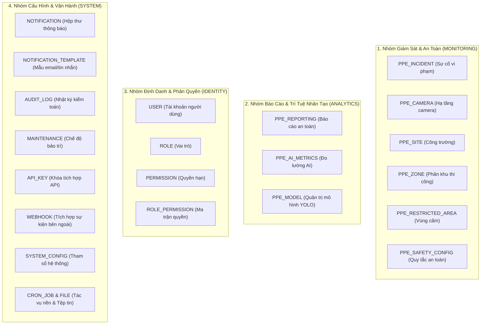

# DANH MỤC TÀI KHOẢN KIỂM THỬ VÀ MA TRẬN PHÂN QUYỀN (TEST ACCOUNTS & RBAC)
*Tài liệu kiểm thử xác thực và bảo mật phân quyền* · *Phiên bản:* 1.0.0

---

## 1. DANH MỤC TÀI KHOẢN HẠT GIỐNG ĐƯỢC XÁC THỰC (VERIFIED SEED ACCOUNTS)

Toàn bộ thông tin tài khoản dưới đây được trích xuất trực tiếp từ mã nguồn khởi tạo cơ sở dữ liệu của dịch vụ định danh `smart-ppe-identity-service` (`prisma/seed.ts`). Đây là các tài khoản tiêu chuẩn được cấp sẵn trên môi trường kiểm thử (Local Dev & Test Environment):

| Email đăng nhập | Mật khẩu kiểm thử | Họ và tên hiển thị | Vai trò hệ thống (`Role`) | Mục đích kiểm thử chính |
| :--- | :--- | :--- | :---: | :--- |
| `admin@ppe.local` | `Admin@123456` | Quản Trị Viên Hệ Thống | **`ADMIN`** | Kiểm thử toàn quyền hệ thống, quản lý người dùng, vai trò, cấu hình hạ tầng, mô hình AI, chế độ bảo trì. |
| `manager@ppe.local` | `Manager@123456` | Nguyễn Văn Quản Lý (Safety Manager) | **`SAFETY_MANAGER`** | Kiểm thử quyền quản lý an toàn công trường, camera, cấu hình quy chuẩn an toàn, thẩm duyệt vi phạm PPE, xuất báo cáo. |
| `officer@ppe.local` | `Officer@123456` | Trần Thị An Toàn (Safety Officer) | **`SAFETY_OFFICER`** | Kiểm thử quyền cán bộ hiện trường, tiếp nhận việc được phân công, cập nhật giải pháp khắc phục, gửi trao đổi thảo luận. |
| `user@ppe.local` | `User@123456` | Nguyễn Văn Công Nhân (Site Worker) | **`USER`** | Kiểm thử quyền tối thiểu của công nhân, xem thông báo cá nhân, cập nhật mật khẩu, kiểm thử màn hình 403 Forbidden. |

> [!CAUTION]
> **CẢNH BÁO AN NINH & CHÍNH SÁCH KHÓA TÀI KHOẢN**:
> Hệ thống áp dụng chính sách khóa tự động: **Nhập sai mật khẩu 5 lần liên tiếp sẽ bị khóa tài khoản trong vòng 15 phút** (`locked_until`).
> - Khi thực hiện các ca kiểm thử sai mật khẩu (`AUTH-002`, `AUTH-003`), **tuyệt đối chỉ dùng tài khoản `user@ppe.local`**, tránh làm khóa tài khoản quản trị `admin@ppe.local`.
> - Để mở khóa nhanh tài khoản bị khóa trong môi trường Docker, chạy lệnh SQL sau:
> ```bash
> docker exec ppe_postgres psql -U postgres -d ppe_identity_db -c \
> "UPDATE users SET failed_login_attempts=0, locked_until=NULL WHERE email='user@ppe.local';"
> ```

---

## 2. MA TRẬN 21 MIỀN TÀI NGUYÊN HỆ THỐNG (`PERMISSION_RESOURCES`)

Hệ thống quản lý phân quyền theo mô hình Dynamic RBAC với 21 nhóm tài nguyên được gom thành 4 danh mục lớn (`src/types/rbac.types.ts`):



---

## 3. BẢNG PHÂN BỔ QUYỀN HẠN CHI TIẾT THEO VAI TRÒ (ROLE-PERMISSION MAPPING)

Dưới đây là bảng đối chiếu danh mục quyền được cấp thực tế cho từng vai trò trong Database (`smart-ppe-identity-service/prisma/seed.ts`):

| Nhóm Tài Nguyên | Tên Quyền Hạn (`Permission Name`) | Hành Động (`Action`) | ADMIN | SAFETY_MANAGER | SAFETY_OFFICER | MANAGER | USER |
| :--- | :--- | :--- | :---: | :---: | :---: | :---: | :---: |
| **Sự Cố (Incidents)** | `PPE_INCIDENT_READ` | Xem danh sách & chi tiết vi phạm | ✅ | ✅ | ✅ | ❌ | ❌ |
| | `PPE_INCIDENT_REVIEW` | Thẩm duyệt vi phạm (Xác nhận/Bác bỏ) | ✅ | ✅ | ✅ | ❌ | ❌ |
| | `PPE_INCIDENT_UPDATE` | Cập nhật giải pháp khắc phục | ✅ | ✅ | ✅ | ❌ | ❌ |
| | `PPE_INCIDENT_MANAGE` | Phân công, đóng và xóa sự cố | ✅ | ✅ | ❌ | ❌ | ❌ |
| **Camera & Video** | `PPE_CAMERA_READ` | Xem danh sách & luồng trực tiếp | ✅ | ✅ | ✅ | ❌ | ❌ |
| | `PPE_CAMERA_MANAGE` | Thêm, sửa, xóa camera, cấu hình ROI | ✅ | ✅ | ❌ | ❌ | ❌ |
| **Công Trường (Sites)**| `PPE_SITE_READ` | Xem danh sách công trường | ✅ | ✅ | ✅ | ❌ | ❌ |
| | `PPE_SITE_MANAGE` | Thêm, sửa, xóa, lưu trữ công trường | ✅ | ✅ | ❌ | ❌ | ❌ |
| | `PPE_ZONE_READ` / `_MANAGE` | Xem / Quản lý phân khu thi công | ✅ | ✅ | ❌ | ❌ | ❌ |
| | `PPE_RESTRICTED_AREA_READ` | Xem / Quản lý vùng cấm nguy hiểm | ✅ | ✅ | ❌ | ❌ | ❌ |
| **Quy Tắc An Toàn** | `PPE_SAFETY_CONFIG_READ` | Xem trang bị bảo hộ bắt buộc | ✅ | ✅ | ✅ | ❌ | ❌ |
| | `PPE_SAFETY_CONFIG_MANAGE`| Thay đổi cấu hình PPE bắt buộc | ✅ | ✅ | ❌ | ❌ | ❌ |
| **Báo Cáo (Reports)** | `PPE_REPORTING_READ` | Xem báo cáo & thống kê biểu đồ | ✅ | ✅ | ❌ | ❌ | ❌ |
| | `PPE_REPORTING_EXPORT` | Xuất báo cáo PDF / Excel | ✅ | ✅ | ❌ | ❌ | ❌ |
| **Trí Tuệ Nhân Tạo** | `PPE_AI_METRICS_READ` | Xem chỉ số mAP50, Latency, FPS | ✅ | ✅ | ❌ | ❌ | ❌ |
| | `PPE_MODEL_READ` | Xem thông tin mô hình YOLO | ✅ | ✅ | ❌ | ❌ | ❌ |
| | `PPE_MODEL_MANAGE` | Triển khai phiên bản mô hình mới | ✅ | ❌ | ❌ | ❌ | ❌ |
| **Người Dùng (Users)**| `USER_READ` | Xem danh sách người dùng | ✅ | ❌ | ❌ | ✅ | ❌ |
| | `USER_CREATE` / `_UPDATE` | Thêm / Sửa thông tin tài khoản | ✅ | ❌ | ❌ | ❌ | ❌ |
| | `USER_DELETE` / `_RESTORE`| Khóa / Mở lại tài khoản | ✅ | ❌ | ❌ | ✅ | ❌ |
| **Vai Trò & Quyền** | `ROLE_READ` / `PERMISSION_READ` | Xem danh mục vai trò & ma trận | ✅ | ❌ | ❌ | ✅ | ❌ |
| | `ROLE_MANAGE` | Tạo vai trò mới, đồng bộ ma trận | ✅ | ❌ | ❌ | ❌ | ❌ |
| **Kiểm Toán & Vận Hành**| `AUDIT_LOG_READ` | Xem nhật ký kiểm toán an ninh | ✅ | ❌ | ❌ | ✅ | ❌ |
| | `SYSTEM_CONFIG_READ` / `_MANAGE`| Xem / Sửa cấu hình & cờ tính năng | ✅ | ❌ | ❌ | ✅ | ❌ |
| | `MAINTENANCE_MANAGE` | Bật / Tắt chế độ bảo trì toàn web | ✅ | ❌ | ❌ | ❌ | ❌ |
| **Thông Báo & File** | `NOTIFICATION_READ` | Đọc hộp thư thông báo | ✅ | ✅ | ✅ | ✅ | ✅ |
| | `NOTIFICATION_TEMPLATE_READ`| Xem mẫu template thông báo | ✅ | ❌ | ❌ | ✅ | ❌ |
| | `FILE_UPLOAD` / `_READ` | Tải lên / Tải về ảnh bằng chứng | ✅ | ✅ | ✅ | ✅ | ✅ |

---

## 4. MA TRẬN TRUY CẬP MÀN HÌNH THEO VAI TRÒ (ROUTE PERMISSION ENFORCEMENT)

Dưới đây là bảng phân bổ quyền truy cập vào 31 màn hình giao diện dựa trên cơ chế Route Guard tầng 2 (`fe-ppe/src/config/navigation.ts`):

| Đường Dẫn Màn Hình (`Route`) | Quyền Bắt Buộc (`Required Permission`) | ADMIN | SAFETY_MANAGER | SAFETY_OFFICER | MANAGER | USER |
| :--- | :--- | :---: | :---: | :---: | :---: | :---: |
| `/login`, `/register`, `/forgot-password`, `/2fa` | Mở công khai (Public) | ✅ | ✅ | ✅ | ✅ | ✅ |
| `/dashboard` | Đã đăng nhập (Authenticated) | ✅ | ✅ | ✅ | ✅ | ✅ |
| `/incidents` & `/incidents/:id` | `PPE_INCIDENT_READ` | ✅ | ✅ | ✅ | ❌ (403) | ❌ (403) |
| `/cameras` & `/cameras/:id` | `PPE_CAMERA_READ` | ✅ | ✅ | ✅ | ❌ (403) | ❌ (403) |
| `/sites` & `/sites/:id` | `PPE_SITE_READ` | ✅ | ✅ | ✅ | ❌ (403) | ❌ (403) |
| `/reports` | `PPE_REPORTING_READ` | ✅ | ✅ | ❌ (403) | ❌ (403) | ❌ (403) |
| `/ai-metrics` & `/ai-metrics/test`| `PPE_AI_METRICS_READ` | ✅ | ✅ | ❌ (403) | ❌ (403) | ❌ (403) |
| `/users` | `USER_READ` | ✅ | ❌ (403) | ❌ (403) | ✅ | ❌ (403) |
| `/roles` | `ROLE_READ` | ✅ | ❌ (403) | ❌ (403) | ✅ | ❌ (403) |
| `/audit-logs` | `AUDIT_LOG_READ` | ✅ | ❌ (403) | ❌ (403) | ✅ | ❌ (403) |
| `/system` | `SYSTEM_CONFIG_READ` | ✅ | ❌ (403) | ❌ (403) | ✅ | ❌ (403) |
| `/maintenance` | `MAINTENANCE_MANAGE` | ✅ | ❌ (403) | ❌ (403) | ❌ (403) | ❌ (403) |
| `/notifications` | `NOTIFICATION_READ` | ✅ | ✅ | ✅ | ✅ | ✅ |
| `/settings/profile` & `/settings/security`| Đã đăng nhập (Personal Scope) | ✅ | ✅ | ✅ | ✅ | ✅ |
| `/change-password` | Đã đăng nhập (Dành cho cờ `mustChangePassword`)| ✅ | ✅ | ✅ | ✅ | ✅ |

---

## 5. HƯỚNG DẪN THỰC HÀNH KIỂM THỬ PHÂN QUYỀN (TESTING INSTRUCTIONS)

### 5.1. Quy trình Chuyển Đổi Nhanh Giữa Các Vai Trò
1. **Bước 1**: Đăng nhập bằng tài khoản Quản trị viên `admin@ppe.local` / `Admin@123456`.
2. **Bước 2**: Thực hiện các thao tác quản trị cấp cao (tạo công trường, thêm camera, gán phân khu, chỉnh sửa vai trò).
3. **Bước 3**: Mở menu tài khoản góc trên bên phải, bấm "Đăng xuất".
4. **Bước 4**: Đăng nhập lại bằng tài khoản Cán bộ an toàn `officer@ppe.local` / `Officer@123456`.
5. **Bước 5**: Kiểm tra tính toàn vẹn của giao diện:
   - Thanh Sidebar tự động ẩn các mục Quản lý người dùng, Vai trò, Báo cáo và Chế độ bảo trì.
   - Thử nhập trực tiếp trên thanh địa chỉ trình duyệt: `http://localhost:3000/roles` hoặc `http://localhost:3000/maintenance`.
   - **Kết quả mong đợi**: Màn hình `ForbiddenView` (403) xuất hiện tức thì, chặn người dùng xem hoặc tương tác với dữ liệu nhạy cảm.

### 5.2. Kịch bản Kiểm thử Cưỡng Chế Đổi Mật Khẩu (`mustChangePassword`)
1. Dùng tài khoản `admin@ppe.local`, vào màn hình `/users`.
2. Tạo một tài khoản người dùng mới hoặc bấm "Đặt lại mật khẩu" cho tài khoản `user@ppe.local`.
3. Đăng xuất và đăng nhập lại bằng `user@ppe.local`.
4. **Kết quả mong đợi**: Sau khi đăng nhập, hệ thống tự động nhận diện cờ `mustChangePassword: true` và điều hướng cưỡng bức về `/change-password`. Người dùng không thể bấm vào bất kỳ menu nào trên Sidebar cho đến khi hoàn thành việc đổi mật khẩu mới.

### 5.3. Kịch bản Kiểm thử Vượt Rào Chế Độ Bảo Trì (Maintenance Bypass)
1. Dùng tài khoản `admin@ppe.local`, vào `/maintenance` và gạt bật chế độ bảo trì toàn hệ thống.
2. Mở trình duyệt ẩn danh (Incognito Window) và đăng nhập bằng tài khoản công nhân `user@ppe.local`.
3. **Kết quả mong đợi**: Người dùng công nhân bị chặn hoàn toàn bởi màn hình `MaintenanceScreen` (có biểu tượng cờ lê Neumorphic và thông điệp bảo trì).
4. Quay lại cửa sổ trình duyệt của tài khoản `admin@ppe.local`:
   - Quản trị viên vẫn truy cập bình thường toàn bộ ứng dụng nhờ quyền `MAINTENANCE_BYPASS` / `ADMIN`.
   - Header hiển thị dải banner màu vàng cảnh báo: "Hệ thống đang trong chế độ bảo trì".
