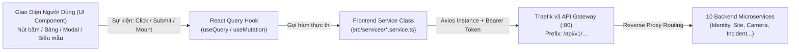
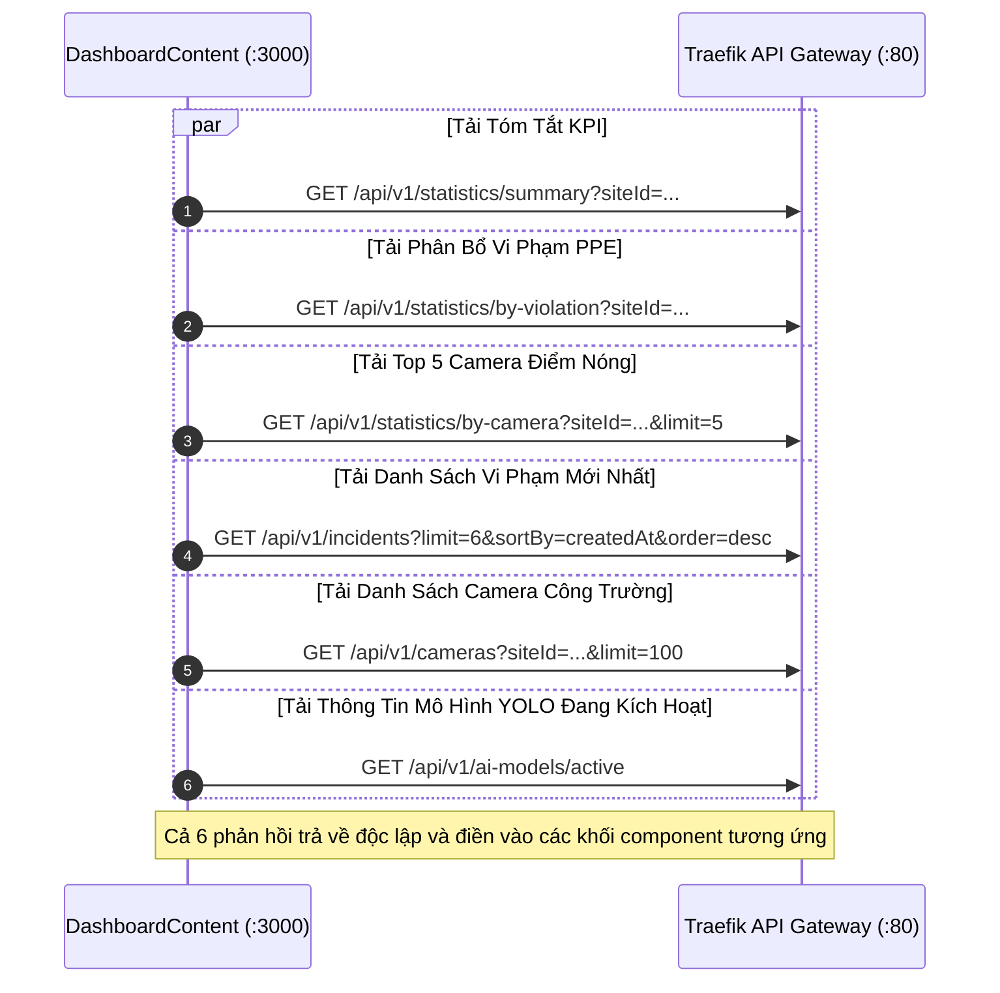
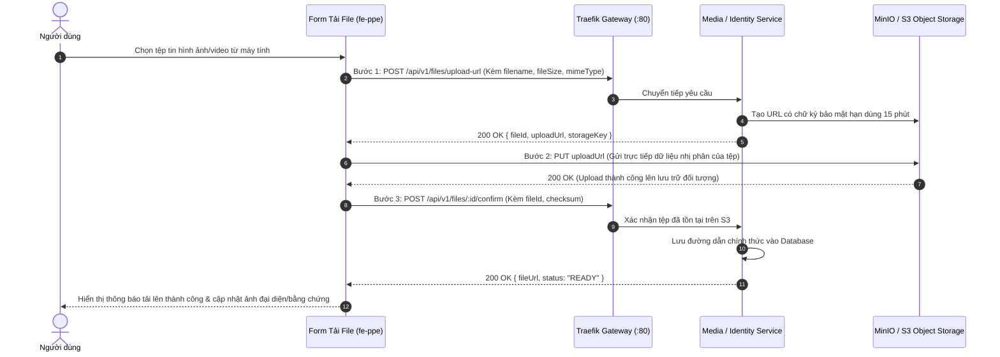

# BẢN ĐỒ ÁNH XẠ GIAO DIỆN – DỊCH VỤ – API ENDPOINT (UI–SERVICE–API MAPPING)
*Tài liệu kỹ thuật tra cứu độc lập dành cho QA Tester & API Automation* · *Phiên bản:* 1.0.0

---

## 1. NGUYÊN TẮC ÁNH XẠ VÀ MÔ HÌNH DỮ LIỆU TỔNG THỂ

Tài liệu này cung cấp bản đồ đối chiếu chi tiết 100% từ giao diện người dùng Frontend (`fe-ppe`), qua tầng React Query Hooks, tầng Frontend Services, tới tầng Backend Microservices thông qua cổng Traefik v3 API Gateway (`/api/v1`).

---

## 2. BẢN ĐỒ ÁNH XẠ CHI TIẾT THEO 13 MODULE NGHIỆP VỤ

### 2.1. Phân hệ 1: Xác thực, Bảo mật & Phiên làm việc (Authentication & Security)
*Frontend Service:* `src/services/auth.service.ts` · *Backend Service:* `smart-ppe-identity-service` (Port nội bộ :9999)

| Screen | UI Component | Action | FE Hook/Function | Backend Service | Method | Endpoint | Data Dependency |
| :--- | :--- | :--- | :--- | :--- | :---: | :--- | :--- |
| `/login` | `LoginForm` | Submit đăng nhập | `useLogin` / `authService.login` | Identity Service | `POST` | `/api/v1/auth/login` | Email, password, captchaToken |
| `/login` | `GoogleButton` | Bấm đăng nhập Google | `authService.getGoogleUrl` | Identity Service | `GET` | `/api/v1/auth/google/url` | Redirect URI, OAuth State |
| `/auth/callback` | Google Callback Page | Tiếp nhận code đổi phiên | `useGoogleLogin` / `authService.loginWithGoogle` | Identity Service | `POST` | `/api/v1/auth/google` | Authorization code, state |
| `/2fa` | `TwoFactorForm` | Xác thực mã OTP | `useVerify2FA` / `authService.verify2FA` | Identity Service | `POST` | `/api/v1/auth/2fa/verify` | `tempToken` từ sessionStorage, code |
| Root / AppShell | `AuthProvider` | Tự động phục hồi phiên | `useMe` / `authService.getMe` | Identity Service | `GET` | `/api/v1/auth/me` | Cookie `accessToken` hoặc `refreshToken` |
| Toàn hệ thống | Axios Interceptor | Tự động làm mới token | `authService.refreshToken` | Identity Service | `POST` | `/api/v1/auth/refresh` | `refreshToken` từ cookie hoặc memory |
| AppHeader / Menu | `UserMenu` | Đăng xuất người dùng | `useLogout` / `authService.logout` | Identity Service | `POST` | `/api/v1/auth/logout` | `refreshToken` phiên hiện tại |
| `/register` | `RegisterForm` | Đăng ký tài khoản mới | `useRegister` / `authService.register` | Identity Service | `POST` | `/api/v1/auth/register` | Email, password, fullName |
| `/verify-email` | Verify Email Page | Kích hoạt tài khoản từ link | `authService.verifyEmail` | Identity Service | `GET` | `/api/v1/auth/verify-email` | Query param `?token=...` |
| `/verify-email` | `ResendButton` | Gửi lại email kích hoạt | `useResendVerification` | Identity Service | `POST` | `/api/v1/auth/resend-verification` | Email |
| `/forgot-password`| `ForgotPasswordForm` | Yêu cầu cấp lại mật khẩu | `useForgotPassword` | Identity Service | `POST` | `/api/v1/auth/forgot-password` | Email |
| `/reset-password` | `ResetPasswordForm` | Đặt mật khẩu mới | `useResetPassword` | Identity Service | `POST` | `/api/v1/auth/reset-password` | Token khôi phục, mật khẩu mới |
| `/change-password`| `ChangePasswordForm` | Đổi mật khẩu bắt buộc | `useChangePassword` | Identity Service | `PUT` | `/api/v1/auth/password` | Mật khẩu cũ, mật khẩu mới |
| `/settings/security`| `TwoFactorPanel` | Khởi tạo cấu hình 2FA | `useSetup2FA` | Identity Service | `POST` | `/api/v1/auth/2fa/setup` | Bearer Token |
| `/settings/security`| `TwoFactorPanel` | Kích hoạt 2FA chính thức | `useEnable2FA` | Identity Service | `POST` | `/api/v1/auth/2fa/enable` | Mã OTP 6 số |
| `/settings/security`| `TwoFactorPanel` | Tắt tính năng 2FA | `useDisable2FA` | Identity Service | `POST` | `/api/v1/auth/2fa/disable` | Mật khẩu hiện tại, mã OTP |
| `/settings/security`| `TwoFactorPanel` | Tạo lại mã sao lưu | `authService.regenerateBackupCodes` | Identity Service | `POST` | `/api/v1/auth/2fa/backup-codes/regenerate`| Mật khẩu hiện tại |
| `/settings/security`| `SocialPanel` | Liên kết tài khoản Google | `useLinkSocial` | Identity Service | `POST` | `/api/v1/auth/social/link` | Provider `GOOGLE`, code, redirectUri |
| `/settings/security`| `SocialPanel` | Hủy liên kết Google | `useUnlinkSocial` | Identity Service | `DELETE`| `/api/v1/auth/social/:provider` | Provider name |
| `/settings/security`| `SessionsPanel` | Tải danh sách phiên active | `useSessions` | Identity Service | `GET` | `/api/v1/auth/sessions` | Bearer Token |
| `/settings/security`| `SessionsPanel` | Đăng xuất phiên từ xa | `useRevokeSession` | Identity Service | `DELETE`| `/api/v1/auth/sessions/:id` | Session ID |
| `/settings/security`| `SessionsPanel` | Đăng xuất toàn bộ phiên khác | `useRevokeOtherSessions` | Identity Service | `DELETE`| `/api/v1/auth/sessions` | `{ keepCurrentSession: true }` |
| `/settings/profile` | `ProfileSettings` | Cập nhật thông tin cá nhân | `useUpdateProfile` | Identity Service | `PUT` | `/api/v1/auth/profile` | fullName, phone, department |
| `/settings/profile` | `AvatarUpload` | 1. Xin URL upload avatar | `authService.requestAvatarUploadUrl` | Identity Service | `POST` | `/api/v1/auth/avatar/upload-url` | filename, contentType, size |
| `/settings/profile` | `AvatarUpload` | 2. Đẩy file nhị phân | `axios.put(signedUrl, file)` | Object Storage | `PUT` | Pre-signed Storage URL | Binary image data |
| `/settings/profile` | `AvatarUpload` | 3. Xác nhận cập nhật avatar| `authService.confirmAvatarUpload` | Identity Service | `POST` | `/api/v1/auth/avatar/confirm` | key, uploadId |
| `/settings/security`| `DeactivatePanel` | Gửi email yêu cầu hủy | `useRequestDeactivate` | Identity Service | `POST` | `/api/v1/auth/deactivate/request` | Mật khẩu hiện tại, lý do |
| `/verify-email/deactivate`| Auto-trigger | Xác nhận hủy vĩnh viễn | `useConfirmDeactivate` | Identity Service | `POST` | `/api/v1/auth/deactivate/confirm` | Query param `?token=...` |

---

### 2.2. Phân hệ 2: Quản lý Sự cố Vi phạm Trang bị Bảo hộ (Incident Management)
*Frontend Service:* `src/services/incident.service.ts` · *Backend Service:* `smart-ppe-incident-service` (Port nội bộ :8893)

| Screen | UI Component | Action | FE Hook/Function | Backend Service | Method | Endpoint | Data Dependency |
| :--- | :--- | :--- | :--- | :--- | :---: | :--- | :--- |
| `/incidents` | `IncidentTable` | Tải danh sách vi phạm | `useIncidents` | Incident Service | `GET` | `/api/v1/incidents` | `page`, `limit`, `siteId`, `status`, `severity`, `type`, `search` |
| `/incidents/[id]` | Màn hình chi tiết | Tải hồ sơ sự cố đầy đủ | `useIncidentDetail` | Incident Service | `GET` | `/api/v1/incidents/:id` | Incident UUID |
| `/incidents` | `ReviewIncidentModal`| Thẩm duyệt: Xác nhận / Bác bỏ| `useReviewIncident` | Incident Service | `POST` | `/api/v1/incidents/:id/review` | `{ action: "CONFIRM"\|"DISMISS", note }` |
| `/incidents` | `AssignIncidentModal`| Phân công cán bộ xử lý | `useAssignOfficer` | Incident Service | `POST` | `/api/v1/incidents/:id/assignments` | `{ assignedToUserId, notes, deadline }` |
| `/incidents/[id]` | `ResolveIncidentModal`| Cập nhật phương án xử lý | `useResolveIncident` | Incident Service | `POST` | `/api/v1/incidents/:id/resolve` | `{ resolutionNotes, correctiveAction }` |
| `/incidents/[id]` | `CloseIncidentDialog` | Nghiệm thu đóng sự cố | `useCloseIncident` | Incident Service | `POST` | `/api/v1/incidents/:id/close` | `{ finalNote, archive: true }` |
| `/incidents` | Nút Xóa sự cố | Xóa vĩnh viễn bản ghi rác | `useDeleteIncident` | Incident Service | `DELETE`| `/api/v1/incidents/:id` | Incident UUID |
| `/incidents/[id]` | `CommentsTimeline` | Tải lịch sử trao đổi | `useIncidentComments` | Incident Service | `GET` | `/api/v1/incidents/:id/comments` | Incident UUID |
| `/incidents/[id]` | `CommentsTimeline` | Gửi bình luận hiện trường | `useAddIncidentComment` | Incident Service | `POST` | `/api/v1/incidents/:id/comments` | `{ comment: string }` |
| `/incidents/[id]` | `EvidenceViewer` | Lấy Signed URL tải ảnh vi phạm SNAPSHOT | `incidentService.getEvidenceDownloadUrl` | Incident Service | `GET` | `/api/v1/evidences/:id/download-url` | Evidence ID |
| `/incidents/[id]` | `EvidenceViewer` | Lấy Signed URL ảnh đối chứng REFERENCE | `incidentService.getEvidenceDownloadUrl` | Incident Service | `GET` | `/api/v1/evidences/:refId/download-url` | Reference Evidence ID |
| `/incidents/[id]` | `ChecksumVerifier` | Kiểm tra toàn vẹn SHA-256 | `useEvidenceIntegrity` | Incident Service | `GET` | `/api/v1/evidences/:id/verify-checksum`| Evidence ID |

---

### 2.3. Phân hệ 3: Quản lý Camera & Thị giác AI (Camera & Video Surveillance)
*Frontend Service:* `src/services/camera.service.ts` · *Backend Service:* `smart-ppe-camera-service` (Port nội bộ :8892)

| Screen | UI Component | Action | FE Hook/Function | Backend Service | Method | Endpoint | Data Dependency |
| :--- | :--- | :--- | :--- | :--- | :---: | :--- | :--- |
| `/cameras` | `CameraTable` / `Grid` | Tải danh sách thiết bị | `useCameras` | Camera Service | `GET` | `/api/v1/cameras` | `page`, `limit`, `siteId`, `status`, `search` |
| `/cameras` | `CreateCameraModal` | Tạo mới camera công trường | `useCreateCamera` | Camera Service | `POST` | `/api/v1/cameras` | `CreateCameraPayload` |
| `/cameras/[id]` | Màn hình Trạm AI | Tải thông tin chi tiết camera| `useCameraDetail` | Camera Service | `GET` | `/api/v1/cameras/:id` | Camera UUID |
| `/cameras` | `EditCameraModal` | Cập nhật cấu hình camera | `useUpdateCamera` | Camera Service | `PUT` | `/api/v1/cameras/:id` | `UpdateCameraPayload` |
| `/cameras` | `DeleteCameraDialog` | Xóa camera khỏi hệ thống | `useDeleteCamera` | Camera Service | `DELETE`| `/api/v1/cameras/:id` | Camera UUID |
| `/cameras` | `CameraRoiDrawer` | Tải cấu hình đa giác ROI | `cameraService.getCameraConfig` | Camera Service | `GET` | `/api/v1/cameras/:id/config` | Camera UUID |
| `/cameras` | `CameraRoiCanvas` | Lưu tọa độ đa giác quét AI | `cameraService.updateCameraConfig` | Camera Service | `PUT` | `/api/v1/cameras/:id/config` | `{ roiPolygon: Point[] }` |
| `/cameras` | Nút Đặt lại ROI | Xóa đa giác về full frame | `cameraService.resetCameraConfig` | Camera Service | `POST` | `/api/v1/cameras/:id/config/reset` | Camera UUID |
| `/cameras` | `CameraHealthDialog` | Ping kiểm tra kết nối | `cameraService.pingCamera` | Camera Service | `POST` | `/api/v1/cameras/:id/ping` | Camera UUID |
| `/cameras` | `CameraHealthDialog` | Tải nhật ký nhịp tim | `cameraService.getHealthLogs` | Camera Service | `GET` | `/api/v1/cameras/:id/health-logs` | Camera UUID, limit=50 |
| `/cameras` | Tường Video (`wall`) | Tải danh sách luồng video | `cameraService.getCameraStreams` | Camera Service | `GET` | `/api/v1/cameras/:id/streams` | Camera UUID |
| `/cameras/[id]` | `WorkerComplianceSummaryTable` | Thống kê tuân thủ theo người | Dùng chung `DataTable` | Cục bộ / AI Inference | `GET` | Dữ liệu khung hình video | Phân trang, tìm Track ID, lọc PPE |

---

### 2.4. Phân hệ 4: Không gian Công trường & Quy tắc An toàn (Site & Spatial Zones)
*Frontend Service:* `src/services/site.service.ts` · *Backend Service:* `smart-ppe-site-service` (Port nội bộ :8891)

| Screen | UI Component | Action | FE Hook/Function | Backend Service | Method | Endpoint | Data Dependency |
| :--- | :--- | :--- | :--- | :--- | :---: | :--- | :--- |
| `/sites` | `SiteTable` / `Cards` | Tải danh sách công trường | `useSites` | Site Service | `GET` | `/api/v1/sites` | `page`, `limit`, `status`, `search` |
| `/sites` | `CreateSiteModal` | Khởi tạo công trường mới | `useCreateSite` | Site Service | `POST` | `/api/v1/sites` | `CreateSitePayload` |
| `/sites/[id]` | Site Command Center | Tải chi tiết công trường | `useSiteDetail` | Site Service | `GET` | `/api/v1/sites/:id` | Site UUID |
| `/sites` | `EditSiteModal` | Sửa thông tin công trường | `useUpdateSite` | Site Service | `PUT` | `/api/v1/sites/:id` | `UpdateSitePayload` |
| `/sites` | `DeleteSiteDialog` | Xóa công trường | `useDeleteSite` | Site Service | `DELETE`| `/api/v1/sites/:id` | Site UUID |
| `/sites` | Nút Lưu trữ | Lưu trữ công trường hoàn thành| `useArchiveSite` | Site Service | `POST` | `/api/v1/sites/:id/archive` | Site UUID |
| `/sites` | `SiteSafetyConfigModal`| Xem cấu hình đồ PPE bắt buộc| `useSiteSafetyConfig` | Site Service | `GET` | `/api/v1/sites/:id/safety-config` | Site UUID |
| `/sites` | `SiteSafetyConfigModal`| Cập nhật quy tắc an toàn | `useUpdateSiteSafetyConfig` | Site Service | `PUT` | `/api/v1/sites/:id/safety-config` | `requiredPPE`, `minConfidence` |
| `/sites` | `SiteZonesDrawer` | Tải danh sách phân khu Zone | `useSiteZones` | Site Service | `GET` | `/api/v1/sites/:id/zones` | Site UUID |
| `/sites` | `SiteZonesDrawer` | Thêm phân khu mới | `useCreateZone` | Site Service | `POST` | `/api/v1/sites/:id/zones` | `{ name, code, description }` |
| `/sites` | Nút Xóa Phân Khu | Xóa phân khu thi công | `useDeleteZone` | Site Service | `DELETE`| `/api/v1/zones/:id` | Zone UUID |
| `/sites/[id]` | `RestrictedAreaCanvas`| Vẽ đa giác vùng cấm bằng chuột| `useCreateRestrictedArea`| Site Service | `POST` | `/api/v1/sites/:id/restricted-areas`| `{ name, cameraId, polygonCoordinates, severity }` |
| `/sites` | `RestrictedAreaPanel` | Tải danh sách vùng cấm | `useRestrictedAreas` | Site Service | `GET` | `/api/v1/sites/:id/restricted-areas`| Site UUID |
| `/sites` | Nút Xóa Vùng Cấm | Xóa vùng cấm nguy hiểm | `useDeleteRestrictedArea`| Site Service | `DELETE`| `/api/v1/restricted-areas/:id` | Area UUID |
| Toàn hệ thống | Quét quy tắc an toàn | Lấy quy tắc an toàn hiệu lực | `siteService.getEffectiveSafetyConfig`| Site Service | `GET` | `/api/v1/safety-rules/effective` | `?siteId=...&cameraId=...` |

---

### 2.5. Phân hệ 5: Báo cáo Thống kê & Phân tích An toàn (Reporting & Analytics)
*Frontend Service:* `src/services/reporting.service.ts` · *Backend Service:* `smart-ppe-reporting-service` (Port nội bộ :8894)

| Screen | UI Component | Action | FE Hook/Function | Backend Service | Method | Endpoint | Data Dependency |
| :--- | :--- | :--- | :--- | :--- | :---: | :--- | :--- |
| `/dashboard` | `DashboardKpiRibbon` | Tải tóm tắt KPI toàn hệ thống | `useReportSummary` | Reporting Service | `GET` | `/api/v1/statistics/summary` | `?siteId=...` |
| `/reports` | `ReportTrendChart` | Tải dữ liệu xu hướng vi phạm | `useViolationTrends` | Reporting Service | `GET` | `/api/v1/statistics/trends` | `?siteId&groupBy=DAY/WEEK/MONTH` |
| `/dashboard` | `ReportViolationDonut`| Tải tỷ lệ phân bổ loại vi phạm| `useViolationDistribution`| Reporting Service | `GET` | `/api/v1/statistics/by-violation` | `?siteId=...` |
| `/dashboard` | `ReportCameraRanking`| Tải Top camera điểm nóng | `useCameraRankings` | Reporting Service | `GET` | `/api/v1/statistics/by-camera` | `?siteId&limit=5` |
| `/reports` | `ReportTemplateCards`| Tải danh mục mẫu báo cáo | `useReportTemplates` | Reporting Service | `GET` | `/api/v1/reports/templates` | None |
| `/reports` | `ReportHistoryTable` | Tải lịch sử các lần xuất file | `useReportHistory` | Reporting Service | `GET` | `/api/v1/reports` | `page`, `limit`, `siteId` |
| `/reports` | `GenerateReportModal`| Kích hoạt tác vụ xuất file | `useGenerateReport` | Reporting Service | `POST` | `/api/v1/reports/export` | `{ templateId, siteId, format, from, to }` |
| `/reports` | Bảng Lịch sử | Tải nội dung file Blob (PDF) | `reportingService.downloadReportContent`| Reporting Service | `GET` | `/api/v1/reports/:id/content` | Report UUID |

---

### 2.6. Phân hệ 6: Đo lường Hiệu năng & Quản trị Mô hình AI (AI Governance)
*Frontend Service:* `src/services/ai-metrics.service.ts` · *Backend Services:* `smart-ppe-reporting-service` (:8894) & `smart-ppe-ai-service` (:8000)

| Screen | UI Component | Action | FE Hook/Function | Backend Service | Method | Endpoint | Data Dependency |
| :--- | :--- | :--- | :--- | :--- | :---: | :--- | :--- |
| `/ai-metrics` | `ActiveModelBanner` | Tải thông tin phiên bản active | `useActiveModelVersion` | Reporting Service | `GET` | `/api/v1/ai-models/active` | None |
| `/ai-metrics` | `AiMetricsKpiSummary`| Tải chỉ số mAP50, Latency, FPS| `useAiPerformance` | Reporting Service | `GET` | `/api/v1/statistics/ai-performance` | `?modelId&timeRange` |
| `/ai-metrics` | `ModelGovernanceTable`| Tải toàn bộ phiên bản YOLO | `useAiModels` | Reporting Service | `GET` | `/api/v1/ai-models` | None |
| `/ai-metrics` | `DeployModelDialog` | Triển khai phiên bản mô hình | `useDeployModelVersion` | Reporting Service | `POST` | `/api/v1/ai-models/:id/deploy` | Model Version ID |
| `/ai-metrics/test`| `MediaUploadZone` | Tải video/ảnh thử nghiệm | `aiMetricsService.uploadTestMedia` | AI Service / Proxy | `POST` | `/api/ai-sandbox/upload` | `FormData (file)` |
| `/ai-metrics/test`| `AiModelTestContent` | Chạy phân tích AI | Internal Route Handler | `POST` | `/api/ai-sandbox/analyze` | FormData chứa video/ảnh |
| `/ai-metrics/test`| `RoiCanvas` | Lưu vùng hiệu chuẩn AI ROI | `aiMetricsService.saveRoiConfig` | AI Service | `POST` | `/api/ai-sandbox/roi` | `{ roiPolygon: Point[] }` |
| `/ai-metrics/test`| `DangerZoneCanvas` | Lưu Vùng Cấm ảo Sandbox | `aiMetricsService.saveDangerZones`| AI Service | `POST` | `/api/ai-sandbox/danger-zones` | `{ zones: DangerZone[] }` |
| `/ai-metrics/test`| `AiModelTuningModal`| Tinh chỉnh tham số ngưỡng AI | `aiMetricsService.updateModelParams` | AI Service | `POST` | `/api/ai-sandbox/tune-params` | `AiTuningParamsPayload` |

---

### 2.7. Phân hệ 7: Quản trị Người dùng & Phiên làm việc (User Administration)
*Frontend Service:* `src/services/user.service.ts` · *Backend Service:* `smart-ppe-identity-service` (Port nội bộ :9999)

| Screen | UI Component | Action | FE Hook/Function | Backend Service | Method | Endpoint | Data Dependency |
| :--- | :--- | :--- | :--- | :--- | :---: | :--- | :--- |
| `/users` | `UserTable` | Tải danh sách người dùng | `useUsers` | Identity Service | `GET` | `/api/v1/users` | `page`, `limit`, `role`, `status`, `search` |
| `/users/[id]` | `UserDetailKpiBar` | Tải thống kê KPI cá nhân | `userService.getUserStats` | Identity Service | `GET` | `/api/v1/users/:id/stats` | User UUID |
| `/users` | `CreateUserModal` | Tạo tài khoản người dùng mới | `useCreateUser` | Identity Service | `POST` | `/api/v1/users` | `CreateUserPayload` |
| `/users` | `EditUserModal` | Cập nhật thông tin tài khoản | `useUpdateUser` | Identity Service | `PUT` | `/api/v1/users/:id` | `UpdateUserPayload` |
| `/users` | Nút Khóa tài khoản | Vô hiệu hóa tài khoản | `useDeleteUser` | Identity Service | `DELETE`| `/api/v1/users/:id` | User UUID |
| `/users` | Nút Mở khóa | Khôi phục tài khoản bị khóa | `useRestoreUser` | Identity Service | `POST` | `/api/v1/users/:id/restore` | User UUID |
| `/users` | `AdminResetPassword` | Đặt lại mật khẩu ngẫu nhiên | `useAdminResetPassword` | Identity Service | `POST` | `/api/v1/users/:id/reset-password` | `{ temporaryPassword? }` |
| `/users` | `UserDetailModal` | Tải danh sách phiên active | `useUserSessions` | Identity Service | `GET` | `/api/v1/users/:id/sessions` | User UUID |
| `/users` | `UserDetailModal` | Hủy phiên đăng nhập từ xa | `userService.deleteSession` | Identity Service | `DELETE`| `/api/v1/users/:id/sessions/:sessionId`| User UUID, Session ID |

---

### 2.8. Phân hệ 8: Vai trò & Phân quyền Động (Dynamic RBAC)
*Frontend Service:* `src/services/rbac.service.ts` · *Backend Service:* `smart-ppe-identity-service` (Port nội bộ :9999)

| Screen | UI Component | Action | FE Hook/Function | Backend Service | Method | Endpoint | Data Dependency |
| :--- | :--- | :--- | :--- | :--- | :---: | :--- | :--- |
| `/roles` | `RoleCardGrid` / `Table` | Tải danh mục vai trò | `useRoles` | Identity Service | `GET` | `/api/v1/rbac/roles` | `page`, `limit`, `search` |
| `/roles` | `PermissionMatrix` | Tải toàn bộ danh mục quyền | `usePermissions` | Identity Service | `GET` | `/api/v1/rbac/permissions` | None |
| `/roles` | `CreateRoleModal` | Tạo nhóm vai trò tùy biến | `useCreateRole` | Identity Service | `POST` | `/api/v1/rbac/roles` | `{ name, description, permissionIds }` |
| `/roles` | `EditRoleModal` | Sửa tên hoặc mô tả vai trò | `useUpdateRole` | Identity Service | `PUT` | `/api/v1/rbac/roles/:id` | `{ name?, description? }` |
| `/roles` | `DeleteRoleDialog` | Xóa vai trò tùy biến | `useDeleteRole` | Identity Service | `DELETE`| `/api/v1/rbac/roles/:id` | Role UUID |
| `/roles` | `PermissionMatrix` | Đồng bộ toàn bộ quyền vai trò| `useSyncRolePermissions` | Identity Service | `POST` | `/api/v1/rbac/roles/:id/permissions`| `{ permissionIds: string[] }` |
| `/users` | `AssignRoleModal` | Gán vai trò cho người dùng | `useAssignUserRole` | Identity Service | `PUT` | `/api/v1/rbac/users/:id/role` | `{ roleId }` |

---

### 2.9. Phân hệ 9: Trung tâm Thông báo & Kênh Cảnh báo (Notification Hub)
*Frontend Service:* `src/services/notification.service.ts` · *Backend Service:* `smart-ppe-notification-service` (Port nội bộ :8889)

| Screen | UI Component | Action | FE Hook/Function | Backend Service | Method | Endpoint | Data Dependency |
| :--- | :--- | :--- | :--- | :--- | :---: | :--- | :--- |
| Toàn hệ thống | `RealtimeProvider` | 1. Xin ticket mở luồng SSE | `apiClient.post` | Notification Service | `POST` | `/api/v1/notifications/stream-ticket`| Bearer Token |
| Toàn hệ thống | `RealtimeProvider` | 2. Mở luồng Server-Sent Events| `new EventSource(...)` | Notification Service | `GET` | `/api/v1/notifications/stream?ticket=...`| Ticket 1 lần |
| AppHeader | `NotificationBell` | Lấy số đếm tin chưa đọc | `useUnreadCount` | Notification Service | `GET` | `/api/v1/notifications/unread-count` | Bearer Token |
| `/notifications`| `NotificationList` | Tải danh sách thông báo | `useNotifications` | Notification Service | `GET` | `/api/v1/notifications` | `page`, `limit`, `isRead`, `type` |
| `/notifications`| Thẻ thông báo | Đánh dấu một tin đã đọc | `useMarkAsRead` | Notification Service | `PATCH` | `/api/v1/notifications/:id/read` | Notification UUID |
| `/notifications`| Nút "Đã đọc tất cả" | Đánh dấu đọc toàn bộ tin | `useMarkAllAsRead` | Notification Service | `POST` | `/api/v1/notifications/mark-all-read` | None |
| `/notifications`| Thẻ thông báo | Xóa thông báo khỏi hộp thư | `useDeleteNotification` | Notification Service | `DELETE`| `/api/v1/notifications/:id` | Notification UUID |
| `/notifications`| `PreferencesCard` | Tải cấu hình nhận cảnh báo | `useNotificationPreferences`| Notification Service | `GET` | `/api/v1/notifications/preferences` | Bearer Token |
| `/notifications`| `PreferencesCard` | Lưu tùy chọn nhận tin | `useUpdateNotificationPreference`| Notification Service | `PUT` | `/api/v1/notifications/preferences` | `channels`, `severityThreshold` |
| `/notifications`| `TemplatesTab` | Tải danh mục mẫu thông báo | `useNotificationTemplates` | Notification Service | `GET` | `/api/v1/notifications/templates` | None |
| `/notifications`| `TemplatesTab` | Gửi thử nghiệm email mẫu | `notificationService.testSendTemplate`| Notification Service | `POST` | `/api/v1/notifications/templates/:code/test-send`| `{ targetEmail, data }` |

---

### 2.10. Phân hệ 10: Cấu hình Tham số Vận hành & Cờ Tính năng (System Config & Flags)
*Frontend Service:* `src/services/system.service.ts` · *Backend Service:* `smart-ppe-identity-service` (Port nội bộ :9999)

| Screen | UI Component | Action | FE Hook/Function | Backend Service | Method | Endpoint | Data Dependency |
| :--- | :--- | :--- | :--- | :--- | :---: | :--- | :--- |
| Public / Auth | Khởi tạo ứng dụng | Lấy cấu hình public & flags | `systemService.getPublicConfig`| Identity Service | `GET` | `/api/v1/system/public` | None |
| `/system` | `FeatureFlagsTab` | Tải toàn bộ cờ tính năng | `useFeatureFlags` | Identity Service | `GET` | `/api/v1/system/configs` | `?type=FEATURE_FLAG` |
| `/system` | `ToggleFlagDialog` | Gạt bật/tắt cờ tính năng | `useSystemMutations` | Identity Service | `PATCH` | `/api/v1/system/configs/:key` | `{ value: boolean }` |
| `/system` | `SystemConfigTable` | Tải danh mục tham số cấu hình | `useSystemConfigs` | Identity Service | `GET` | `/api/v1/system/configs` | `?type=GENERAL` |
| `/system` | `CreateConfigModal` | Tạo tham số cấu hình mới | `useSystemMutations` | Identity Service | `POST` | `/api/v1/system/configs` | `{ key, value, type, description }` |
| `/system` | `EditConfigModal` | Chỉnh sửa giá trị tham số | `useSystemMutations` | Identity Service | `PUT` | `/api/v1/system/configs/:key` | `{ value, description }` |
| `/system` | `DeleteConfigDialog`| Xóa tham số cấu hình | `useSystemMutations` | Identity Service | `DELETE`| `/api/v1/system/configs/:key` | Config Key |
| `/system` | `SystemHealthMatrix` | Kiểm tra nhịp tim 10 Services | `useSystemHealth` | Identity Service | `GET` | `/api/v1/system/health` | None |

---

### 2.11. Phân hệ 11: Quản trị Chế độ Bảo trì Toàn hệ thống (Maintenance Mode)
*Frontend Service:* `src/services/maintenance.service.ts` · *Backend Service:* `smart-ppe-identity-service` (Port nội bộ :9999)

| Screen | UI Component | Action | FE Hook/Function | Backend Service | Method | Endpoint | Data Dependency |
| :--- | :--- | :--- | :--- | :--- | :---: | :--- | :--- |
| AuthLayout | Layout Guard | Tự động kiểm tra cờ bảo trì | `useMaintenanceStatus` | Identity Service | `GET` | `/api/v1/maintenance/status` | Public / None |
| `/maintenance` | `ControlPanel` | Tải cấu hình bảo trì chi tiết | `useMaintenanceConfig` | Identity Service | `GET` | `/api/v1/maintenance/config` | Quyền `MAINTENANCE_MANAGE` |
| `/maintenance` | `ControlPanel` | Bật chế độ bảo trì toàn web | `useMaintenanceMutations` | Identity Service | `POST` | `/api/v1/maintenance/enable` | `{ reason, scheduledEnd, allowedRoles }` |
| `/maintenance` | `ControlPanel` | Tắt bảo trì, mở lại trang | `useMaintenanceMutations` | Identity Service | `POST` | `/api/v1/maintenance/disable` | None |
| `/maintenance` | `ControlPanel` | Cập nhật thông điệp bảo trì | `useMaintenanceMutations` | Identity Service | `PUT` | `/api/v1/maintenance/config` | `{ message, scheduledStart, scheduledEnd }` |

---

### 2.12. Phân hệ 12: Nhật ký Kiểm toán An ninh (Audit Logs)
*Frontend Service:* `src/services/audit.service.ts` · *Backend Service:* `smart-ppe-identity-service` (Port nội bộ :9999)

| Screen | UI Component | Action | FE Hook/Function | Backend Service | Method | Endpoint | Data Dependency |
| :--- | :--- | :--- | :--- | :--- | :---: | :--- | :--- |
| `/audit-logs` | `AuditLogTable` | Tải nhật ký kiểm toán có lọc | `useAuditLogs` | Identity Service | `GET` | `/api/v1/audit-logs` | `page`, `limit`, `action`, `resource`, `userId`, `from`, `to` |
| `/audit-logs` | `AuditDetailDrawer` | Tải chi tiết vết tích kiểm toán| `useAuditDetail` | Identity Service | `GET` | `/api/v1/audit-logs/:id` | Audit Log UUID |
| `/audit-logs` | `AuditKpiSummary` | Tải chỉ số tổng quan kiểm toán | `useAuditSummary` | Identity Service | `GET` | `/api/v1/audit-logs/summary` | None |
| `/audit-logs` | Tab Thay đổi cấu hình | Lọc riêng lịch sử cấu hình | `auditService.getConfigChanges` | Identity Service | `GET` | `/api/v1/audit-logs/config-changes` | `page`, `limit` |
| `/audit-logs` | Tab Thẩm duyệt sự cố | Lọc riêng lịch sử duyệt vi phạm| `auditService.getIncidentReviews`| Identity Service | `GET` | `/api/v1/audit-logs/incident-reviews` | `page`, `limit` |
| `/audit-logs` | `ExportAuditDialog` | Xuất file nhật ký kiểm toán | `useExportAuditLogs` | Identity Service | `GET` | `/api/v1/audit-logs/export` | `format: "EXCEL"\|"CSV"`, `from`, `to` |

---

### 2.13. Phân hệ 13: Lưu trữ Bằng chứng & Quản lý Tệp Tin (Media & Object Storage)
*Frontend Service:* `src/services/media.service.ts` · *Backend Service:* `smart-ppe-media-service` (Port nội bộ :8890)

| Screen | UI Component | Action | FE Hook/Function | Backend Service | Method | Endpoint | Data Dependency |
| :--- | :--- | :--- | :--- | :--- | :---: | :--- | :--- |
| Upload file | Bất kỳ form upload nào | 1. Xin URL upload Pre-signed | `mediaService.requestUploadUrl` | Media Service | `POST` | `/api/v1/files/upload-url` | `{ filename, mimeType, sizeBytes }` |
| Upload file | Trình duyệt Client | 2. Đẩy file trực tiếp lên S3 | `axios.put(uploadUrl, file)` | Object Storage | `PUT` | Pre-signed Upload URL | File binary |
| Upload file | Bất kỳ form upload nào | 3. Xác nhận tải lên thành công | `mediaService.confirmUpload` | Media Service | `POST` | `/api/v1/files/:id/confirm` | `{ fileId, checksumSha256 }` |
| Xem tệp tin | Trình chiếu ảnh / video | Lấy đường dẫn tải file có chữ ký | `mediaService.getDownloadUrl` | Media Service | `GET` | `/api/v1/files/:id/download-url` | File UUID |
| Quản trị file | Thao tác dọn dẹp | Xóa file rác mồ côi | `mediaService.cleanupOrphanFiles`| Media Service | `POST` | `/api/v1/files/cleanup` | `{ olderThanHours: 24 }` |

---

## 3. CÁC CHUỖI GỌI API TUẦN TỰ VÀ SONG SONG ĐẶC TRƯNG

### 3.1. Chuỗi Gọi Song Song khi Khởi Tạo Bảng Điều Khiển (Dashboard Parallel Initialization)
Khi người dùng truy cập màn hình `/dashboard`, để rút ngắn tối đa thời gian chờ đợi (TTFB) và dựng giao diện đồng thời, `DashboardContent` kích hoạt song song 6 truy vấn độc lập:

### 3.2. Chuỗi Gọi Tuần Tự trong Quy Trình Tải Lên Tệp Tin An Toàn (Sequential Upload)
Để tránh làm nghẽn băng thông của Backend API Gateway và ngăn ngừa rủi ro máy chủ bị tấn công từ chối dịch vụ (DoS) do upload file dung lượng lớn, hệ thống áp dụng cơ chế Pre-signed URL 3 bước nghiêm ngặt:

---

## 4. DANH MỤC CÁC ENDPOINT ĐANG SỬ DỤNG CLIENT FALLBACK HOẶC CHỜ BACKEND

| Endpoint | Chức năng Frontend tương ứng | Trạng thái hiện tại | Giải pháp dự phòng trên Frontend (`Fallback Logic`) |
| :--- | :--- | :---: | :--- |
| `POST /api/v1/cameras/:id/ping` | Đo nhịp tim và độ trễ camera | `[CLIENT_FALLBACK]` | Nếu camera đang có trạng thái `ONLINE` nhưng backend camera-service chưa bật tính năng ping ICMP, Frontend tự động gán độ trễ tiêu chuẩn `38ms` để đồng bộ hiển thị KPI. |
| `POST /api/ai-sandbox/analyze` | Phân tích video AI Sandbox | `[CLIENT_FALLBACK]` | Khi backend AI Worker chưa khởi động container, Frontend áp dụng engine bám vết giả lập (`live-tracking-engine.ts`) để hiển thị demo bounding box trên khung video mẫu. |
| `GET /api/v1/camera-streams` | Luồng phát HLS/WebRTC trực tiếp | `[CLIENT_FALLBACK]` | Khi chưa có luồng RTSP camera thật ngoài công trường, giao diện sử dụng video giả lập cục bộ `public/videos/ai-cctv-sample.mp4`. |
