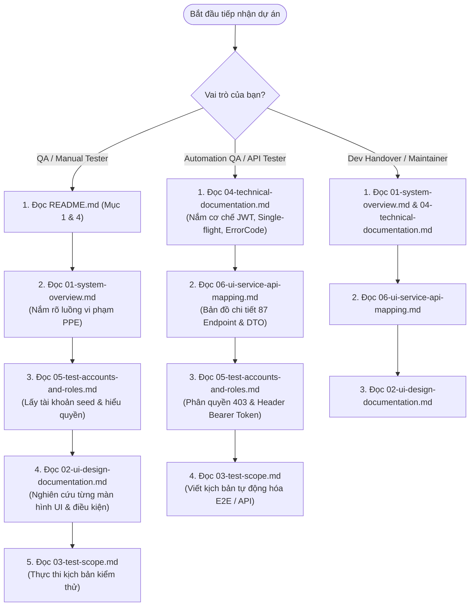

# BỘ TÀI LIỆU HƯỚNG DẪN KIỂM THỬ VÀ BÀN GIAO FRONTEND
## DỰ ÁN HỆ THỐNG GIÁM SÁT TRANG BỊ BẢO HỘ LAO ĐỘNG THÔNG MINH (SMART PPE MONITORING)
*Phiên bản tài liệu:* 1.1.0 · *Cập nhật mới nhất:* 08/11/2026  
*Phạm vi dự án:* Ứng dụng Frontend `fe-ppe` (Next.js 16.4.2 / React 19.3.0 / Turbopack / TanStack Query v5 / Neumorphic Design System)  
*Đối tượng sử dụng:* Đội ngũ Đảm bảo Chất lượng (QA/QC), Kỹ sư Kiểm thử Phần mềm (Manual & Automation Testers), Kỹ sư Phát triển (Frontend/Backend Developers) và Cán bộ Quản lý Dự án (Project Managers).

---

## 1. MỤC ĐÍCH VÀ PHẠM VI TÀI LIỆU

### 1.1. Mục đích tài liệu
Bộ tài liệu này được biên soạn độc quyền phục vụ công tác **bàn giao kỹ thuật, kiểm thử chất lượng toàn diện (QA Testing) và nghiệm thu dự án** cho hệ thống Frontend `fe-ppe`. Tài liệu cung cấp toàn bộ tri thức kỹ thuật cần thiết để một kiểm thử viên hoặc kỹ sư mới gia nhập có thể:
1. Nắm bắt tức thì toàn bộ nghiệp vụ an toàn lao động PPE, kiến trúc tổng thể và cơ chế tương tác đa dịch vụ Microservices.
2. Tra cứu chi tiết từng màn hình giao diện: cấu trúc bố cục, thành phần UI, điều kiện kích hoạt, luật kiểm tra (validation), các trạng thái hiển thị (loading, error, empty, success).
3. Truy vết chính xác từng nút bấm/thao tác trên giao diện người dùng tương ứng với Hook React Query nào, hàm Service nào, gọi đến Backend Microservice nào, HTTP Method và Endpoint URL là gì, dữ liệu truyền đi (Request DTO) và phản hồi trả về (Response DTO).
4. Thực thi các kịch bản kiểm thử (Test Cases) chuẩn hóa bao phủ kiểm thử chức năng (Functional), giao diện (UI), xác thực & phân quyền (Auth & RBAC), kiểm soát lỗi biên (Edge Cases), lỗi hạ tầng mạng và phục hồi phiên.
5. Tra cứu danh mục tài khoản kiểm thử hạt giống (Seed Accounts), ma trận phân quyền 21 tài nguyên hệ thống, và quy trình thiết lập môi trường test.

### 1.2. Phạm vi kiểm toán & Tính xác thực
- **100% Thông tin được xác thực từ mã nguồn thực tế**: Mọi đường dẫn file, tên component, tên hook, tham số query, đường dẫn API và mã lỗi trong bộ tài liệu này đều được trích xuất trực tiếp từ mã nguồn `fe-ppe`, thư viện hợp đồng dùng chung `smart-ppe-shared-contracts` và 10 Backend Microservices.
- **Không suy diễn hoặc tạo dựng thông tin ảo**: Các trường dữ liệu, chức năng đang trong giai đoạn phát triển (TODO), hoặc các tính năng đang sử dụng cơ chế giả lập/dự phòng (Mock/Fallback) đều được đánh dấu minh bạch.

---

## 2. DANH MỤC TÀI LIỆU VÀ ĐƯỜNG DẪN ĐIỀU HƯỚNG

Bộ tài liệu kiểm thử được tổ chức theo cấu trúc module hóa gồm 6 tài liệu chuyên đề chi tiết:

| Tên tệp | Tên chuyên đề | Nội dung tóm tắt & Giá trị cốt lõi | Liên kết điều hướng |
| :--- | :--- | :--- | :--- |
| **`01-system-overview.md`** | **Tổng Quan Hệ Thống** | Mục tiêu dự án, 5 vai trò người dùng, 4 nhóm phân hệ nghiệp vụ, luồng xử lý vi phạm thời gian thực, kiến trúc phân tầng Microservices và sơ đồ tương tác FE-BE. | [Xem chi tiết](./01-system-overview.md) |
| **`02-ui-design-documentation.md`** | **Tài Liệu Thiết Kế Giao Diện UI** | Hồ sơ kiểm thử chuyên sâu cho toàn bộ 30+ màn hình, bảng điều khiển, modal và drawer. Bóc tách layout, components, states, ma trận UI-Service-API và sequence diagram. | [Xem chi tiết](./02-ui-design-documentation.md) |
| **`03-test-scope.md`** | **Phạm Vi & Kịch Bản Kiểm Thử (Test Scope)** | Ma trận kịch bản test chuẩn QA (Test ID, Preconditions, Steps, Expected Results, Related APIs, Priority, Type) bao phủ chức năng, phân quyền, lỗi biên và responsive. | [Xem chi tiết](./03-test-scope.md) |
| **`04-technical-documentation.md`** | **Tài Liệu Kỹ Thuật Frontend** | Kiến trúc mã nguồn, 2 lớp Route Guards, cơ chế Refresh Token Single-flight, React Query cache invalidation, Event Bus, cấu hình biến môi trường và xử lý lỗi. | [Xem chi tiết](./04-technical-documentation.md) |
| **`05-test-accounts-and-roles.md`** | **Tài Khoản Kiểm Thử & Phân Quyền (RBAC)** | Danh mục 4 tài khoản seed demo, bảng ma trận phân quyền 21 tài nguyên (`PERMISSION_RESOURCES`), phạm vi màn hình khả dụng theo role và chính sách bảo mật khóa tài khoản. | [Xem chi tiết](./05-test-accounts-and-roles.md) |
| **`06-ui-service-api-mapping.md`** | **Bản Đồ Ánh Xạ UI – Service – API** | Bảng tra cứu trực tiếp độc lập phân chia theo 13 module nghiệp vụ: kết nối từ màn hình -> UI component -> Event -> Hook -> Service -> Backend Endpoint. | [Xem chi tiết](./06-ui-service-api-mapping.md) |

---

## 3. LỘ TRÌNH ĐỌC TÀI LIỆU ĐỀ XUẤT (RECOMMENDED READING ORDER)

Tùy theo vai trò chuyên môn trong dự án, đội ngũ dự án được khuyến nghị tiếp cận bộ tài liệu theo các lộ trình tối ưu sau:

### 3.1. Dành cho Tester Mới Gia Nhập (Onboarding QA)
1. **Bước 1**: Đọc [01-system-overview.md](./01-system-overview.md) để hiểu mục đích của hệ thống Smart PPE, 5 vai trò người dùng, luồng phát hiện sự cố từ camera AI đến thông báo và vòng đời giải quyết vi phạm.
2. **Bước 2**: Đọc [05-test-accounts-and-roles.md](./05-test-accounts-and-roles.md) để lấy thông tin tài khoản đăng nhập (Admin, Safety Manager, Safety Officer, User) và nắm vững quyền truy cập của từng tài khoản.
3. **Bước 3**: Đọc [02-ui-design-documentation.md](./02-ui-design-documentation.md) để hiểu cặn kẽ giao diện của từng màn hình bạn sắp kiểm thử.
4. **Bước 4**: Mở [03-test-scope.md](./03-test-scope.md) để thực hiện kiểm thử theo từng ca test cụ thể.

### 3.2. Dành cho Kỹ Sư Kiểm Thử Tự Động / API (Automation QA / Security Tester)
1. **Bước 1**: Đọc [04-technical-documentation.md](./04-technical-documentation.md) để hiểu kiến trúc xác thực (JWT in-memory, HttpOnly Cookie, Mutex Refresh Token Single-flight, cơ chế Route Guard 2 lớp, cấu trúc bọc unwrap response của Axios).
2. **Bước 2**: Đọc [06-ui-service-api-mapping.md](./06-ui-service-api-mapping.md) để đối chiếu toàn bộ các API Endpoints, query parameters, request payload và mã phản hồi.
3. **Bước 3**: Đọc [03-test-scope.md](./03-test-scope.md) các mục API Error Handling, Rate Limiting (429), Token Expiry (401), Maintenance (503) và Boundary Testing.

---

## 4. TỔNG HỢP CHỈ SỐ KỸ THUẬT & KIỂM THỬ HỆ THỐNG FRONTEND

Dưới đây là bảng thống kê tổng thể trạng thái kỹ thuật và kiểm thử của dự án `fe-ppe`:

| Hạng mục đo lường | Số lượng / Chỉ số | Ghi chú kỹ thuật |
| :--- | :---: | :--- |
| **Công nghệ nền tảng Frontend** | Next.js 16.4.2 · React 19.3.0 | Kiến trúc App Router, React Server Components (RSC) kết hợp Client-only Boundary |
| **Số lượng Màn hình / Route khả dụng** | **31 Routes** | Gồm 8 public auth routes, 21 authenticated business routes, 1 catch-all 404, 1 landing redirect |
| **Số lượng Backend Microservices tích hợp** | **10 Services** | Đi qua Traefik v3 Reverse Proxy Gateway tại cổng 80 (`http://localhost:80/api/v1`) |
| **Tổng số Backend API Endpoints** | **87+ Endpoints** | Đã đối chiếu và tích hợp đầy đủ trong các file Service tầng FE |
| **Số file Frontend Services (`src/services`)** | **13 Services** | `auth`, `camera`, `site`, `incident`, `reporting`, `ai-metrics`, `notification`, `user`, `rbac`, `audit`, `system`, `maintenance`, `media` |
| **Số module React Query Hooks (`src/hooks`)** | **32 Hook Groups** | Quản lý cache tập trung, phân loại Query Keys theo domain, hỗ trợ prefetch và optimistic update |
| **Số vai trò người dùng trong hệ thống (RBAC)** | **5 Roles** | `ADMIN`, `SAFETY_MANAGER`, `SAFETY_OFFICER`, `MANAGER`, `USER` |
| **Số quyền hạn chi tiết (`PermissionResource`)** | **21 Resources** | 4 nhóm phân loại lớn: `MONITORING`, `ANALYTICS`, `IDENTITY`, `SYSTEM` |
| **Bộ Bằng Chứng Thị Giác AI Chuẩn Hóa** | **Dual Snapshot [0..1]** | Loại bỏ 100% mock box; lưu 2 ảnh SNAPSHOT vi phạm & REFERENCE đối chứng |
| **Công Cụ Khoanh Vùng & Hiệu Chuẩn** | **Vùng Cấm & AI ROI** | Hỗ trợ vẽ đa giác chuột trên khung hình camera tại `/sites/[id]` & `/ai-metrics/test` |
| **Tỷ lệ kiểm thử tự động nội bộ (`npm test`)** | **110 / 110 Passed** | 100% test suites kiểm thử Auth Hooks, Token Store, Session Manager và Query Keys thành công |
| **Trạng thái Build Production (`next build`)** | **Pass (0 Error)** | 41/41 routes sinh thành công dưới dạng Static / Dynamic Server Rendering với Turbopack |

---

## 5. QUY ƯỚC KÝ HIỆU TRẠNG THÁI KIỂM THỬ

Trong suốt các tài liệu chuyên đề, các ký hiệu trạng thái sau đây được sử dụng thống nhất nhằm phản ánh mức độ hoàn thiện của từng tính năng:

- `[VERIFIED]`: Tính năng đã được kiểm tra trực tiếp trong mã nguồn, có đầy đủ UI Component, Hook, Service kết nối đến API backend thực tế hoặc đã vượt qua bộ test tự động.
- `[PARTIAL]`: Tính năng đã hiện thực giao diện UI và hook, nhưng backend chỉ hỗ trợ một phần schema hoặc đang áp dụng cơ chế chuyển đổi dữ liệu client-side.
- `[CLIENT_FALLBACK]`: Tính năng giao diện đã hoàn thiện, có tích hợp gọi API nhưng đồng thời duy trì logic giả lập toán học / dữ liệu dự phòng cục bộ khi backend trả về rỗng hoặc chưa sẵn sàng (VD: Video stream tracking, AI Sandbox, KPI Latency).
- `[TODO / UNIMPLEMENTED]`: Tính năng mới có khai báo interface hoặc nút bấm trên UI nhưng logic xử lý sự kiện đang để trống (`onClick={() => {}}`) hoặc chưa có endpoint backend tương ứng.

---

> [!IMPORTANT]
> **Lưu ý dành cho Tester khi kiểm thử môi trường Local**:
> Hệ thống áp dụng chính sách khóa tài khoản an toàn: **Nhập sai mật khẩu 5 lần liên tiếp sẽ bị khóa tài khoản trong 15 phút** (`locked_until`). Khi thực hiện kịch bản test sai thông tin đăng nhập, vui lòng sử dụng tài khoản công nhân `user@ppe.local` thay vì tài khoản quản trị `admin@ppe.local`. Hướng dẫn mở khóa cưỡng bức bằng lệnh cơ sở dữ liệu đã được ghi chú chi tiết tại tài liệu [05-test-accounts-and-roles.md](./05-test-accounts-and-roles.md).
